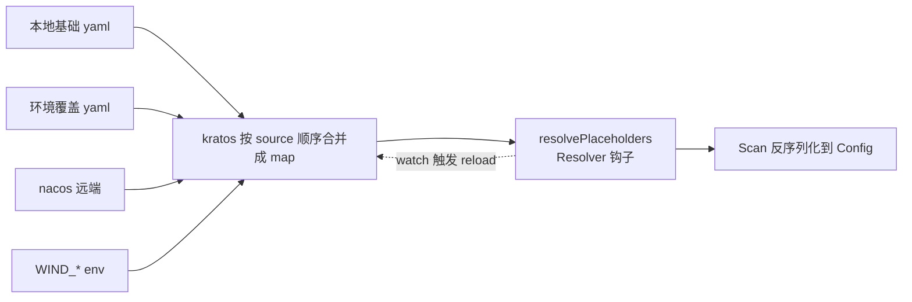

# wind-template 配置占位符机制方案

> 状态：方案已裁定（4 项策略决策全部落定），可实施
> 背景：`${spring.redis.host:localhost}` 这类占位符在 Spring Boot 中生效（绑定阶段的 PlaceholderResolver），在 wind-template 中不生效（kratos 配置链路只做"合并 + 反序列化"，没有占位符解析环节，值按字面字符串进入 `Config` 结构体）。

## 1. 目标与非目标

**目标**

- 在配置值里支持**引用配置树中另一个键**：`addr: ${data.redis.addr}`，消除"同一个值写多处"的维护问题（如 redis 地址同时出现在 `addr` 和 DSN 里）。
- 语法严格、行为可预测、错误信息可定位。

**非目标（明确不做）**

- 不支持 `:default` 默认值——默认值职责归基础 yaml + 分层覆盖（`data.yaml` 基础值 + `data.dev.yaml` 差异覆盖）。
- 不支持环境变量直取（`${REDIS_HOST}`）——env 覆盖继续走 `WIND_*` 通道，职责不重叠。
- 不支持 `\${` 转义——严格路径语法已排除绝大多数误伤，等真实冲突出现再议。
- 不做条件、拼接运算、表达式——只做纯引用替换。

## 2. 语法规范

```
${<dot.path>}
```

- 路径字符集：`[a-zA-Z0-9_]` 段 + `.` 分隔，须匹配正则 `\$\{([a-zA-Z0-9_]+(?:\.[a-zA-Z0-9_]+)*)\}`。
- 不匹配该模式的 `${...}` **原样保留**（如 `${SERVICE_NAME}` 带连字符、`${a b}` 带空格），不报错不误伤。
- 一个值里可以混排多个占位符和普通文本：`root:${data.db.password}@tcp(${data.db.host}:3306)/db`。
- 占位符引用的值本身可以再含占位符（嵌套引用），递归展开。

## 3. 解析时机与挂载点

挂在 kratos v3 的 `Resolver` 钩子上（`config.WithResolver`），这是唯一正确的位置：



关键性质：

- **merge 之后、Scan 之前**——引用拿到的是分层覆盖、nacos 下发、env 覆盖全部生效后的**最终值**。
- **watch 热更自动重跑**：nacos 推送 → kratos 重新 merge → 重新过 resolver → 重新 Scan，无需额外代码。
- 不用 `WithDecoder`（kratos-kit 的 `ENC[...]` 用它是因为自包含变换；占位符是跨键引用，Decoder 阶段后面的 source 还没合并，会拿到覆盖前的旧值）。

## 4. 解析算法

对合并后的 `map[string]any` 做一次递归遍历：

1. **只处理 string 叶子**：值不含 `${` 直接跳过（快速路径）；含则进入展开。
2. **展开单个占位符**：按 `dot.path` 逐段下查合并树。查到 → 取值；查不到 → **报错**：
   `配置引用 "${data.redis.addr}" 不存在（定义于 "data.database.source"）`
3. **被引用值的类型**：
   - string → 直接替换（若其本身含占位符，递归展开）；
   - int/float/bool（如 `timeoutMs: 5000`）→ `fmt.Sprint` 转字符串后替换（混排场景与整值引用进 string 字段均成立；**整值引用进 int 字段**由 Scan 处理，天然支持 `"${data.redis.port}"` → int）。
4. **环检测**：DFS 带 visiting **栈**（不是 set，栈能拼出完整路径）。命中已在栈中的引用即环：
   `配置引用成环: a → b → c → a`，返回 error。
5. **map 节点递归下钻**；数组（`[]any`）里的 string 元素同样处理（yaml 列表里可能出现）。

## 5. 错误语义（两条路径，行为不同，都不 panic）

| 场景 | resolver 返回 error 后的行为 | 效果 |
|---|---|---|
| **启动加载** | `cfg.Load()` 失败 → `loadConfig` 返回错误 → 进程退出 | fail-fast，配置作者错误当场暴露 |
| **watch 热更** | kratos 记日志，**保留旧配置值**继续运行 | 远端一次误推送（引入坏引用/环）不打挂服务 |

panic 不需要：启动路径 error 已经 fail-fast；热更路径 panic 反而把"保守降级"变成"打挂线上"。

## 6. 豁免规则（引导段鸡生蛋）

- **`nacos` 段跳过解析**：`nacos.addr` 是拉取远端配置的前提，引用远端值是死锁。resolver 遍历时跳过 `nacos` 子树。
- 但 `readLocalNacosSection` 预读拿到的是字面量，若有人写了占位符会**静默连错**——所以对 `nacos` 段做**校验而非静默跳过**：发现残留的合法格式占位符 → 报错提示"nacos 段不允许使用占位符"。
- `app` 段不豁免（`app.env` 等可以被引用，无死锁风险）。

> 参考：kratos-kit 的 `key.yaml`/`root.key` 豁免机制（密钥文件不能用 `ENC[...]`，且排除在配置加载之外）与本豁免同构，属于此类引导架构的标准做法。

## 7. 边界情况汇总

| 情况 | 行为 |
|---|---|
| 引用键不存在 | 启动报错退出（错误含引用名 + 所在键路径） |
| 循环引用 | 启动报错退出（错误含完整环路径） |
| 引用值为空字符串 | 正常替换为空串（区分"键不存在"和"值为空"） |
| 被引用值是数字/布尔 | `fmt.Sprint` 转字符串 |
| 值里含非法格式 `${...}`（连字符/空格等） | 原样保留，不报错 |
| nacos 段写了占位符 | 报错（明确禁止） |
| nacos 远端下发的值里带占位符 | 正常解析（已在合并树里，引用本地或远端键都行） |
| `WIND_*` env 覆盖了被引用的键 | 生效（resolver 在 env 合并后运行，解析到覆盖后的值） |

## 8. 代码改动清单

**改动 1：新增 `pkg/bootstrap/placeholder.go`**（唯一新增文件，无新依赖）

```go
package bootstrap

import (
	"fmt"
	"regexp"
	"strings"
)

// 占位符:${a.b.c} 严格路径,无默认值;缺失/循环/引导段使用均报错。
// 语义详见 resolvePlaceholders 注释。
var placeholderRe = regexp.MustCompile(`\$\{([a-zA-Z0-9_]+(?:\.[a-zA-Z0-9_]+)*)\}`)

// resolvePlaceholders 作为 config.WithResolver 挂载:
// 全部 source 合并完成后、Scan 之前执行;watch 热更时随 reload 自动重跑。
// 启动失败 → loadConfig 报错退出;热更失败 → kratos 记日志并保留旧值。
func resolvePlaceholders(values map[string]any) error {
	return walkMap(values, values, nil)
}

// walkMap 遍历 map 节点;root 为整棵合并树(查引用用),path 为当前键路径。
func walkMap(root, node map[string]any, path []string) error { ... }

// walkSlice 处理 yaml 列表里的 string 元素。
func walkSlice(root any, node []any, path []string) error { ... }

// expandString 展开单个 string 值里的全部占位符,visiting 栈检测环。
func expandString(root any, s string, path, visiting []string) (string, error) { ... }

// lookupPath 按 a.b.c 下查合并树,返回 (值, 是否存在)。
func lookupPath(root map[string]any, ref string) (any, bool) { ... }
```

**改动 2：`pkg/bootstrap/config.go` 挂载**（一行）

```go
cfg := config.New(
	config.WithSource(sources...),
	config.WithResolver(resolvePlaceholders),
)
```

**改动 3：`envfile.go` 顶部约定注释追加**

```
// 占位符约定:值可写 ${a.b.c} 引用合并树中其他键(合并后解析,nacos 段除外);
// 无默认值,缺失/循环在启动时报错。WIND_* env 覆盖在解析前生效。
```

**改动 4：`bootstrap.yaml` 样例头注释同步**（模板复制进新项目，文档要跟着走）。

**改动 5（已裁定：加）：sample 服务的 `data.dev.yaml` 加演示用法**

如 DSN 引用单独的 `data.database.password` 键，让模板使用者一看就懂。

## 9. 测试计划（`placeholder_test.go`）

| 用例 | 断言 |
|---|---|
| 基本引用 `${data.redis.addr}` | 替换成功 |
| DSN 混排多占位符 + 普通文本 | 全部替换 |
| 嵌套引用（引用的值本身含占位符） | 递归展开 |
| 引用不存在键 | error 含引用名和所在路径 |
| 环 `a→b→a` | error 含完整环路径 |
| 自引用 `a: ${a}` | error |
| 引用 int 值 | 替换为字符串 |
| nacos 段占位符 | error（豁免报错而非静默） |
| 非法格式 `${xxx-yyy}` / `${a b}` | 原样保留 |
| 值为空串的被引用键 | 替换为空串 |
| 数组内 string 占位符 | 替换 |
| 整值引用进 int 字段的 Scan | 集成测试：`port: "${data.redis.port}"` → int 字段 |

## 10. 裁定记录（全部落定，无遗留决策）

1. **非法格式 `${...}`（不匹配路径正则，如带连字符/空格）**：原样保留，不报错不告警。Dockerfile 风格变量、正则、模板字面量不被误伤；代价是近似手误的格式问题推迟到连接失败时暴露，可接受。
2. **引用键存在但值为空字符串**：替换为空串。与 Spring 语义一致，"键不存在 = 报错"与"值为空 = 合法"明确区分。
3. **环/缺失引用的错误形式**：返回 error，不 panic。启动路径 fail-fast 退出；watch 热更路径 kratos 记日志并保留旧值，远端误推送不打挂线上。
4. **sample 演示用法**：加。`data.dev.yaml` 的 DSN 引用单独的 `data.database.password` 键。

实施后若运维侧需要 watch 失败告警，在 resolver 返回的 error 文案上做区分接入即可，机制不变。

## 附：调研记录（结论已内化进方案）

- **kratos v3 config** 自带 `Resolver func(map[string]any) error` 与 `config.WithResolver`，执行时机即"merge 后、Scan 前"，watch reload 自动重跑——本方案直接复用，不包 Decoder。
- **tx7do/kratos-bootstrap**（kratos v2）：无占位符机制；nacos source 只做原文透传（`Load` 返回单 KV，Format 取 dataID 扩展名）。可借鉴的是 Watch 链路（OnChange → channel → Next → 重新 merge）与两段式加载（先读本地拿远端连接参数）——wind-template 已有等价实现且更细（fallbackSource 容错、watcher 噪音规避）。factory + proto 契约体系不抄。
- **liujitcn/kratos-kit**（kratos v3）：同样没有 `${...}` 占位符；其 `ENC[...]` 密文解密挂 `WithDecoder`（自包含变换，跨键引用不适用——Decoder 阶段后续 source 尚未合并）。其 `key.yaml` 豁免机制为本方案 `nacos:` 段豁免提供同构先例；其 polaris 误注册到 `TypeNacos` 的 bug 是 factory 注册模式的反面教材。
- **Spring Boot 对照**：`${key:default}` 生效靠绑定阶段 PlaceholderResolver + 全 PropertySource 合并视图，Go/kratos 生态无对应物；且 Spring Boot 3 的 `spring.redis.*` → `spring.data.redis.*` 别名兼容是框架硬编码，wind-template 配置树键为 `data.redis.addr`。
