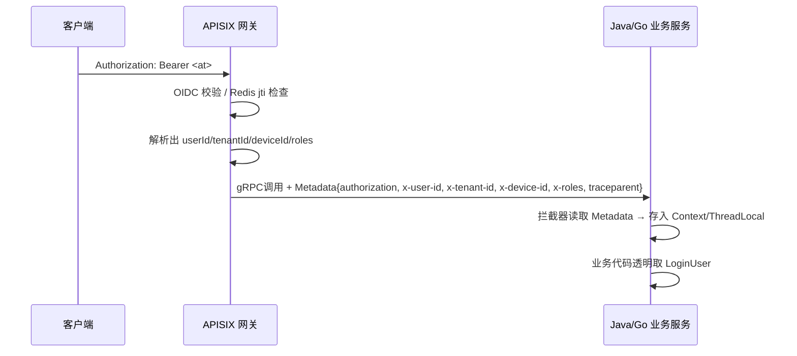
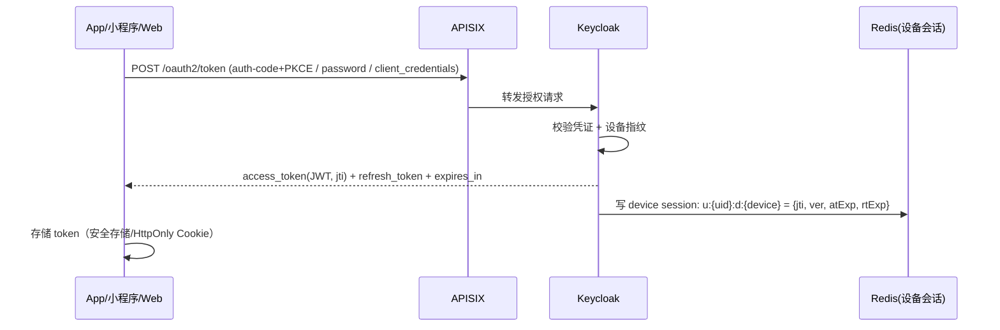
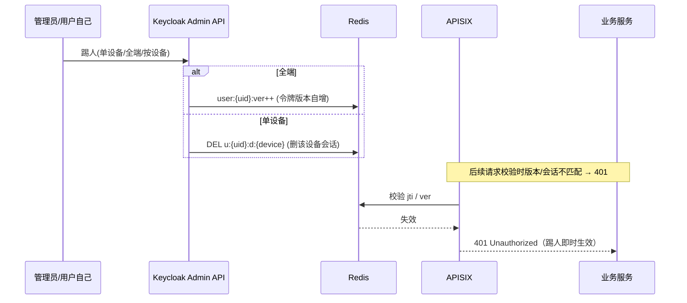
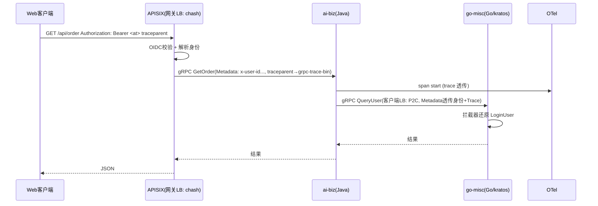

# 微服务架构设计方案（Java + Go/kratos + gRPC）

## 0. 总基调与决策原则

- **最少可用、可演进**：先搭"骨架四件套"（网关 + 认证 + 服务发现 + 配置），其余能力按业务紧迫度渐进接入。
- **语言取舍**：
  - **Spring Boot**：保留给现有 `ai-*` 业务（尤其是强依赖 Spring AI 的对话/TTS/3D 数字人模块），以及 CRUD 重、生态依赖多的服务。
  - **Quarkus**：仅用于**新建设备边缘、高并发网关类、Serverless/高密度 K8s** 场景——优势是 native image、启动毫秒级、内存低；缺点是 Spring 生态复用成本高。**建议：首期不引入 Quarkus，等确实需要 native/低资源再切。**
  - **Go/kratos**：统一用于**网关旁路、鉴权边车、高性能 RPC 服务、定时任务 worker、实时/流式边缘服务**。
- **跨语言统一契约**：所有 RPC 走 gRPC + Protobuf，由独立 `proto` 仓库 + Buf 管理。

---

## 1. 【架构全景图】

```mermaid
flowchart TB
    subgraph Client["客户端层"]
        WEB[Web H5/PC]
        APP[移动端 App]
        MP[小程序 / 第三方]
    end

    subgraph Edge["接入层 / K8s Ingress"]
        GW[API 网关<br/>APISIX ×3<br/>路由/鉴权前置/白名单/限流]
    end

    subgraph Auth["统一认证与授权中心"]
        KC[Keycloak (Quarkos) ×3<br/>OAuth2.1 + OIDC]
        REDIS_AUTH[(Redis Cluster<br/>token 状态/设备会话/jti)]
        CASBIN[Casbin 策略引擎<br/>RBAC + 数据权限]
    end

    subgraph Mesh["服务网格 / 服务发现"]
        K8S[K8s CoreDNS + EndpointSlice<br/>Java/Go 统一注册]
        NACOS[Nacos 集群<br/>多集群/信创兜底]
    end

    subgraph JavaSvc["Java 业务服务 (Spring Boot)"]
        AIBIZ[ai-biz]
        AI3D[ai-3d 小护]
        AIPLAT[ai-platform]
        AIGRAPH[ai-graph]
    end

    subgraph GoSvc["Go 业务服务 (kratos)"]
        GOMISC[go-misc / 高性能服务]
        GOWORKER[go-worker<br/>定时任务执行]
    end

    subgraph Mid["中间件层 (CNCF)"]
        MQ[RocketMQ / Kafka<br/>事务消息/事件]
        REDIS[(Redis Cluster<br/>缓存/状态)]
        DB[(MySQL / TiDB<br/>持久化)]
        OTEL[OpenTelemetry Collector ×2]
        LOKI[(Loki + Grafana<br/>日志/Trace)]
        JAEGER[(Jaeger/Tempo<br/>链路)]
    end

    Client -->|HTTPS + Bearer| GW
    GW -->|OIDC 校验 + 注入| KC
    GW -->|gRPC + Metadata| JavaSvc
    GW -->|gRPC + Metadata| GoSvc
    GW -.白名单免鉴权.-> JavaSvc
    KC --> REDIS_AUTH
    JavaSvc --> CASBIN
    GoSvc --> CASBIN
    JavaSvc --> K8S
    GoSvc --> K8S
    JavaSvc --> REDIS
    GoSvc --> REDIS
    JavaSvc --> DB
    GoSvc --> MQ
    JavaSvc --> OTEL
    GoSvc --> OTEL
    OTEL --> JAEGER
    OTEL --> LOKI
```

---

## 2. 【组件选型对比表】

| # | 能力 | 候选组件 | 优缺点 | 最终选型 & 理由 |
|---|------|----------|--------|-----------------|
| 1 | 统一认证授权 | **Keycloak**、Casdoor、Spring Authorization Server | Keycloak：协议完备(PKCE/客户端凭证/刷新)、会话可吊销、运维重；Casdoor：Go 写、轻量、国产友好、UI 好；SAS：灵活但要自建管理面 | **Keycloak(Quarkus 发行版)**。协议合规 + 服务端会话天然支持"踢人"，无需纯无状态 JWT。Casdoor 作信创/轻量备选 |
| 2 | RBAC / 数据权限 | **Casbin**、Keycloak Roles、SpiceDB | Casbin：RBAC/ABAC、行级过滤、Java( jcasbin)/Go(casbin) 同模型；SpiceDB：Zanzibar 强但重 | **Casbin**（统一 `model.conf`+`policy.csv`，Java/Go 共用策略）。接口级鉴权在网关 PEP，数据权限在业务 PDP |
| 3 | API 网关 | **APISIX**、Kong、Higress、Spring Cloud Gateway | APISIX：etcd 驱动、gRPC 代理、limit-req/jwt-auth/openid-connect 插件全；Higress：Envoy 系、信创友好 | **APISIX**（原生支持 gRPC 路由+鉴权插件+白名单+限流）。Higress 为信创备选 |
| 4 | 注册/发现 | **K8s CoreDNS**、Nacos、Consul | K8s DNS：零组件、Java/Go 通吃；Nacos：动态+信创+多集群；Consul：需额外运维 | **K8s EndpointSlice 为主**（gRPC 用 k8s resolver）；**Nacos 作多集群/信创兜底** |
| 5 | 配置中心 | **Nacos**、Apollo、K8s ConfigMap+Reloader | Nacos：动态推送+灰度(namespace/group/tag)+双语言；Apollo：灰度强但 Java 偏重；CM：重启生效 | **Nacos**（动态+灰度+双语言）；Apollo 备选 |
| 6 | RPC 契约 | **Buf/BSR**、protoc、grpc-gateway | Buf：lint/breaking/中央仓库，Java&Go 代码生成一致；protoc 裸用易失控 | **Buf + BSR** 管理 `.proto`，统一生成 Java(grpc-java) / Go(kratos) stub |
| 7 | 负载均衡 | 网关：APISIX upstream(rr/lc/chash)；RPC：gRPC round_robin、kratos P2C | — | **网关层** chash(按 user/jti 亲和) + least-conn；**RPC 层** 客户端侧 P2C(幂等) / round_robin |
| 8 | 分布式事务 | **DTM**、Seata、RocketMQ 事务消息 | DTM：Go 内核+Java SDK，TCC/Saga/2-phase-msg 全；Seata：Java 强、Go 弱；消息最终一致最稳 | **默认消息最终一致**(Outbox+RocketMQ)；强一致流用 **DTM-Saga**（语言中立） |
| 9 | 限流降级熔断 | 网关：APISIX limit-req/limit-count；服务：**Sentinel**(Java+Go)、Resilience4j | Sentinel：流控/降级/熔断多语言统一；Res4j 仅 Java | **网关 APISIX** + **服务 Sentinel**(sentinel-core + sentinel-go 统一规则) |
| 10 | 链路追踪 | **OpenTelemetry**、Jaeger、Zipkin | OTel：统一标准，Java agent + Go SDK 通吃，HTTP(grpc-trace-bin/traceparent)与 gRPC 透传 | **OTel Collector** → Jaeger/Tempo 后端 |
| 11 | 日志 | **Loki+Grafana**、ELK、ClickHouse | Loki：标签索引、轻、与 Trace 同栈；ELK：全文强但重 | **Loki + Fluent Bit DaemonSet**，日志注入 `trace_id`；ELK 作复杂检索备选 |
| 12 | 分布式定时任务 | **PowerJob/XXL-JOB**、Dkron、Argo Workflows | PowerJob：分片(map/reduce)+失败重试+Java 强；跨语言靠 RPC 派发；Argo：K8s 原生 DAG | **PowerJob(调度)** + **Go worker(kratos) 经 gRPC 接单**；Argo 作 K8s 原生 DAG 备选 |

---

## 3. 【跨语言鉴权透传方案】

**核心思路**：Token 只在**边界（网关）校验一次**，校验通过后把"已信任的身份声明"通过 **gRPC Metadata** 下发到所有下游，**下游不再重复解析 JWT**，只读取 Metadata 还原用户。

### 3.1 HTTP ↔ gRPC 转换位置



### 3.2 Java（gRPC ServerInterceptor）还原当前用户

```java
// LoginUser.java —— 透明身份载体
public record LoginUser(Long userId, String tenantId, String deviceId, List<String> roles) {}

// AuthServerInterceptor.java
@GrpcGlobalServerInterceptor
public class AuthServerInterceptor implements ServerInterceptor {
    public static final Context.Key<LoginUser> USER_KEY = Context.key("loginUser");

    @Override
    public <ReqT, RespT> ServerCall.Listener<ReqT> interceptCall(
            ServerCall<ReqT, RespT> call, Metadata headers, ServerCallHandler<ReqT, RespT> next) {
        String userId = headers.get(Metadata.Key.of("x-user-id", ASCII_STRING));
        String tenant = headers.get(Metadata.Key.of("x-tenant-id", ASCII_STRING));
        String device = headers.get(Metadata.Key.of("x-device-id", ASCII_STRING));
        // 网关已校验，这里做轻量防御（非空 + 可选二次验签）
        LoginUser user = new LoginUser(Long.valueOf(userId), tenant, device,
                split(headers.get(Metadata.Key.of("x-roles", ASCII_STRING))));
        Context ctx = Context.current().withValue(USER_KEY, user);
        return Contexts.interceptCall(ctx, call, headers, next);
    }
}

// 业务透明获取（Controller/Service 中）
public class UserContext {
    public static LoginUser current() {
        LoginUser u = AuthServerInterceptor.USER_KEY.get();
        if (u == null) throw new UnauthenticatedException();
        return u;
    }
}
```

### 3.3 Go（kratos middleware）还原当前用户

```go
// middleware/auth.go
func AuthMiddleware() middleware.Middleware {
    return func(handler middleware.Handler) middleware.Handler {
        return func(ctx context.Context, req interface{}) (interface{}, error) {
            md, ok := metadata.FromServerContext(ctx)
            if !ok {
                return nil, errors.Unauthorized("AUTH", "missing metadata")
            }
            userId := md.Get("x-user-id")
            tenant := md.Get("x-tenant-id")
            u := &LoginUser{UserID: userId, TenantID: tenant}
            ctx = context.WithValue(ctx, loginUserKey{}, u)
            return handler(ctx, req)
        }
    }
}

// 业务透明获取
func CurrentUser(ctx context.Context) *LoginUser {
    if u, ok := ctx.Value(loginUserKey{}).(*LoginUser); ok {
        return u
    }
    panic("no login user in context")
}
```

> **白名单**：APISIX 对 `/health`、`/api/public/**`、OAuth 的 `/token`、`/.well-known` 等路由**不挂 jwt-auth/openid-connect 插件**，直接放行；这些接口在下游拦截器中 `userId==null` 即视为匿名。

---

## 4. 【关键时序图】

### 4.1 多端登录 + 颁发 Token



### 4.2 踢人下线（Token 失效链路）



### 4.3 一次携带鉴权的跨语言 RPC 调用



---

## 5. 【Token 失效设计】（非纯无状态 JWT）

采用 **"短时效访问令牌 + 令牌版本 + Redis 设备会话"** 混合方案，兼顾无状态性能与即时吊销：

1. **Access Token**：JWT，有效期 **15 分钟**，Payload 含 `jti`、`uid`、`tid`(租户)、`ver`(令牌版本)、`did`(设备)。
2. **Refresh Token**：存 Redis（`rt:{jti}` → userId/device/过期），可吊销、可轮换。
3. **设备会话**：`u:{uid}:d:{did}` = `{jti, ver, atExp, rtExp}`，登录/刷新时写入。
4. **踢人实现**：
   - **全端**：自增 `user:{uid}:ver`；资源服务器校验 `token.ver == redis.ver`，不等即失效（本地缓存 ver，秒级生效）。
   - **单设备/按设备**：`DEL u:{uid}:d:{did}` 或标记该 jti  revoked。
5. **校验成本优化**：网关校验一次后，下游**不再验签**，只信任 Metadata；`ver` 用短 TTL 本地缓存，避免每请求打 Redis。
6. **兜底**：访问令牌 15 分钟天然上界，即使 Redis 抖动，最坏 15 分钟内全局失效也会生效。

> 这样既没有"纯无状态 JWT 无法踢人"的痛点，又避免每次请求都查库。

---

## 6. 【模块 / 代码仓库划分建议】

```
org-monorepo/
├── proto/                  # 单一契约源（Buf module，BSR 发布）
│   ├── auth/v1/*.proto
│   ├── order/v1/*.proto
│   └── common/error.proto  # 统一错误码 google.rpc.Status 扩展
├── java/
│   ├── common-auth-java/   # 拦截器 + LoginUser + 错误码适配
│   ├── ai-biz/             # 现有 Spring Boot 业务
│   ├── ai-3d/              # 小护（Spring Boot + Spring AI）
│   ├── ai-platform/
│   └── ai-gateway-bridge/  # 可选：Java 侧网关旁路
├── go/
│   ├── common-auth-go/     # kratos middleware + LoginUser
│   ├── go-misc/            # kratos 高性能 RPC 服务
│   └── go-worker/          # 定时任务 worker（接 PowerJob 单）
└── deploy/                 # Helm/K8s manifests, Dockerfile
```

- **proto 管理**：`proto/` 独立仓，CI 用 Buf 做 lint/breaking，生成 Java 与 Go stub 分别提交到各自 `generated/` 或走 BSR 拉取。
- **版本策略**：包名带 `v1`，破坏性变更走 `v2`，网关做协议转换兼容期。

---

## 7. 【风险点与演进路线】

### 高可用部署形态（建议）

| 组件 | 形态 | 副本/集群 |
|------|------|-----------|
| Keycloak | 无状态 + 共享 DB | 3 副本 + Redis 会话缓存 |
| APISIX | etcd 集群 + 数据面 | 3+ 副本（HPA） |
| Redis | Cluster / Sentinel | 3 主 3 从 |
| Nacos | 集群模式 | 3 节点 |
| MySQL | 主从 / TiDB | 1主2从 |
| OTel Collector | 网关+agent 两层 | 2+ 副本 |
| Loki | 单/微服务模式 | 按需 HA |
| RocketMQ | 多副本 + Dledger | 3 节点 |

### 性能瓶颈 & 对策

- Token 校验集中在网关，下游零成本；`ver` 本地缓存降低 Redis 压力。
- gRPC 客户端侧负载均衡（P2C）避免热点；长连接复用。
- Loki 标签基数控制，避免 `trace_id` 作高基数标签（仅索引、不标签）。

### 信创 / 国产化替代

- 网关 Higress、注册/配置 Nacos/Apollo、事务 Seata/DTM、DB 达梦/OceanBase/TiDB、OS OpenEuler/麒麟、镜像 ARM64。
- Java/Go 均可在国产 K8s（如 腾云/灵雀）运行，无绑定。

### 演进路线（灰度迁移）

1. **Phase 1**：接入 APISIX + Keycloak + Nacos + OTel，存量 `ai-*` 平滑迁入，白名单兜底。
2. **Phase 2**：proto 仓库 + Buf 落地，Java 内部先 gRPC 化；引入 Casbin、Sentinel、Loki。
3. **Phase 3**：用 kratos 新建高性能/worker 服务，跨语言 gRPC 打通；PowerJob 跨语言派单。
4. **Phase 4**：DTM 强一致流、信创替换、按流量金丝雀（K8s/Istio）逐步替换存量。

---

## 附录：Java/Go 生态不对等桥接说明

- **事务**：Seata Go 支持弱 → 统一用 **DTM**（Go 内核 + Java SDK）消除不对等。
- **限流**：Resilience4j 仅 Java → 用 **Sentinel**（双语言）或把限流上移到 APISIX + 服务侧 kratos ratelimit。
- **RBAC**：自研难统一 → **Casbin** 同模型双语言引擎，策略集中存储（Nacos/DB）双端同步。
- **服务发现**：Java 习惯 Nacos/Consul，Go kratos 原生 k8s → **统一以 K8s 为真相源**，Nacos 仅多集群兜底。
