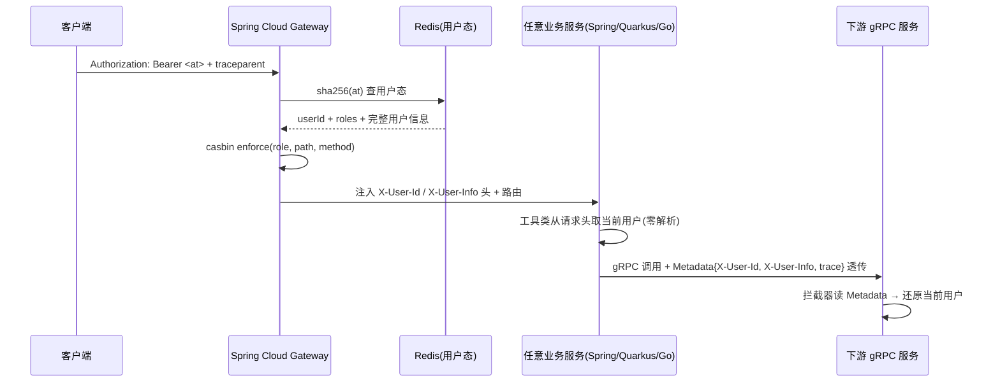
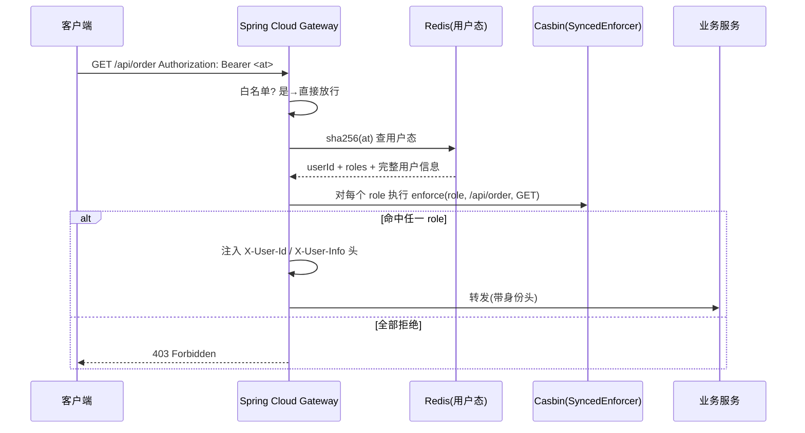
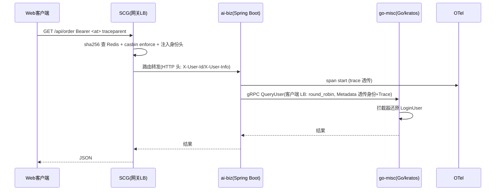

# 微服务架构设计方案（Java/Spring Boot + Quarkus + Go/kratos，gRPC 契约）

> 文档导航（TOC）：[§0 总基调](#s0) · [§1 架构全景图](#s1) · [§2 选型对比](#s2) · [§3 跨语言鉴权透传](#s3) · [§4 Casbin↔Keycloak 桥接](#s4) · [§5 关键时序图](#s5) · [§6 Token 失效/踢人](#s6) · [§7 gRPC 服务发现](#s7) · [§8 模块/仓库划分](#s8) · [§9 风险与演进](#s9) · [§10 网关模块落地规范](#s10) · [§11 需求来源与基线](#s11)

<span id="s0"></span>

## 0. 总基调与决策原则

- **最少可用、可演进**：先搭"骨架四件套"（网关 + 认证 + 服务发现 + 配置），其余能力按业务紧迫度渐进接入。
- **语言取舍**：
  - **Spring Boot**：保留给现有 `ai-*` 业务（尤其是强依赖 Spring AI 的对话/TTS/3D 数字人模块），以及 CRUD 重、生态依赖多的服务。
  - **Quarkus**：用于**新建设备边缘、高并发网关类、Serverless/高密度 K8s** 场景——优势是 native image、启动毫秒级、内存低；本方案将其与 Spring Boot、Go/kratos 并列作为三大框架之一。
  - **Go/kratos**：统一用于**网关旁路、鉴权边车、高性能 RPC 服务、定时任务 worker、实时/流式边缘服务**。
- **跨语言统一契约**：所有 RPC 走 gRPC + Protobuf，由独立 `proto` 仓库 + Buf 管理。
- **统一身份透传规范**：Token 仅在**边界（Spring Cloud Gateway）校验一次**，校验通过后注入 `X-User-Id` + `X-User-Info`(完整用户信息 JSON) 请求头，下游零解析、只读头；跨进程经 gRPC Metadata 透传。

---

<span id="s1"></span>

## 1. 【架构全景图】

```mermaid
flowchart TB
    subgraph Client["客户端层"]
        WEB[Web H5/PC]
        APP[移动端 App]
        MP[小程序 / 第三方]
    end

    subgraph Edge["接入层 / K8s Ingress"]
        GW[API 网关<br/>Spring Cloud Gateway ×3<br/>路由 / 鉴权前置 / 白名单 / 限流]
    end

    subgraph Auth["统一认证与授权中心"]
        KC[Keycloak (OAuth2.1 + 刷新令牌) ×3]
        REDIS_AUTH[(Redis Cluster<br/>token→userId+完整用户信息+roles)]
        CASBIN[Casbin 策略引擎<br/>仅 p 规则(RBAC)]
    end

    subgraph Mesh["服务发现 / 配置"]
        NACOS[Nacos 集群<br/>注册发现 + 配置中心<br/>本地开发默认]
        K8S[K8s EndpointSlice<br/>生产环境服务发现]
    end

    subgraph JavaSvc["Java 业务服务"]
        SB[Spring Boot 服务]
        QK[Quarkus 服务]
    end

    subgraph GoSvc["Go 业务服务 (kratos)"]
        GOMISC[go-misc / 高性能服务]
        GOWORKER[go-worker<br/>定时任务执行]
    end

    subgraph Mid["中间件层 (CNCF)"]
        MQ[RocketMQ / Kafka<br/>事务消息/事件]
        REDIS[(Redis Cluster<br/>缓存/状态)]
        DB[(MySQL / TiDB<br/>持久化 + casbin_rule)]
        OTEL[OpenTelemetry Collector ×2]
        OO[(OpenObserve<br/>链路 + 日志 + 指标 单后端)]
    end

    Client -->|HTTPS + Bearer| GW
    GW -->|sha256(token) 查 Redis 取身份| REDIS_AUTH
    GW -->|casbin enforce(role,path,method)| CASBIN
    GW -->|注入身份头 转发| JavaSvc
    GW -->|注入身份头 + gRPC Metadata| GoSvc
    GW -.白名单免鉴权.-> JavaSvc

    KC --> REDIS_AUTH
    KC -->|Admin API 管账号/角色| CASBIN

    JavaSvc --> NACOS
    GoSvc --> NACOS
    JavaSvc --> K8S
    GoSvc --> K8S

    JavaSvc --> REDIS
    GoSvc --> REDIS
    JavaSvc --> DB
    GoSvc --> MQ
    JavaSvc --> OTEL
    GoSvc --> OTEL
    OTEL --> OO
```

> 说明：登录/令牌服务（独立部署）负责调 Keycloak 换 token、用 JWK 验签解析 JWT、把 `sha256(token)→userId+roles+完整用户信息` 写入 Redis 并加入 `user:{userId}:tokens` 集合。网关只消费 Redis 用户态与 `casbin_rule`，不验签、不管理用户。

---

<span id="s2"></span>

## 2. 【组件选型对比表】

| # | 能力 | 候选组件 | 优缺点 | 最终选型 & 理由 |
|---|------|----------|--------|-----------------|
| 1 | 统一认证授权 | **Keycloak**、Casdoor、Spring Authorization Server | Keycloak：OAuth2.1 完备(PKCE/客户端凭证/刷新)、会话可吊销、运维重；Casdoor：Go 写、轻量；SAS：灵活但要自建管理面 | **Keycloak**（OAuth2.1 + 刷新令牌）。协议合规 + 服务端会话天然支持"踢人"，无需纯无状态 JWT |
| 2 | RBAC 鉴权 | **Casbin**、Keycloak Roles、SpiceDB | Casbin：RBAC 同模型(Java jcasbin / Go casbin)、行级过滤；SpiceDB：Zanzibar 强但重 | **Casbin**（仅 `p` 规则，`p.sub`=Keycloak Realm Role 名）。网关做 PEP，业务做可选数据权限 PDP。**关键：Keycloak 角色名 ↔ casbin `p.sub` 同名桥接**（见 §4） |
| 3 | API 网关 | **Spring Cloud Gateway**、APISIX、Kong、Higress | SCG：与 Spring 生态无缝、WebFlux 非阻塞、易集成 Casbin；APISIX：etcd 驱动、插件全 | **Spring Cloud Gateway**（WebFlux/Netty 响应式）。网关层做路由/鉴权前置/白名单/限流，集成 Casbin 做统一鉴权 |
| 4 | 注册/发现 | **Nacos + K8s**、Consul | Nacos：动态+双语言+信创；K8s EndpointSlice：零组件、gRPC resolver 原生；Consul：运维重 | **Nacos(本地开发默认) + K8s(生产)** 双支持。自定义 gRPC `NacosNameResolver` 与 `K8sNameResolver` 平滑切换 |
| 5 | 配置中心 | **Nacos**、Apollo、K8s ConfigMap+Reloader | Nacos：动态推送+灰度(namespace/group/tag)+双语言；Apollo：灰度强但 Java 偏重 | **Nacos**（动态+灰度+双语言）；K8s ConfigMap 作生产兜底 |
| 6 | RPC 契约 | **gRPC + Buf/BSR**、protoc、grpc-gateway | gRPC：强类型、跨语言一致、Metadata 透传友好；Buf：lint/breaking/中央仓库一致生成 | **gRPC + Buf** 管理 `.proto`，统一生成 Java(grpc-java)/Go(kratos) stub；**自定义 Nacos/K8s nameresolver + 客户端 round_robin** |
| 7 | 负载均衡 | 网关：SCG 路由配置；RPC：gRPC round_robin、kratos P2C | — | **网关层** 按 SCG 路由配置(rr/lc/chash)；**RPC 层 客户端侧 round_robin**（本地用 Nacos resolver） |
| 8 | 分布式事务 | **DTM**、Seata、RocketMQ 事务消息 | DTM：Go 内核+Java SDK，TCC/Saga/2-phase-msg 全；Seata：Java 强、Go 弱 | **默认消息最终一致**(Outbox+RocketMQ)；强一致流用 **DTM-Saga**（语言中立） |
| 9 | 限流降级熔断 | 网关：SCG 限流；服务：**Sentinel**(sentinel-core + sentinel-go) | Sentinel：双语言统一规则；Resilience4j 仅 Java | **网关 SCG 限流配置 + 服务 Sentinel**(sentinel-core + sentinel-go 统一规则) |
| 10 | 链路追踪 | **OpenTelemetry**、Jaeger、Zipkin | OTel：标准统一，Java agent + Go SDK 通吃，HTTP(traceparent)与 gRPC 透传；OpenObserve 单后端同时吃 traces+logs 并原生关联 | **OTel Collector** → **OpenObserve**（traces/logs/metrics 单后端，trace↔log 原生一键关联） |
| 11 | 日志 | **OpenObserve**、Loki+Grafana、ELK、ClickHouse | OpenObserve：OTel 原生、搜索/关联体验优于 Grafana、Loki API 兼容可回退；ELK：全文强但重 | **OpenObserve**（OTLP 直收），trace_id 作行内字段；Loki 作回退备选（兼容 API） |
| 12 | 分布式定时任务 | **XXL-JOB**、snail-job、PowerJob、Argo | XXL-JOB：成熟、社区大、Java+Go SDK 齐备；snail-job：新一代云原生、双语言；PowerJob：Java 强 | **主选 XXL-JOB**（Java+Go SDK 齐备）；**snail-job 作备选**（云原生、双语言友好）。Argo 作 K8s 原生 DAG 备选 |

---

<span id="s3"></span>

## 3. 【跨语言鉴权透传方案】

**核心思路**：Token 只在**边界（Spring Cloud Gateway）校验一次**（reference token 模式：拿 `sha256(token)` 查 Redis 取身份），校验通过后把"已信任身份"通过 **HTTP 请求头**注入到所有下游，下游经 gRPC 调用时把身份放进 **gRPC Metadata** 透传。全程**下游不再解析 Token**。

### 3.1 统一头 / Metadata 约定（对齐 `CommonConstants` 与 `GrpcHeaders`）

| 名称 | 用途 | 注入者 |
|---|---|---|
| `X-User-Id` | 用户唯一 ID | 网关（取自 Redis 用户态） |
| `X-User-Info` | 完整用户信息 JSON（含 userId、roles、username、tenant、deviceId 等） | 网关 |
| `Authorization` | 原始 Bearer token（透传给需要调用下游三方/Keycloak 的服务） | 客户端 → 网关透传 |
| `X-Client-Id` | 调用方客户端标识（服务间调用时由发起方写入） | 各框架客户端拦截器 |

> 你口语里的 `xuserID`/`xuser` 在本设计中规范为 `X-User-Id` / `X-User-Info`。

> **`tenant` / `tenantId` 字段说明（前瞻）**：`X-User-Info` 与 `LoginUser` 中的 `tenant`/`tenantId` 为**多租户预留字段**，本期按**单租户**落地，不参与鉴权链路判定、也不影响 casbin `p` 规则，网关与业务侧透传即可，后续扩多租户时再启用。

### 3.2 整体透传时序



### 3.3 Spring Boot（工具类 + gRPC 拦截器）

```java
// ===== 身份载体（完整用户信息） =====
public record LoginUser(
        String userId,
        List<String> roles,
        String username,
        String tenantId,   // 多租户预留字段，本期单租户，不参与鉴权判定
        String deviceId
) {}

// ===== 工具类：从当前 HTTP 请求头取身份（零解析） =====
public final class RequestUserUtils {
    public static final String HEADER_USER_ID = "X-User-Id";
    public static final String HEADER_USER_INFO = "X-User-Info";

    public static LoginUser current(ServerHttpRequest req) {
        String userId = req.getHeaders().getFirst(HEADER_USER_ID);
        String infoJson = req.getHeaders().getFirst(HEADER_USER_INFO);
        if (userId == null) return null;            // 匿名（白名单）
        return JsonUtils.toBean(infoJson, LoginUser.class);
    }
}

// ===== gRPC 服务端拦截器：Metadata → Context =====
@GrpcGlobalServerInterceptor
public class AuthServerInterceptor implements ServerInterceptor {
    public static final Context.Key<LoginUser> USER_KEY = Context.key("loginUser");

    @Override
    public <ReqT, RespT> ServerCall.Listener<ReqT> interceptCall(
            ServerCall<ReqT, RespT> call, Metadata headers, ServerCallHandler<ReqT, RespT> next) {
        String userId = headers.get(Metadata.Key.of("X-User-Id", ASCII_STRING));
        String infoJson = headers.get(Metadata.Key.of("X-User-Info", ASCII_STRING));
        LoginUser user = (userId == null) ? null : JsonUtils.toBean(infoJson, LoginUser.class);
        Context ctx = Context.current().withValue(USER_KEY, user);
        return Contexts.interceptCall(ctx, call, headers, next);
    }
}

// ===== gRPC 客户端拦截器：Context → Metadata 透传 =====
public class AuthClientInterceptor implements ClientInterceptor {
    @Override
    public <ReqT, RespT> ClientCall<ReqT, RespT> interceptCall(
            MethodDescriptor<ReqT, RespT> method, CallOptions callOptions, Channel next) {
        return new ForwardingClientCall.SimpleForwardingClientCall<>(next.newCall(method, callOptions)) {
            @Override
            public void start(Listener<RespT> responseListener, Metadata headers) {
                LoginUser u = AuthServerInterceptor.USER_KEY.get();
                if (u != null) {
                    headers.put(Metadata.Key.of("X-User-Id", ASCII_STRING), u.userId());
                    headers.put(Metadata.Key.of("X-User-Info", ASCII_STRING), JsonUtils.toJson(u));
                }
                super.start(responseListener, headers);
            }
        };
    }
}
```

### 3.4 Quarkus（复用现有 gRPC 拦截器骨架）

现有 `xxs-quarkus-grpc` 已含 `GrpcHeaders`、`MetadataInterceptor`(Server)、`AuthClientInterceptor`(Client)，扩展为读取/写入 `X-User-Info` 即可：

```java
// HeaderUtils：从 HTTP 请求头取身份（零解析）
public final class HeaderUtils {
    public static final String HEADER_USER_ID = "X-User-Id";
    public static final String HEADER_USER_INFO = "X-User-Info";

    public static Optional<String> getUserId() {
        return Optional.ofNullable(RestRequestContext.getHeader(HEADER_USER_ID));
    }
    public static Optional<LoginUser> getUserInfo() {
        String json = RestRequestContext.getHeader(HEADER_USER_INFO);
        return Optional.ofNullable(json).map(j -> JsonbBuilder.create().fromJson(j, LoginUser.class));
    }
}

// MetadataInterceptor（Server）扩展：读 X-User-Id / X-User-Info 注入 Quarkus 请求上下文
// AuthClientInterceptor（Client）扩展：从上下文取出 userId/userInfo 写入 gRPC Metadata 透传
```

> 统一 gRPC metadata key 与 Spring 侧一致：`X-User-Id`、`X-User-Info`、`Authorization`、`X-Client-Id`（复用 `GrpcHeaders` 常量定义）。

### 3.5 Go（go-kratos：middleware + client interceptor）

```go
// middleware/auth.go —— 服务端：Metadata → context
func AuthMiddleware() middleware.Middleware {
    return func(handler middleware.Handler) middleware.Handler {
        return func(ctx context.Context, req interface{}) (interface{}, error) {
            md, ok := metadata.FromServerContext(ctx)
            if !ok {
                return nil, errors.Unauthorized("AUTH", "missing metadata")
            }
            userId := md.Get("X-User-Id")
            infoJson := md.Get("X-User-Info")
            u := &LoginUser{}
            if userId != "" {
                _ = json.Unmarshal([]byte(infoJson), u)
                u.UserID = userId
            }
            ctx = context.WithValue(ctx, loginUserKey{}, u)
            return handler(ctx, req)
        }
    }
}

// client interceptor —— 透传当前用户到下游
func AuthClientInterceptor() grpc.ClientOption {
    return grpc.WithMiddleware(func(handler middleware.Handler) middleware.Handler {
        return func(ctx context.Context, req interface{}) (interface{}, error) {
            if u, ok := ctx.Value(loginUserKey{}).(*LoginUser); ok && u != nil {
                ctx = metadata.AppendToClientContext(ctx,
                    "X-User-Id", u.UserID, "X-User-Info", toJSON(u))
            }
            return handler(ctx, req)
        }
    })
}

// 业务透明获取
func CurrentUser(ctx context.Context) *LoginUser {
    if u, ok := ctx.Value(loginUserKey{}).(*LoginUser); ok {
        return u
    }
    return nil // 匿名
}
```

> **白名单**：SCG 对 `/health`、`/auth/**`、`/.well-known`、`/actuator/**` 等路由不挂鉴权过滤器，直接放行；这些接口在下游拦截器中 `userId==null` 即视为匿名。

---

<span id="s4"></span>

## 4. 【Casbin ↔ Keycloak 角色桥接】（落地实现细节见 §10，需求来源见 §11）

### 4.1 业务目标：多端统一用户体系

| 端 | 诉求 | 由谁满足 |
|---|---|---|
| 管理系统（后台） | 管理账号、角色、权限点；角色权限变更即时调整 casbin 配置；把角色赋予用户 | Keycloak（账号/角色，走 Admin API）+ casbin_rule 写入（权限点，走 Watcher 热更新） |
| App（移动端） | 自注册，获得默认角色 | Keycloak 注册流 / 默认角色 `sys.app_user` |
| Web / 小程序 / 第三方 | 同上多端思路 | Keycloak 一个 realm 下多 client |

统一认证底座用 **Keycloak**。

### 4.2 令牌模式（已确认）：reference token（opaque）

- 网关**不验签 JWT、不解析**：Keycloak 颁发的 `access_token`（本身是 JWT）被当作不透明随机串。
- 网关仅拿 `sha256(rawToken)` 去 Redis 查用户态（userId + 完整用户信息 + roles）。
- JWT 的验签与声明解析（sub / realm_access.roles / jti / exp）**只发生在外部登录/令牌服务端**，网关运行时零 Keycloak、零 oauth2 依赖（Keycloak 挂了也不影响已登录用户，只要 Redis 在）。

### 4.3 胶水约定（最重要）

**casbin 的 `p.sub`（角色 key）必须等于 Keycloak 的 Realm Role 名。** 这是连接"Keycloak 角色"与"casbin 权限"的唯一桥梁。

例：Keycloak 有 `biz.admin`、`biz.order.query` 两个 realm role，则 `casbin_rule` 只能写 `p, biz.admin, ...`、`p, biz.order.query, ...`。

#### 4.3.1 角色命名规范（前缀）

为避免与 Keycloak 内置角色（如 `offline_access`、`uma_authorization`、`default-roles-*`）冲突，新建 realm role 必须加统一前缀；casbin `p.sub` 使用**完整角色名（含前缀）**，与 Keycloak realm role 名逐字相等。

| 前缀 | 用途 | 示例 |
|---|---|---|
| `biz.` | 业务角色（由管理系统/权限后台创建） | `biz.admin`、`biz.order.query`、`biz.finance.read` |
| `sys.` | 系统 / 默认角色（注册流/平台内置） | `sys.app_user`、`sys.anonymous` |

> **Keycloak 约束**：realm role 名不允许冒号 `:`（校验正则约 `^[\w-.@]+$`），故前缀用点号 `.` 而非冒号。不要用 `biz:` / `sys:`。
>
> 真实落地：你在 Keycloak 新建业务 realm role 时命名成 `biz.order.query`，casbin 的 `p` 规则就写 `p, biz.order.query, /api/order/list, GET`——两侧逐字相等，`biz.` 仅用于防撞名。

### 4.4 Casbin 模型（model.conf）—— 仅 p 规则，无 g

角色从 Redis/token 获取，因此模型**不再需要 `g` 规则与 `role_definition`**；`p.sub` 直接是角色 key。

```ini
[request_definition]
r = sub, obj, act

[policy_definition]
p = sub, obj, act

[policy_effect]
e = some(where (p.eft == allow))

[matchers]
m = r.sub == p.sub && r.obj == p.obj && r.act == p.act
```

- `r.sub` = 角色 key（对每个角色逐一 `enforce`）
- `r.obj` = 请求路径（规范化：去 query、可配置是否忽略尾斜杠）
- `r.act` = HTTP 方法（GET/POST/...，统一大写）
- 如需 Ant 风格前缀匹配（如 `/api/order/**`），引入 `keyMatch2` 等 Casbin 内置函数并在 matcher 中使用。

### 4.5 Keycloak ↔ casbin 完整映射规划

本节把"Keycloak 用户/权限 → casbin 规则"这件事讲透：**不存在自动转换器**，只有"角色名同名"这一座桥。

#### 4.5.1 为什么不能"自动转换"

Keycloak 掌握的是 **"用户 U 拥有角色 R"**（身份），但它**不知道接口路径**（`/api/order/list`）。而 casbin 的 `p` 规则是 **"角色 R 能访问 路径 P + 方法 M"**（权限点）。`p` 规则的 `obj` / `act` 两个维度 Keycloak 根本没有，因此**无法从 Keycloak 数据自动生成 casbin 规则**。能对齐的**只有"角色名"这一维**——也是 §4.3 胶水约定的由来。

#### 4.5.2 三层真相源 + 映射模型

```mermaid
flowchart LR
  KC[Keycloak<br/>用户↔角色 真相源] -->|Admin API 分配 realm role| U[用户]
  U -->|登录/令牌服务 验签解析 JWT| R[(Redis<br/>token→userId+roles[]+ver)]
  R -->|网关 sha256 查| GW[网关 Casbin enforce]
  MGR[管理系统/权限后台] -->|写 casbin_rule p 规则| DB[(casbin_rule)]
  DB -->|Redis Watcher 热更新| GW
  KC -.角色名必须同名.-> DB
  REG[角色注册表] -.校验 p.sub 合法性.-> DB
```

| 维度 | 真相源 | 落到哪 | 谁写 |
|---|---|---|---|
| 用户 ↔ 角色 | **Keycloak** | Redis `roles[]` | 登录/令牌服务解析 JWT 写入 |
| 角色 ↔ 权限点 | **`casbin_rule`** | DB | 管理系统/权限后台 |
| 角色名契约 | 两端共用 | 角色注册表（见 §10.6.5） | 管理系统创建角色时双写 |

- **两个写入面**（不是同步任务）：① Keycloak 管用户↔角色；② `casbin_rule` 管角色↔路径。两者仅靠"角色名逐字相等"对接（§4.3.1 前缀规范）。
- **没有 `g` 规则**：用户→角色关系不进 casbin，运行时从 Redis 用户态来（§4.4 模型已无 `g`）。

### 4.6 鉴权分层边界（接口级 vs 数据权限）

需求（§11.1）要求"支持数据权限"，但当前 casbin 模型只有 `sub/obj/act` 三列，**放不下数据维度**。边界约定如下：

- **网关层：只做接口级前置鉴权**。`p = sub, obj=path, act=method`，回答"这个角色能不能调这个接口"。**数据权限（如"只能看自己部门"）不进网关 casbin**。
- **业务服务层：数据权限下沉**。由业务服务自行实现——可在业务侧再起一个 casbin 实例，模型扩展为 `p = sub, obj, act, scope`（`scope` 取 `dept:self` / `dept:all` 等），或走自定义数据过滤（MyBatis-Flex 的 `TenantLineHandler` / 数据范围拦截器）。网关只透传 `X-User-Id` / `X-User-Info`（见 §3.1）供业务还原用户上下文。
- **理由**：网关是无状态数据面，不持有"部门 / 数据范围"等业务上下文；数据权限必须结合业务数据判定，放在网关会过度耦合且无法热更。

> 若未来确有"网关一把梭"诉求，可把模型扩到 4 列 `p = sub, obj, act, scope`，但本期按上述分层落地（已与需求方确认）。

### 4.7 Redis 用户态约定

| 项 | 约定 |
|---|---|
| Key | `{prefix}` + `sha256(rawToken)`（**不存明文 token**，仅存其 sha256） |
| Value（JSON） | `{ "userId": "u1", "roles": ["biz.admin","biz.order.query"], "ver": 3, "status": "valid", "exp": 1735689600, "deviceId": "web-abc", "issuedAt": 1735686000, "userInfo": {完整用户信息} }` |
| TTL | 略短于 access_token 过期时间；吊销靠 `status=revoked` 而非仅依赖 TTL |
| 校验失败 | 读不到 / `status=revoked` / 已过期 / `token.ver ≠ redis.ver` → **401** |

> `ver`（令牌版本）用于用户→角色变更即时生效，详见 §10.6.5。

### 4.8 两个外部写入面（网关只读，不管理）

1. **账号与角色分配（Keycloak Admin API）**：管理系统后端用 `client_credentials` 拿管理员令牌，调用 Keycloak Admin REST API 增删用户、创建/分配/回收 realm role。用户→角色映射真相在 Keycloak，casbin 不存。
2. **权限点写入（casbin_rule + Watcher 热更新）**：管理系统编辑"角色 → 资源 → 方法"时，删除该角色旧 `p` 规则 → 写入新 `p` 规则到 `casbin_rule` → 向 `casbin:policy:update` 频道 publish。网关 `RedisCasbinWatcher` 订阅后 `loadPolicy()` 重载，角色权限变更即时生效（无需用户重登录）。

> App 自注册默认角色 `sys.app_user`，业务侧给 `sys.app_user` 配 `p` 规则即可获得基础权限。

### 4.9 登录/令牌服务职责（外部实现）

调 Keycloak 换 `access_token`(JWT) → 用 Keycloak JWK 验签解析出 `userId`/`realm_access.roles`/`jti`/`exp` → 把**当前 `ver`**（取自 Redis/DB 的 `user:{userId}:ver`）一并写入 token 用户态 → 以 `sha256(access_token)` 为 key 写 Redis（并加入 `user:{userId}:tokens` 集合）→ 返 token 给客户端。

---

<span id="s5"></span>

## 5. 【关键时序图】

### 5.1 多端登录 + 颁发 Token（OAuth2.1）


### 5.2 网关鉴权 + 注入身份头



### 5.3 一次携带鉴权的跨语言 RPC 调用



---

<span id="s6"></span>

## 6. 【Token 失效 / 踢人设计】（reference token 模式）

1. **单 token 踢人**：`DEL` / 置 `status=revoked` 该条 Redis 记录 → 下次请求网关查到缺失或 `revoked` → 401。
2. **按用户全端踢**：登录/令牌服务维护 `user:{userId}:tokens`（Set<sha256>），批量 `DEL` 并清集合。
3. **彻底下线（两层动作）**：只删 Redis 不够——用户若持未过期 refresh_token 会续命。彻底下线须**配合 Keycloak Admin API 撤销该用户会话/refresh token**（两层动作缺一不可）。
4. **网关缓存窗口**：若网关 Caffeine 缓存 `token→userInfo`，踢人后有短暂放行窗口；建议缓存 TTL 设短（如 60s），或踢人时经 Redis Pub/Sub 清各节点 Caffeine（同 casbin watcher 思路）。
5. **Redis 高可用**：网关鉴权完全依赖 Redis，须 Cluster/Sentinel。
6. **Token 安全**：token 用 sha256 作 key（不存明文 token）；全程 HTTPS；短 TTL + 可吊销 refresh token。

---

<span id="s7"></span>

## 7. 【gRPC 服务发现与负载均衡】

### 7.1 Nacos 服务发现（scheme 前缀式 + `-grpc` 双注册）

- **scheme 前缀式**：调用方在 `spring.grpc.client.channel.<name>.target` 用 `nacos://<serviceName>` 声明目标，
  由 `xxs-spring-grpc-nacos` 提供的 `nacos` scheme 自定义 `NameResolver` 从 Nacos 拉取实例（健康过滤 + 订阅热刷新）。
- **`-grpc` 双注册**：单应用内 HTTP（如 8080）与 gRPC（如 9090）双端口共存，分别注册为两个 Nacos 服务——
  HTTP 端口以 `spring.application.name` 注册（引入 `spring-cloud-starter-alibaba-nacos-discovery`）；
  gRPC 端口以 `spring.application.name + grpc.nacos.service-suffix`（默认 `-grpc`，即 `greeter-grpc`）注册（由 starter 自动完成）。
- **三层解耦**：proto 服务名（`Greeter`）/ channel 名（`greeter`）/ Nacos 服务名（`greeter-grpc`）彼此独立；
  channel 名仅用于客户端配置聚合，Nacos 服务名固定为 `<appName>-grpc`。
- 本地开发默认走 Nacos；K8s 生产可后续把 `nacos://` 替换为 `dns:///` 或自定义 scheme，业务代码无需改动。

### 7.2 负载均衡：客户端 round_robin

- RPC 层客户端侧统一使用 **`round_robin`** 负载均衡策略（在 nameresolver 提供地址列表后由 gRPC 客户端均衡）。
- 各框架接入方式：
  - **Spring Boot**：`@GrpcClient("service-name")` + 配置 `grpc.client.service-name.negotiation-type` 与 resolver 前缀。
  - **Quarkus**：`quarkus.grpc.clients.{svc}.host=dns:///...`（或 nacos 自定义 scheme）+ `quarkus.grpc.clients.{svc}.load-balancing-policy=round_robin`。
  - **Go/kratos**：使用 `discovery` / 自定义 resolver + `grpc.WithDefaultServiceConfig('{"loadBalancingPolicy":"round_robin"}')`。

---

<span id="s8"></span>

## 8. 【模块 / 代码仓库划分建议】

```
org-monorepo/
├── proto/                  # 单一契约源（Buf module，BSR 发布）
│   ├── auth/v1/*.proto
│   ├── order/v1/*.proto
│   └── common/error.proto  # 统一错误码 google.rpc.Status 扩展
├── java/
│   ├── xxs-component/xxs-gateway/  # Spring Cloud Gateway + Casbin 统一鉴权（parent=xxs-component，可部署网关应用，非 Starter 可复用库）
│   ├── common-auth-java/   # Spring 侧拦截器 + LoginUser + RequestUserUtils
│   ├── ai-biz/             # 现有 Spring Boot 业务
│   ├── ai-3d/              # 小护（Spring Boot + Spring AI）
│   ├── ai-platform/
│   └── quarkus-svc/        # Quarkus 高并发/边缘服务（含 xxs-quarkus-grpc）
├── go/
│   ├── common-auth-go/     # kratos middleware + LoginUser + 透传
│   ├── go-misc/            # kratos 高性能 RPC 服务
│   └── go-worker/          # 定时任务 worker（接 XXL-JOB 执行器）
└── deploy/                 # Helm/K8s manifests, Dockerfile
```

- **proto 管理**：`proto/` 独立仓，CI 用 Buf 做 lint/breaking，生成 Java 与 Go stub 分别提交到各自 `generated/` 或走 BSR 拉取。
- **版本策略**：包名带 `v1`，破坏性变更走 `v2`，网关做协议转换兼容期。
- **登录/令牌服务**：独立部署，对接 Keycloak，承担 §4.9 的换 token / 验签 / 写 Redis 职责。

---

<span id="s9"></span>

## 9. 【风险点与演进路线】

### 高可用部署形态（建议）

| 组件 | 形态 | 副本/集群 |
|------|------|-----------|
| Keycloak | 无状态 + 共享 DB | 3 副本 + Redis 会话缓存 |
| Spring Cloud Gateway | 无状态数据面 | 3+ 副本（HPA） |
| Redis | Cluster / Sentinel | 3 主 3 从（网关鉴权强依赖） |
| Nacos | 集群模式 | 3 节点（注册+配置） |
| MySQL | 主从 / TiDB | 1主2从（含 casbin_rule） |
| OTel Collector | 网关+agent 两层 | 2+ 副本 |
| OpenObserve | 单/微服务模式（可接 S3/MinIO 存储） | 按需 HA；与 Loki 兼容 API 可回退 |
| RocketMQ | 多副本 + Dledger | 3 节点 |
| XXL-JOB | 调度中心 + 执行器 | 调度中心 2+ 副本，执行器随业务扩容 |

### 性能瓶颈 & 对策

- Token 校验集中在网关，下游零成本；网关 `ver`/用户态用本地 Caffeine 短 TTL 缓存 + Redis Pub/Sub 清缓存，降低 Redis 压力。
- gRPC 客户端侧 `round_robin` 避免热点；长连接复用。
- OpenObserve 字段基数控制，避免 `trace_id` 作高基数标签（仅作行内字段、不标签）。

### 信创 / 国产化替代

- 网关 Higress、注册/配置 Nacos/Apollo、事务 DTM、DB 达梦/OceanBase/TiDB、OS OpenEuler/麒麟、镜像 ARM64。
- Java/Go 均可在国产 K8s 运行，无绑定。

### 演进路线（灰度迁移）

1. **Phase 1**：接入 SCG + Keycloak + Nacos + OTel，存量 `ai-*` 平滑迁入，白名单兜底。
2. **Phase 2**：proto 仓库 + Buf 落地，Java 内部先 gRPC 化；引入 Casbin（Keycloak 角色桥接）、Sentinel、OpenObserve（链路+日志单后端）。
3. **Phase 3**：用 kratos 新建高性能/worker 服务，跨语言 gRPC 打通（Nacos/K8s resolver + round_robin）；XXL-JOB 跨语言派单。
4. **Phase 4**：DTM 强一致流、信创替换、按流量金丝雀（K8s）逐步替换存量。

---

## 附录：Java/Go 生态不对等桥接说明

- **事务**：Seata Go 支持弱 → 统一用 **DTM**（Go 内核 + Java SDK）消除不对等。
- **限流**：Resilience4j 仅 Java → 用 **Sentinel**（sentinel-core + sentinel-go 双语言统一规则）。
- **RBAC**：自研难统一 → **Casbin** 同模型双语言引擎（`p.sub`=Keycloak Realm Role 名）；策略集中存 `casbin_rule`，经 Watcher 双端同步热更新。
- **服务发现**：Java 习惯 Nacos，Go kratos 原生 k8s → **自定义双 nameresolver（Nacos 本地 / K8s 生产）**，客户端 `round_robin` 统一负载均衡。
- **定时任务**：跨语言派单 → **XXL-JOB**（Java + Go 执行器 SDK 齐备），snail-job 作备选。
- **身份透传**：统一 `X-User-Id` / `X-User-Info` 头与 gRPC Metadata key，Spring Boot / Quarkus / Go-kratos 三框架各提供“取头工具类 + 拦截器”对称实现，确保零解析、只读透传。

---

<span id="s10"></span>

## 10. 网关模块（xxs-gateway）落地实现规范

> 本节由 `doc/PROMPT.md` 整理而来，是交给“实现端 AI”的网关模块（`xxs-micro/xxs-component/xxs-gateway`）落地指令。
> 目标：基于 Spring Cloud Gateway 集成 Casbin（jcasbin），在网关层做**统一鉴权**，交付一个**可复用 Starter**（自动装配 + 配置属性 + SPI 扩展点）。
> **网关只做鉴权，不管理角色/权限/用户**（原则见 §4）。

### 10.1 硬约束（必读，违反即返工）

1. **坐标与版本**
   - 根坐标 `groupId=com.bigbear`，全局版本 `${revision}=1.0.0`（由 `flatten-maven-plugin` 解析，子模块直接继承 parent，**不要**写死版本号）。
   - `xxs-gateway` 的 parent 为 `com.bigbear:xxs-component:1.0.0`。
   - Java **25**，`maven.compiler.source/target=25`，编译必须带 `-parameters`。
   - 技术栈版本（**由 `xxs-gateway` 自己导入 BOM**）：`spring-boot-dependencies` = **4.1.0**、`spring-cloud-dependencies` = **2025.1.2**、`spring-cloud-alibaba-dependencies` = **2025.1.0.0**（按需引入）。
2. **响应式非阻塞**：Gateway 运行在 WebFlux/Netty 上，**严禁**引入 `spring-boot-starter-web`。所有阻塞调用（Redis 取用户、DB、Casbin `enforce`）必须用 `Mono.fromCallable(...).subscribeOn(Schedulers.boundedElastic())` 包裹。
   - **不要**引入 `spring-boot-starter-oauth2-resource-server` 与 `spring-security-oauth2-jose`（任何 OAuth2 / 安全过滤器链）。网关**不验签、不解析 JWT**：Keycloak 颁发的 `access_token`（本身是 JWT）被当作**不透明引用令牌（opaque token）**，网关仅拿 `sha256(rawToken)` 去 Redis 查用户态；JWT 的验签与声明解析由外部**登录/令牌服务**完成，网关运行时零 Keycloak、零 oauth2 依赖。
3. **可用公共依赖**（已在 `xxs-dependencies` 管理版本）：`com.mybatis-flex:mybatis-flex-spring-boot4-starter`、`cn.hutool:hutool-core` / `hutool-http`、`org.projectlombok:lombok`（provided）、`org.mapstruct:mapstruct`。
4. **需新增到 `xxs-dependencies` 的版本登记**：`org.casbin:jcasbin`（如 `1.40.1`）、`com.github.ben-manes.caffeine:caffeine`。
5. **包名约定**：所有代码放在 `com.bigbear.gateway.auth` 下。

### 10.2 总体架构（网关过滤器流程）

```
请求 → [CasbinAuthorizationGlobalFilter 鉴权]
        ├─ 白名单放行（/auth/**、/actuator/**、OPTIONS、静态资源）
        ├─ 提取 Authorization: Bearer <token>
        ├─ 取原始 Bearer token → sha256 → 查 Redis → TokenUserInfo(userId + roles[] + ver + exp + userInfo)
        ├─ 不验签、不解析 JWT；rawToken 由 Keycloak 颁发，网关当作不透明串
        │        └─ Redis 缺失 / 已过期 / status=revoked / token.ver ≠ redis.ver → 返回 401（未认证）
        ├─ 规范化请求 path（去 query）+ method（大写）
        ├─ 对每个 role 调 enforcer.enforce(role, path, method)，命中任一即通过
        │        └─ 走多级缓存（Caffeine → Redis → DB 回源 casbin_rule 的 p 规则）
        └─ 放行 / 401(未认证) / 403(无权限)
                         ↑
  外部系统负责写入（网关不管理）：
    · Keycloak 托管用户/角色；登录/令牌服务把 userId+roles 写入 Redis（key=sha256(token)）
    · 角色→路径→方法的 p 规则由管理后台写入 casbin_rule(p 表)
    · DB 变更后由管理后台发 Redis Pub/Sub 广播 → 网关 Watcher 集群 reload
```

- **网关职责边界**：仅认证（查 Redis 取用户/角色）+ 鉴权（casbin `enforce`）。**不提供**角色/权限/用户的增删改查接口。
- **唯一真相源（规则）**：数据库 `casbin_rule` 扁平表，仅存 `p` 规则。用户/角色真相源：Keycloak（IdP）；运行时用户态在 Redis。
- **多级缓存**：Caffeine → Redis → DB 回源。**热更新**：Redis Watcher（Pub/Sub）。
- **线程安全**：使用 `SyncedEnforcer`。

### 10.3 数据表（DB 规则唯一真相源，方案 A）

```sql
CREATE TABLE IF NOT EXISTS casbin_rule (
    id      BIGINT       NOT NULL AUTO_INCREMENT PRIMARY KEY,
    ptype   VARCHAR(16)  NOT NULL,
    v0      VARCHAR(128) DEFAULT '',
    v1      VARCHAR(128) DEFAULT '',
    v2      VARCHAR(128) DEFAULT '',
    v3      VARCHAR(128) DEFAULT '',
    v4      VARCHAR(128) DEFAULT '',
    v5      VARCHAR(128) DEFAULT '',
    UNIQUE KEY uk_ptype_v (ptype, v0, v1, v2, v3, v4, v5)
) ENGINE=InnoDB DEFAULT CHARSET=utf8mb4;
```

> 角色/权限/用户由外部系统维护（用户与角色在 Keycloak，权限点在各业务后台），通过外部代码把“角色→路径→方法”写入 `casbin_rule` 的 `p` 行（约定见 §10.6）。网关只认 `casbin_rule`，不直连业务用户/角色表。
> Casbin 模型（`model.conf`，仅 `p` 规则无 `g`）见 §4.4。

### 10.4 pom.xml 配置

`xxs-dependencies/pom.xml` 的 `<dependencyManagement>` 内新增：

```xml
<dependency>
  <groupId>org.casbin</groupId>
  <artifactId>jcasbin</artifactId>
  <version>1.40.1</version>
</dependency>
<dependency>
  <groupId>com.github.ben-manes.caffeine</groupId>
  <artifactId>caffeine</artifactId>
  <version>3.2.0</version>
</dependency>
```

`xxs-gateway/pom.xml` 关键依赖（依赖管理自行导入 `spring-boot-dependencies` 4.1.0 与 `spring-cloud-dependencies` 2025.1.2）：

```xml
<dependencies>
    <dependency>
      <groupId>org.springframework.cloud</groupId>
      <artifactId>spring-cloud-starter-gateway</artifactId>
    </dependency>
    <dependency>
      <groupId>org.casbin</groupId>
      <artifactId>jcasbin</artifactId>
    </dependency>
    <dependency>
      <groupId>com.mybatis-flex</groupId>
      <artifactId>mybatis-flex-spring-boot4-starter</artifactId>
    </dependency>
    <dependency>
      <groupId>org.springframework.boot</groupId>
      <artifactId>spring-boot-starter-data-redis</artifactId>
    </dependency>
    <dependency>
      <groupId>com.github.ben-manes.caffeine</groupId>
      <artifactId>caffeine</artifactId>
    </dependency>
    <!-- 网关不引入任何 oauth2 / JWT 验签依赖：token 当作 opaque 串，仅查 Redis；JWT 验签在外部登录服务 -->
    <dependency>
      <groupId>cn.hutool</groupId>
      <artifactId>hutool-core</artifactId>
    </dependency>
    <dependency>
      <groupId>org.projectlombok</groupId>
      <artifactId>lombok</artifactId>
      <scope>provided</scope>
    </dependency>
    <dependency>
      <groupId>org.springframework.boot</groupId>
      <artifactId>spring-boot-starter-test</artifactId>
      <scope>test</scope>
    </dependency>
    <dependency>
      <groupId>io.projectreactor</groupId>
      <artifactId>reactor-test</artifactId>
      <scope>test</scope>
    </dependency>
</dependencies>
```

### 10.5 Casbin 核心组件（包 `com.bigbear.gateway.auth.casbin`）

- **`JdbcCasbinAdapter`**：实现 jcasbin `Adapter`（建议同时实现 `BatchAdapter`）。`loadPolicy` 读 `casbin_rule` 全量（`ptype='p'`），走多级缓存；`savePolicy` 全量覆盖；`addPolicy`/`removePolicy` 增量写 DB + 标记缓存失效 + 发布 Watcher 广播。**只处理 `p` 规则**。
- **`CasbinEnforcerFactory` / `CasbinManager`**：构建并持有单例 `SyncedEnforcer`；提供 `reload()`（清缓存 + `loadPolicy()`，供 Watcher 回调）。本地 Caffeine 用固定 key（如 `"casbin:policy"`）整体缓存 Policy 快照；Redis 用同 key 序列化存储。
- **`RedisCasbinWatcher`**：实现 jcasbin `Watcher`；`update()` 向 Redis channel（`casbin:policy:update`）发布消息；订阅收到消息后执行 `CasbinManager.reload()`，实现集群热更新。触发方是**外部管理后台**改完 `casbin_rule` 后调用广播（网关侧只订阅，不主动写）。

### 10.6 外部写入约定（网关不管理，仅定义契约）

> 网关不提供任何管理/转换代码。以下契约由接入的登录服务与权限管理后台遵守。Redis 用户态与踢人设计亦见 §4.7、§6。

#### 10.6.1 Redis 用户态（token → userId + roles + userInfo + status）

| 项 | 约定 |
|---|---|
| Key | `{xxs.gateway.auth.token.redis-key-prefix}` + `sha256(rawToken)`（不存明文 token，仅存其 sha256） |
| Value（JSON） | `{ "userId": "u1", "roles": ["biz.admin","biz.order.query"], "ver": 3, "status": "valid", "exp": 1735689600, "deviceId": "web-abc", "issuedAt": 1735686000, "userInfo": {完整用户信息} }` |
| TTL | 建议略短于 access_token 过期时间；吊销靠 `status=revoked` 而非仅依赖 TTL |

- 单 token 踢人：`DEL` / 置 `status=revoked` → 下次请求网关查到缺失或 `revoked` → 401。
- 按用户全端踢：登录/令牌服务维护 `user:{userId}:tokens`（Set<sha256>），批量 `DEL` 并清集合；彻底下线须配合 Keycloak Admin API 撤销会话/refresh token。
- 登录/令牌服务流程：调 Keycloak 换 `access_token`(JWT) → 用 Keycloak JWK 验签并解析 `sub` / `realm_access.roles` / `jti` / `exp` → 以 `sha256(access_token)` 为 key 写入 Redis（并加入 `user:{userId}:tokens` 集合）。
- 网关 `TokenUserResolver` 以相同 `sha256(rawToken)` 读取；读不到 / `status=revoked` / 已过期 / `token.ver ≠ redis.ver`（见 §10.6.5） → 401。
- 网关本地缓存窗口：若 Caffeine 缓存 `token→userInfo`，踢人后有短暂放行窗口；建议 TTL 设短（如 60s），或踢人时经 Redis Pub/Sub 清各节点 Caffeine。

#### 10.6.2 `casbin_rule` 的 `p` 规则写入约定

权限管理后台把“角色 → 路径 → 方法”写成一行：`ptype='p', v0=roleKey, v1=resourcePath, v2=httpMethod, v3..v5=''`（例：`p, biz.admin, /api/order/list, GET`）。`v0`（角色 key）必须是带前缀的完整 realm role 名（见 §4.3.1）。写完后向 `casbin:policy:update` 频道 `publish` 一条消息触发网关 reload。

#### 10.6.3 管理系统对接约定（多端 / 账号·角色·权限）

管理系统（后台）同时承担“账号/角色管理”与“权限点管理”两个写入面，关键是通过**角色 key 同名**契约把 Keycloak 与 casbin 接起来：

- **胶水约定（强制）**：casbin 的 `p.sub`（角色 key）**必须等于 Keycloak 的 Realm Role 名**（见 §4.3）。
- **账号与角色分配（走 Keycloak Admin API）**：管理系统后端用 `client_credentials` 拿管理员令牌，调用 Keycloak **Admin REST API** 增删用户、创建/分配/回收 realm role（不碰 casbin，用户→角色映射真相在 Keycloak）。
- **权限点管理（走 casbin_rule 写入 + Watcher 热更新）**：编辑“角色 → 资源 → 方法”时，删除该角色旧 `p` 规则 → 写入新 `p` 规则到 `casbin_rule` → 向 `casbin:policy:update` 频道 publish。网关 `RedisCasbinWatcher` 订阅后 `reload()`，角色权限变更即时生效（无需用户重登录）。
- **App 自注册默认角色**：App 用户自注册后挂默认 realm role `sys.app_user`；业务侧给 `sys.app_user` 配 `p` 规则即可获得基础权限（其基础 `p` 规则由初始化脚本 seed，见 §10.6.5）。
- **角色权限变更即时生效机制**：
  - ① **角色→资源权限点变更** = 改 casbin `p` 规则（经 Watcher 热更新），即时生效，用户无需重登录。
  - ② **用户→角色变更** = Keycloak Admin API 改 realm role 映射，网关不实时拉，读 Redis 里的 `roles[]`。要即时生效，靠短访问令牌 + `ver` 机制（详见 §10.6.5）：改角色时 `user:{uid}:ver++`，登录/令牌服务把当前 `ver` 写进 token 用户态；网关 `TokenUserResolver` 比对 `token.ver ≠ redis.ver → 401` 强制重登录。

#### 10.6.4 App 手机号注册/登录（Keycloak 自定义 Authenticator SPI，路线 A）

App 端用户**自己用手机号 + 短信验证码注册/登录**。Keycloak 原生只认用户名/邮箱+密码，需通过**自定义 Authentication Flow + Authenticator（SPI）**实现“手机号 + 短信验证码”；可基于社区开源 `keycloak-phone-authenticator` 类项目改造。

- **注册流**：填手机号 → 调短信网关（阿里云/腾讯云等）发验证码 → 校验 → 创建用户（手机号作 username 或 user attribute）→ 赋默认角色 `sys.app_user`。
- **登录流**：填手机号 → 发验证码 → 校验通过 → Keycloak 正常发 `access_token`。
- **路线 A（经登录/令牌服务中转，本方案采用）**：App **不直接连 Keycloak**，把“手机号 + 验证码”给自有**登录/令牌服务**；服务用 Keycloak 自定义 Direct Grant（手机号当用户名、验证码当密码）换 `access_token`(JWT) → 用 Keycloak JWK 验签解析 `userId`/`realm_access.roles`/`jti`/`exp` → 以 `sha256(access_token)` 为 key 写 Redis（并加入 `user:{userId}:tokens` 集合）→ 返 token 给 App。
- **token 在网关侧**：App 拿到的 `access_token` 在网关仍当 opaque 串，`sha256(token)` 查 Redis → casbin `enforce`。
- **短信工程细节（外部实现负责）**：手机号唯一性约束、验证码防刷/过期、短信成本控制。

路线 A 时序（登录/注册）：

```
App(手机号+验证码) → 登录/令牌服务
  登录/令牌服务 → Keycloak(手机号 Authenticator)：校验验证码、换 access_token(JWT)
  Keycloak → 登录/令牌服务：access_token
  登录/令牌服务：用 Keycloak JWK 验签解析 → userId/roles
  登录/令牌服务 → Redis：写 token:{sha256}→userId+roles+status；user:{uid}:tokens 加成员
  登录/令牌服务 → App：access_token
后续：App 请求带 token → 网关 sha256 查 Redis → casbin enforce
```

#### 10.6.5 角色注册与一致性（含 `ver` 机制落地）

本节补齐 §4.5.2 里"角色名契约"与"用户→角色即时生效"的闭环细节，由管理系统/权限后台与登录/令牌服务遵守（网关不参与）。

**1) 角色注册表（双写登记）**

管理系统在 Keycloak **创建/删除 realm role** 时，**同时**在权限管理侧登记/注销该角色名（仅存名字，如表 `role_catalog`）。它是"Keycloak 角色 ↔ casbin `p.sub`"对齐的单一视角登记簿，也是 `p` 规则的合法 `sub` 白名单。

**2) 写 `p` 规则前的合法性校验**

权限后台写 `p, role, path, method` 前，校验 `role` 已存在于角色注册表；不存在则**拒绝写入并告警**，杜绝"Keycloak 没有该 role 却写了 casbin 规则"的悬空权限。校验通过后，role 必须使用 §4.3.1 的 `biz.` / `sys.` 前缀完整名。

**3) 首次初始化同步**

提供一次性脚本/Job，拉取 Keycloak 全部 realm role 名单导入角色注册表，作为 casbin `p` 规则的合法 `sub` 白名单基线。此后新角色走"双写登记"保持同步。

**4) `sys.app_user` 默认角色 `p` 规则 seed**

App 自注册默认角色 `sys.app_user` 由 Keycloak 注册流挂载（见 §10.6.4）。其基础 `p` 规则通过 `schema.sql` / 初始化 Job 预置，例如：

```sql
INSERT INTO casbin_rule (ptype, v0, v1, v2) VALUES
  ('p', 'sys.app_user', '/api/app/profile', 'GET'),
  ('p', 'sys.app_user', '/api/app/home',    'GET');
```

写入后需 publish 一次 `casbin:policy:update` 让网关 reload（或依赖网关启动首次 `loadPolicy` 自带）。

**5) 角色删除级联**

Keycloak 删 realm role 时，**管理系统主动触发**并保证两步都成功（失败需回滚/告警）：

1. 先删 `casbin_rule` 中该 role 的全部 `p` 规则 → publish `casbin:policy:update` 热更新；
2. 再删 Keycloak realm role，并同步注销角色注册表登记。

约定：**先清 casbin `p` 规则，再清 Keycloak 角色**，避免残留悬空规则。

**6) `ver` 令牌版本机制落地（用户→角色变更即时生效）**

| 步骤 | 动作 | 实现方 |
|---|---|---|
| ① | 改某用户角色（Keycloak Admin API）后，同时 `INCR user:{uid}:ver`（存 Redis 或 DB） | 管理系统 |
| ② | 写 token 用户态时，把**当前 `ver`** 写入 `TokenUserInfo`（见 §4.7 / §10.6.1 / §11.2 的 Value 结构） | 登录/令牌服务 |
| ③ | 网关 `TokenUserResolver` 从 `TokenUserInfo` 取 `ver`，与 Redis 中 `user:{uid}:ver` 比对：`token.ver ≠ redis.ver → 401` 强制重登录 | 网关 |
| ④ | 效果：角色变更后用户下次请求即失效，无需等 token 自然过期，也无需全端踢 | — |

> `user:{uid}:ver` 与 `user:{uid}:tokens`（Set<sha256>）可并存：前者用于角色变更即时失效，后者用于全端踢人（§6 / §10.6.1）。

### 10.7 网关鉴权过滤器与解析器

#### 10.7.1 `CasbinAuthorizationGlobalFilter implements GlobalFilter, Ordered`
- `getOrder()` 返回 **-100**。
- 流程：
  1. **白名单**：`OPTIONS`、`/actuator/**`、配置的白名单前缀直接放行。
  2. **解析用户**：`AuthorizationResolver` 取出**原始 token 串**（不验签）→ `TokenUserResolver` 以 `sha256(rawToken)` 查 Redis 得 `TokenUserInfo(userId, roles, ver, exp, userInfo)`。无 token / Redis 无该 token / `status=revoked` / 已过期 / `token.ver ≠ redis.ver` → 401。
  3. **规范化请求**：去 query 的 path + 大写 method。
  4. **鉴权**（每个角色逐一 enforce，命中任一即通过）：
     ```java
     Mono<Boolean> allowed = Mono.fromCallable(() -> {
         SyncedEnforcer enforcer = casbinManager.getEnforcer();
         return userInfo.roles().stream()
                 .anyMatch(role -> enforcer.enforce(role, path, method));
     }).subscribeOn(Schedulers.boundedElastic());
     ```
  5. false → 403；true → 放行（把 `userId`、角色放入 `exchange.getAttributes()` 或下游请求头透传）。

#### 10.7.2 解析器 / 扩展点（包 `com.bigbear.gateway.auth.resolver`）
- `AuthorizationResolver` 接口：`resolve(exchange) -> Mono<RawTokenContext>`（从 `Authorization: Bearer <token>` 取出原始 token 串，不验签）。
  - 默认实现 `HeaderTokenAuthorizationResolver`。
- `TokenUserResolver` 接口：`resolve(rawToken) -> Mono<TokenUserInfo>`（以 `sha256(rawToken)` 查 Redis；`status≠valid` 或缺失 → 抛未认证）。
  - 默认实现 `RedisTokenUserResolver`。
- **删除** `TokenParser` / `KeycloakJwtTokenParser`（网关不验签 JWT）。
- 默认 Bean 若容器已有自定义实现则不覆盖（SPI 扩展）。

### 10.8 自动装配与配置（可复用 Starter）

- **`CasbinGatewayProperties`**（prefix = `xxs.gateway.auth`）：`modelLocation`（默认 `classpath:casbin/model.conf`）、`enabled`（默认 `true`）、`whitelist`、`cache`、`watcher.redisChannel`（默认 `casbin:policy:update`）、`token.redisKeyPrefix`（默认 `gateway:token:user:`，实际 key = `{prefix}` + `sha256(rawToken)`）。（已移除 `oauth2.issuerUri` / `oauth2.jwkSetUri` / `token.redisKeyClaim`。）
- **`CasbinGatewayAutoConfiguration`**：`@AutoConfiguration` + `@EnableConfigurationProperties`；条件装配 `enabled`（默认 true）。依次注册 `CasbinRuleMapper`、`JdbcCasbinAdapter`、`RedisCasbinWatcher`、`CasbinManager`、`RedisTokenUserResolver`、`CasbinAuthorizationGlobalFilter`、`AuthorizationResolver`/`TokenUserResolver`。**不再注册 `NimbusReactiveJwtDecoder` / `TokenParser`**。
- **SPI 注册**：`src/main/resources/META-INF/spring/org.springframework.boot.autoconfigure.AutoConfiguration.imports` 写入 `com.bigbear.gateway.auth.config.CasbinGatewayAutoConfiguration`。

### 10.9 目录结构（落地对照）

```
xxs-component/
└─ xxs-gateway/
   ├─ pom.xml
   ├─ src/main/java/com/bigbear/gateway/auth/
   │  ├─ config/        CasbinGatewayProperties / CasbinGatewayAutoConfiguration
   │  ├─ filter/        CasbinAuthorizationGlobalFilter
   │  ├─ casbin/
   │  │   ├─ cache/        Caffeine/Redis 多级缓存工具
   │  │   ├─ model/        CasbinRule 实体、CasbinRuleMapper
   │  │   ├─ adapter/      JdbcCasbinAdapter（仅 p 规则）
   │  │   ├─ watcher/      RedisCasbinWatcher
   │  │   └─ manager/      CasbinManager / CasbinEnforcerFactory
   │  ├─ resolver/      AuthorizationResolver / HeaderTokenAuthorizationResolver
   │  │                TokenUserResolver / RedisTokenUserResolver / model(TokenUserInfo)
   │  └─ (无 controller / service / domain / converter —— 网关不管理)
   ├─ src/main/resources/  casbin/model.conf、schema.sql、META-INF/spring/...imports
   └─ src/test/java/...   (WebTestClient 集成测试)
```

### 10.10 测试与验收标准

1. **构建**：`mvn -pl xxs-component/xxs-gateway -am clean package` 通过，无 servlet/web 冲突。
2. **集成测试**（WebTestClient + 测试库 + 测试 Redis）：
   - 预置 `casbin_rule`：`p, biz.admin, /api/test, GET`（角色须带 §4.3.1 前缀）。
   - 预置 Redis：`gateway:token:user:{sha256(token)}` → `{"userId":"u1","roles":["biz.admin"],"ver":1,"status":"valid"}`。
   - 合法 token（`sha256` 命中）→ 200；角色 `biz.user`（无对应 p 规则） → 403；无 token / Redis 无该 token / `status=revoked` / 过期 / `ver` 不匹配 → 401；白名单 → 放行。
3. **不阻塞 event loop**：`enforce`、Redis 取用户必须在 `boundedElastic` 调度。
4. **热更新**：写新 `p` 规则并 publish `casbin:policy:update`，验证 Watcher 重载后新策略生效。
5. **契约不泄漏内部**：网关**对外契约**（resolver 接口签名、`CasbinGatewayProperties` 配置项、示例响应文档）不暴露 `ptype/v0/v1` 等 Casbin 内部字段；但 Redis 用户态须完整存储并透传 `userInfo`（用于注入 `X-User-Info` 头）与 `ver`（用于 §10.6.5 版本比对）。管理后台写 `casbin_rule` 的内部列约定（`ptype`/`v0..v5`）见 §10.6.2，属内部实现，不在网关对外契约范围。
6. **缓存一致性**：外部写 `casbin_rule` 并广播后，本地 Caffeine 与 Redis 策略缓存失效，下次请求回源 DB 并回填。

### 10.11 默认决策

- 用户/角色由 **Keycloak** 托管；扁平 `casbin_rule` 仅存 `p` 规则。
- `userId`/角色来自 Redis 用户态，**不**经 casbin `g` 规则。
- 路径匹配默认**精确匹配**；如需 Ant 风格前缀匹配，引入 `keyMatch2` 并在 matcher 中使用。
- **令牌模式：reference token（opaque），非 JWT 验签**：网关仅以 `sha256(token)` 查 Redis 用户态；JWT 验签在外部登录/令牌服务。
- **角色 key（casbin `p.sub`）必须等于 Keycloak Realm Role 名**（胶水约定）。
- **踢人粒度**：单 token + 按用户全端（建议配合 Keycloak 会话撤销以彻底下线）。
- **App 手机号注册/登录走路线 A**（见 §10.6.4）。
- **网关本地缓存窗口**：Caffeine 缓存 `token→userInfo` 建议 TTL 设短（如 60s），或踢人时经 Pub/Sub 清各节点。
- Redis 用户态 key = `{prefix}` + `sha256(rawToken)`。

### 10.12 给实现端 AI 的明确要求

- 严格使用 `casbin_rule` 扁平表（方案 A），**只写 `p` 规则，不处理 `g`**。
- **不要**实现任何角色/权限/用户管理接口。
- **不要**引入 `spring-boot-starter-oauth2-resource-server` 与 `spring-security-oauth2-jose`；网关不验签 JWT，token 当作 opaque 串，仅以 `sha256(token)` 查 Redis。
- 全程响应式，任何阻塞必须 `subscribeOn(Schedulers.boundedElastic())`。
- 实现后附最简 `application.yml` 与接入说明：由登录/令牌服务写 Redis（sha256 + status + `user:{userId}:tokens`），由权限管理后台写 `casbin_rule` 的 `p` 行并 publish 触发 reload；如需自定义用户来源，实现 `TokenUserResolver` 扩展点。

---

<span id="s11"></span>

## 11. 需求来源与基线（原 `doc/提示词.md` 整理）

### 11.1 原始需求提示词（角色 / 硬性约束 / 能力要求 / 输出要求）

> 你是一位拥有 10 年以上经验的资深架构师，精通 Java（Spring Boot / Quarkus）与 Go（go-kratos）混合微服务架构设计。请基于以下硬性约束与能力要求，输出一套完整、可落地的微服务架构设计方案。

**一、硬性约束（不可违背）**
1. 后端语言与框架：Java 服务可用 Spring Boot 或 Quarkus（说明各自适用场景与取舍）；Go 服务统一使用 go-kratos。
2. 跨语言 RPC：必须使用 gRPC + Protobuf。
3. 所有组件需支持容器化部署（Docker / K8s），尽量选用云原生（CNCF）生态。

**二、必须实现的能力**
1. 统一认证与授权中心（兼容多端、OAuth 2.1、踢人下线、白名单、业务透明获取用户）。
2. RBAC 权限管理（用户/角色/权限/资源，支持数据权限与接口级鉴权）。
3. API 网关（路由、鉴权前置、白名单、限流入口）。
4. 注册中心 / 服务发现（Java 与 Go 统一注册）。
5. 配置中心（动态配置、灰度、环境隔离）。
6. RPC 与跨语言调用（gRPC 契约管理、错误码、拦截器）。
7. 负载均衡（网关层与 RPC 层策略）。
8. 分布式事务（TCC / Saga / 消息最终一致性）。
9. 限流、降级、熔断（网关与微服务双层）。
10. 链路追踪（跨 Java/Go、跨 HTTP/gRPC 的 Trace 透传）。
11. 日志采集与存储（结构化、集中检索、与 TraceId 关联）。
12. 分布式定时任务（调度中心、分片、失败重试、跨语言执行）。

**三、输出要求**
1. 架构全景图（Mermaid）。
2. 组件选型对比表（2~3 候选、优缺点、最终选型与理由）。
3. 跨语言鉴权透传方案（Token 在 HTTP Header 与 gRPC Metadata 间转换、业务还原用户，附代码）。
4. 关键时序图（多端登录颁发 Token、踢人下线、跨语言 RPC 调用）。
5. Token 失效设计（非纯无状态 JWT 实现踢人）。
6. 模块 / 代码仓库划分建议（Java 与 Go 各自模块、proto 管理）。
7. 风险点与演进路线（高可用、性能瓶颈、信创替代、灰度迁移）。

**四、约束补充**
- 避免堆砌组件，强调“最少可用、可演进”。
- 给出每个中间件的高可用部署形态。
- Java/Go 生态组件能力不对等时，明确桥接方案。

### 11.2 需求基线（多端统一用户体系 / 已确认决策 / 关键约定 / 风险）

**一、业务目标：多端统一用户体系**
| 端 | 诉求 | 由谁满足 |
|---|---|---|
| 管理系统（后台） | 管理账号、角色、权限点；角色权限变更即时调整 casbin 配置；把角色赋予用户 | Keycloak（账号/角色，走 Admin API）+ casbin_rule 写入（权限点，走 Watcher 热更新） |
| App（移动端） | 自注册，获得默认角色 | Keycloak 注册流 / 默认角色 `sys.app_user` |
| Web / 小程序 / 第三方 | 同上多端思路 | Keycloak 一个 realm 下多 client |

统一认证底座用 **Keycloak**。

**二、已确认的技术决策**
- 令牌模式：reference token（不透明令牌），不走 JWT 验签模式。
- 复用 Keycloak 发的 token，但网关把它当 opaque 串（网关不验签、不解析，只拿 `sha256(token)` 查 Redis；JWT 验签解析只在外部登录/令牌服务端）。
- 网关彻底移除 oauth2 / JWT 依赖（零 Keycloak、零 oauth2 运行时依赖）。
- 网关职责边界不变（只做查 Redis + casbin enforce，不管理角色/权限/用户）。
- 权限模型不变：casbin 仅 `p` 规则（无 `g`；用户→角色从 Redis 来）。
- 踢人粒度：单 token + 按用户全端。

**三、关键约定与边界**
- 胶水约定：casbin 的 `p.sub`（角色 key）必须等于 Keycloak 的 Realm Role 名。
- 鉴权分层边界：网关**只做接口级前置鉴权**（回答"这个角色能不能调这个接口"）；**数据权限（如"只能看自己部门"）下沉到业务层**（见 §4.6），由业务服务自行实现（扩展 casbin `scope` 列或 MyBatis-Flex 数据范围拦截器），网关只透传 `X-User-Id` / `X-User-Info` 供业务还原用户上下文。
- Redis 用户态：Key = `{prefix}` + `sha256(token)`；Value = `{ userId, roles[], ver, userInfo, status, exp, deviceId, issuedAt }`（`ver` 见 §10.6.5，用于用户→角色变更即时生效；`userInfo` 为完整用户信息，用于注入 `X-User-Info` 头）；读不到 / `status=revoked` / 过期 / `token.ver ≠ redis.ver` → 401。
- App 自注册默认角色 `sys.app_user`（其基础 `p` 规则由初始化 seed，见 §10.6.5）。
- 管理系统两个写入面：① Keycloak Admin API 管账号与角色分配；② 写 `casbin_rule` 的 `p` 规则 + publish 热更新。
- 登录/令牌服务职责：调 Keycloak 换 token → 验签解析 JWT 取 userId/roles → 写 Redis（并加入 `user:{userId}:tokens` 集合）。

**四、风险与注意**
- 全端踢彻底性：只删 Redis 不够，须配合 Keycloak Admin API 撤销会话/refresh token（两层动作）。
- 网关缓存窗口：本地 Caffeine 缓存 `token→userInfo` 踢人后有短暂放行窗口；建议 TTL 设短或经 Pub/Sub 清缓存。
- Redis 高可用：网关鉴权完全依赖 Redis，须 Cluster/Sentinel。
- Token 安全：sha256 作 key（不存明文 token）；全程 HTTPS；短 TTL + 可吊销 refresh token。
