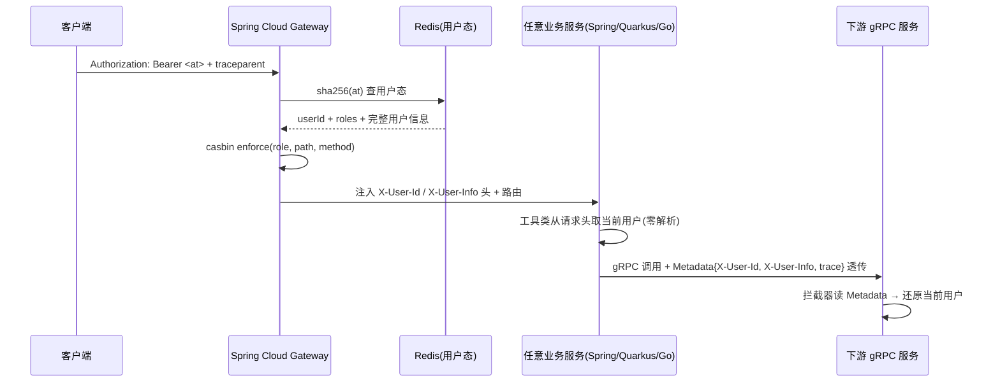
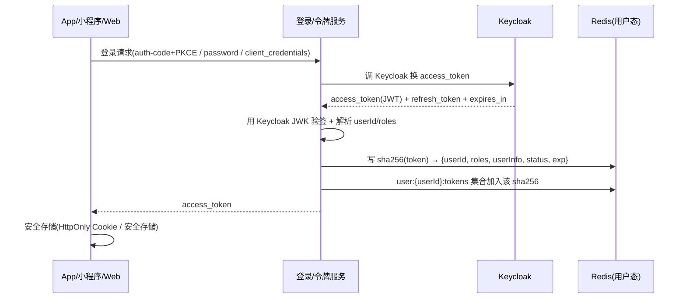
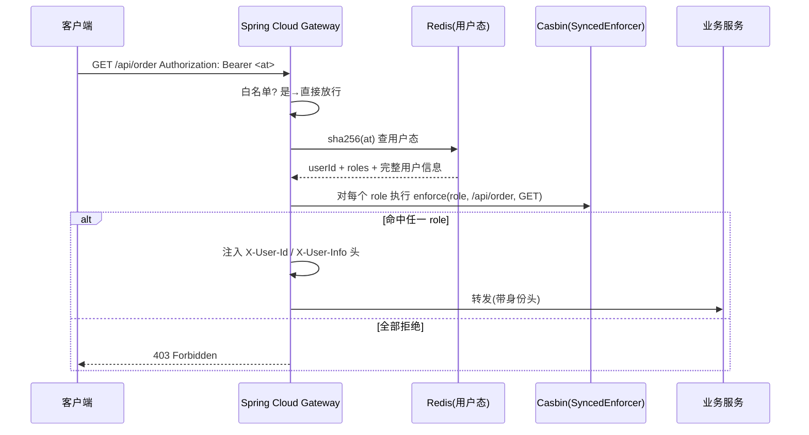
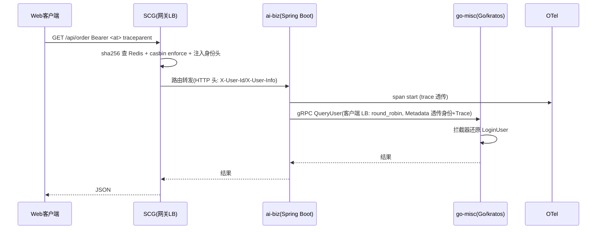

# 微服务架构设计方案（Java + Go/kratos + gRPC）

## 0. 总基调与决策原则

- **最少可用、可演进**：先搭"骨架四件套"（网关 + 认证 + 服务发现 + 配置），其余能力按业务紧迫度渐进接入。
- **语言取舍**：
  - **Spring Boot**：保留给现有 `ai-*` 业务（尤其是强依赖 Spring AI 的对话/TTS/3D 数字人模块），以及 CRUD 重、生态依赖多的服务。
  - **Quarkus**：用于**新建设备边缘、高并发网关类、Serverless/高密度 K8s** 场景——优势是 native image、启动毫秒级、内存低；本方案将其与 Spring Boot、Go/kratos 并列作为三大框架之一。
  - **Go/kratos**：统一用于**网关旁路、鉴权边车、高性能 RPC 服务、定时任务 worker、实时/流式边缘服务**。
- **跨语言统一契约**：所有 RPC 走 gRPC + Protobuf，由独立 `proto` 仓库 + Buf 管理。
- **统一身份透传规范**：Token 仅在**边界（Spring Cloud Gateway）校验一次**，校验通过后注入 `X-User-Id` + `X-User-Info`(完整用户信息 JSON) 请求头，下游零解析、只读头；跨进程经 gRPC Metadata 透传。

---

## 1. 【架构全景图】

```mermaid
flowchart TB
    subgraph Client["客户端层"]
        WEB[Web H5/PC]
        APP[移动端 App]
        MP[小程序 / 第三方]
    end

    subgraph Edge["接入层 / K8s Ingress"]
        GW[API 网关<br/>Spring Cloud Gateway ×3<br/>路由 / 鉴权前置 / 白名单 / 限流]
    end

    subgraph Auth["统一认证与授权中心"]
        KC[Keycloak (OAuth2.1 + 刷新令牌) ×3]
        REDIS_AUTH[(Redis Cluster<br/>token→userId+完整用户信息+roles)]
        CASBIN[Casbin 策略引擎<br/>仅 p 规则(RBAC)]
    end

    subgraph Mesh["服务发现 / 配置"]
        NACOS[Nacos 集群<br/>注册发现 + 配置中心<br/>本地开发默认]
        K8S[K8s EndpointSlice<br/>生产环境服务发现]
    end

    subgraph JavaSvc["Java 业务服务"]
        SB[Spring Boot 服务]
        QK[Quarkus 服务]
    end

    subgraph GoSvc["Go 业务服务 (kratos)"]
        GOMISC[go-misc / 高性能服务]
        GOWORKER[go-worker<br/>定时任务执行]
    end

    subgraph Mid["中间件层 (CNCF)"]
        MQ[RocketMQ / Kafka<br/>事务消息/事件]
        REDIS[(Redis Cluster<br/>缓存/状态)]
        DB[(MySQL / TiDB<br/>持久化 + casbin_rule)]
        OTEL[OpenTelemetry Collector ×2]
        LOKI[(Loki + Fluent Bit<br/>日志)]
        JAEGER[(Jaeger<br/>链路)]
    end

    Client -->|HTTPS + Bearer| GW
    GW -->|sha256(token) 查 Redis 取身份| REDIS_AUTH
    GW -->|casbin enforce(role,path,method)| CASBIN
    GW -->|注入身份头 转发| JavaSvc
    GW -->|注入身份头 + gRPC Metadata| GoSvc
    GW -.白名单免鉴权.-> JavaSvc

    KC --> REDIS_AUTH
    KC -->|Admin API 管账号/角色| CASBIN

    JavaSvc --> NACOS
    GoSvc --> NACOS
    JavaSvc --> K8S
    GoSvc --> K8S

    JavaSvc --> REDIS
    GoSvc --> REDIS
    JavaSvc --> DB
    GoSvc --> MQ
    JavaSvc --> OTEL
    GoSvc --> OTEL
    OTEL --> JAEGER
    OTEL --> LOKI
```

> 说明：登录/令牌服务（独立部署）负责调 Keycloak 换 token、用 JWK 验签解析 JWT、把 `sha256(token)→userId+roles+完整用户信息` 写入 Redis 并加入 `user:{userId}:tokens` 集合。网关只消费 Redis 用户态与 `casbin_rule`，不验签、不管理用户。

---

## 2. 【组件选型对比表】

| # | 能力 | 候选组件 | 优缺点 | 最终选型 & 理由 |
|---|------|----------|--------|-----------------|
| 1 | 统一认证授权 | **Keycloak**、Casdoor、Spring Authorization Server | Keycloak：OAuth2.1 完备(PKCE/客户端凭证/刷新)、会话可吊销、运维重；Casdoor：Go 写、轻量；SAS：灵活但要自建管理面 | **Keycloak**（OAuth2.1 + 刷新令牌）。协议合规 + 服务端会话天然支持"踢人"，无需纯无状态 JWT |
| 2 | RBAC 鉴权 | **Casbin**、Keycloak Roles、SpiceDB | Casbin：RBAC 同模型(Java jcasbin / Go casbin)、行级过滤；SpiceDB：Zanzibar 强但重 | **Casbin**（仅 `p` 规则，`p.sub`=Keycloak Realm Role 名）。网关做 PEP，业务做可选数据权限 PDP。**关键：Keycloak 角色名 ↔ casbin `p.sub` 同名桥接**（见 §4） |
| 3 | API 网关 | **Spring Cloud Gateway**、APISIX、Kong、Higress | SCG：与 Spring 生态无缝、WebFlux 非阻塞、易集成 Casbin；APISIX：etcd 驱动、插件全 | **Spring Cloud Gateway**（WebFlux/Netty 响应式）。网关层做路由/鉴权前置/白名单/限流，集成 Casbin 做统一鉴权 |
| 4 | 注册/发现 | **Nacos + K8s**、Consul | Nacos：动态+双语言+信创；K8s EndpointSlice：零组件、gRPC resolver 原生；Consul：运维重 | **Nacos(本地开发默认) + K8s(生产)** 双支持。自定义 gRPC `NacosNameResolver` 与 `K8sNameResolver` 平滑切换 |
| 5 | 配置中心 | **Nacos**、Apollo、K8s ConfigMap+Reloader | Nacos：动态推送+灰度(namespace/group/tag)+双语言；Apollo：灰度强但 Java 偏重 | **Nacos**（动态+灰度+双语言）；K8s ConfigMap 作生产兜底 |
| 6 | RPC 契约 | **gRPC + Buf/BSR**、protoc、grpc-gateway | gRPC：强类型、跨语言一致、Metadata 透传友好；Buf：lint/breaking/中央仓库一致生成 | **gRPC + Buf** 管理 `.proto`，统一生成 Java(grpc-java)/Go(kratos) stub；**自定义 Nacos/K8s nameresolver + 客户端 round_robin** |
| 7 | 负载均衡 | 网关：SCG 路由配置；RPC：gRPC round_robin、kratos P2C | — | **网关层** 按 SCG 路由配置(rr/lc/chash)；**RPC 层 客户端侧 round_robin**（本地用 Nacos resolver） |
| 8 | 分布式事务 | **DTM**、Seata、RocketMQ 事务消息 | DTM：Go 内核+Java SDK，TCC/Saga/2-phase-msg 全；Seata：Java 强、Go 弱 | **默认消息最终一致**(Outbox+RocketMQ)；强一致流用 **DTM-Saga**（语言中立） |
| 9 | 限流降级熔断 | 网关：SCG 限流；服务：**Sentinel**(sentinel-core + sentinel-go) | Sentinel：双语言统一规则；Resilience4j 仅 Java | **网关 SCG 限流配置 + 服务 Sentinel**(sentinel-core + sentinel-go 统一规则) |
| 10 | 链路追踪 | **OpenTelemetry**、Jaeger、Zipkin | OTel：标准统一，Java agent + Go SDK 通吃，HTTP(grpc-trace-bin/traceparent)与 gRPC 透传 | **OTel Collector** → Jaeger 后端 |
| 11 | 日志 | **Loki+Grafana**、ELK、ClickHouse | Loki：标签索引、轻、与 Trace 同栈；ELK：全文强但重 | **Loki + Fluent Bit DaemonSet**，日志注入 `trace_id`；ELK 作复杂检索备选 |
| 12 | 分布式定时任务 | **XXL-JOB**、snail-job、PowerJob、Argo | XXL-JOB：成熟、社区大、Java+Go SDK 齐备；snail-job：新一代云原生、双语言；PowerJob：Java 强 | **主选 XXL-JOB**（Java+Go SDK 齐备）；**snail-job 作备选**（云原生、双语言友好）。Argo 作 K8s 原生 DAG 备选 |

---

## 3. 【跨语言鉴权透传方案】

**核心思路**：Token 只在**边界（Spring Cloud Gateway）校验一次**（reference token 模式：拿 `sha256(token)` 查 Redis 取身份），校验通过后把"已信任身份"通过 **HTTP 请求头**注入到所有下游，下游经 gRPC 调用时把身份放进 **gRPC Metadata** 透传。全程**下游不再解析 Token**。

### 3.1 统一头 / Metadata 约定（对齐 `CommonConstants` 与 `GrpcHeaders`）

| 名称 | 用途 | 注入者 |
|---|---|---|
| `X-User-Id` | 用户唯一 ID | 网关（取自 Redis 用户态） |
| `X-User-Info` | 完整用户信息 JSON（含 userId、roles、username、tenant、deviceId 等） | 网关 |
| `Authorization` | 原始 Bearer token（透传给需要调用下游三方/Keycloak 的服务） | 客户端 → 网关透传 |
| `X-Client-Id` | 调用方客户端标识（服务间调用时由发起方写入） | 各框架客户端拦截器 |

> 你口语里的 `xuserID`/`xuser` 在本设计中规范为 `X-User-Id` / `X-User-Info`。

### 3.2 整体透传时序



### 3.3 Spring Boot（工具类 + gRPC 拦截器）

```java
// ===== 身份载体（完整用户信息） =====
public record LoginUser(
        String userId,
        List<String> roles,
        String username,
        String tenantId,
        String deviceId
) {}

// ===== 工具类：从当前 HTTP 请求头取身份（零解析） =====
public final class RequestUserUtils {
    public static final String HEADER_USER_ID = "X-User-Id";
    public static final String HEADER_USER_INFO = "X-User-Info";

    public static LoginUser current(ServerHttpRequest req) {
        String userId = req.getHeaders().getFirst(HEADER_USER_ID);
        String infoJson = req.getHeaders().getFirst(HEADER_USER_INFO);
        if (userId == null) return null;            // 匿名（白名单）
        return JsonUtils.toBean(infoJson, LoginUser.class);
    }
}

// ===== gRPC 服务端拦截器：Metadata → Context =====
@GrpcGlobalServerInterceptor
public class AuthServerInterceptor implements ServerInterceptor {
    public static final Context.Key<LoginUser> USER_KEY = Context.key("loginUser");

    @Override
    public <ReqT, RespT> ServerCall.Listener<ReqT> interceptCall(
            ServerCall<ReqT, RespT> call, Metadata headers, ServerCallHandler<ReqT, RespT> next) {
        String userId = headers.get(Metadata.Key.of("X-User-Id", ASCII_STRING));
        String infoJson = headers.get(Metadata.Key.of("X-User-Info", ASCII_STRING));
        LoginUser user = (userId == null) ? null : JsonUtils.toBean(infoJson, LoginUser.class);
        Context ctx = Context.current().withValue(USER_KEY, user);
        return Contexts.interceptCall(ctx, call, headers, next);
    }
}

// ===== gRPC 客户端拦截器：Context → Metadata 透传 =====
public class AuthClientInterceptor implements ClientInterceptor {
    @Override
    public <ReqT, RespT> ClientCall<ReqT, RespT> interceptCall(
            MethodDescriptor<ReqT, RespT> method, CallOptions callOptions, Channel next) {
        return new ForwardingClientCall.SimpleForwardingClientCall<>(next.newCall(method, callOptions)) {
            @Override
            public void start(Listener<RespT> responseListener, Metadata headers) {
                LoginUser u = AuthServerInterceptor.USER_KEY.get();
                if (u != null) {
                    headers.put(Metadata.Key.of("X-User-Id", ASCII_STRING), u.userId());
                    headers.put(Metadata.Key.of("X-User-Info", ASCII_STRING), JsonUtils.toJson(u));
                }
                super.start(responseListener, headers);
            }
        };
    }
}
```

### 3.4 Quarkus（复用现有 gRPC 拦截器骨架）

现有 `xxs-quarkus-grpc` 已含 `GrpcHeaders`、`MetadataInterceptor`(Server)、`AuthClientInterceptor`(Client)，扩展为读取/写入 `X-User-Info` 即可：

```java
// HeaderUtils：从 HTTP 请求头取身份（零解析）
public final class HeaderUtils {
    public static final String HEADER_USER_ID = "X-User-Id";
    public static final String HEADER_USER_INFO = "X-User-Info";

    public static Optional<String> getUserId() {
        return Optional.ofNullable(RestRequestContext.getHeader(HEADER_USER_ID));
    }
    public static Optional<LoginUser> getUserInfo() {
        String json = RestRequestContext.getHeader(HEADER_USER_INFO);
        return Optional.ofNullable(json).map(j -> JsonbBuilder.create().fromJson(j, LoginUser.class));
    }
}

// MetadataInterceptor（Server）扩展：读 X-User-Id / X-User-Info 注入 Quarkus 请求上下文
// AuthClientInterceptor（Client）扩展：从上下文取出 userId/userInfo 写入 gRPC Metadata 透传
```

> 统一 gRPC metadata key 与 Spring 侧一致：`X-User-Id`、`X-User-Info`、`Authorization`、`X-Client-Id`（复用 `GrpcHeaders` 常量定义）。

### 3.5 Go（go-kratos：middleware + client interceptor）

```go
// middleware/auth.go —— 服务端：Metadata → context
func AuthMiddleware() middleware.Middleware {
    return func(handler middleware.Handler) middleware.Handler {
        return func(ctx context.Context, req interface{}) (interface{}, error) {
            md, ok := metadata.FromServerContext(ctx)
            if !ok {
                return nil, errors.Unauthorized("AUTH", "missing metadata")
            }
            userId := md.Get("X-User-Id")
            infoJson := md.Get("X-User-Info")
            u := &LoginUser{}
            if userId != "" {
                _ = json.Unmarshal([]byte(infoJson), u)
                u.UserID = userId
            }
            ctx = context.WithValue(ctx, loginUserKey{}, u)
            return handler(ctx, req)
        }
    }
}

// client interceptor —— 透传当前用户到下游
func AuthClientInterceptor() grpc.ClientOption {
    return grpc.WithMiddleware(func(handler middleware.Handler) middleware.Handler {
        return func(ctx context.Context, req interface{}) (interface{}, error) {
            if u, ok := ctx.Value(loginUserKey{}).(*LoginUser); ok && u != nil {
                ctx = metadata.AppendToClientContext(ctx,
                    "X-User-Id", u.UserID, "X-User-Info", toJSON(u))
            }
            return handler(ctx, req)
        }
    })
}

// 业务透明获取
func CurrentUser(ctx context.Context) *LoginUser {
    if u, ok := ctx.Value(loginUserKey{}).(*LoginUser); ok {
        return u
    }
    return nil // 匿名
}
```

> **白名单**：SCG 对 `/health`、`/auth/**`、`/.well-known`、`/actuator/**` 等路由不挂鉴权过滤器，直接放行；这些接口在下游拦截器中 `userId==null` 即视为匿名。

---

## 4. 【Casbin ↔ Keycloak 角色桥接】（参考 `doc/提示词.md`、`doc/PROMPT.md`）

### 4.1 业务目标：多端统一用户体系

| 端 | 诉求 | 由谁满足 |
|---|---|---|
| 管理系统（后台） | 管理账号、角色、权限点；角色权限变更即时调整 casbin 配置；把角色赋予用户 | Keycloak（账号/角色，走 Admin API）+ casbin_rule 写入（权限点，走 Watcher 热更新） |
| App（移动端） | 自注册，获得默认角色 | Keycloak 注册流 / 默认角色 `app_user` |
| Web / 小程序 / 第三方 | 同上多端思路 | Keycloak 一个 realm 下多 client |

统一认证底座用 **Keycloak**。

### 4.2 令牌模式（已确认）：reference token（opaque）

- 网关**不验签 JWT、不解析**：Keycloak 颁发的 `access_token`（本身是 JWT）被当作不透明随机串。
- 网关仅拿 `sha256(rawToken)` 去 Redis 查用户态（userId + 完整用户信息 + roles）。
- JWT 的验签与声明解析（sub / realm_access.roles / jti / exp）**只发生在外部登录/令牌服务端**，网关运行时零 Keycloak、零 oauth2 依赖（Keycloak 挂了也不影响已登录用户，只要 Redis 在）。

### 4.3 胶水约定（最重要）

**casbin 的 `p.sub`（角色 key）必须等于 Keycloak 的 Realm Role 名。** 这是连接"Keycloak 角色"与"casbin 权限"的唯一桥梁。

例：Keycloak 有 `admin`、`order:query` 两个 realm role，则 `casbin_rule` 只能写 `p, admin, ...`、`p, order:query, ...`。

### 4.4 Casbin 模型（model.conf）—— 仅 p 规则，无 g

角色从 Redis/token 获取，因此模型**不再需要 `g` 规则与 `role_definition`**；`p.sub` 直接是角色 key。

```ini
[request_definition]
r = sub, obj, act

[policy_definition]
p = sub, obj, act

[policy_effect]
e = some(where (p.eft == allow))

[matchers]
m = r.sub == p.sub && r.obj == p.obj && r.act == p.act
```

- `r.sub` = 角色 key（对每个角色逐一 `enforce`）
- `r.obj` = 请求路径（规范化：去 query、可配置是否忽略尾斜杠）
- `r.act` = HTTP 方法（GET/POST/...，统一大写）
- 如需 Ant 风格前缀匹配（如 `/api/order/**`），引入 `keyMatch2` 等 Casbin 内置函数并在 matcher 中使用。

### 4.5 Redis 用户态约定

| 项 | 约定 |
|---|---|
| Key | `{prefix}` + `sha256(rawToken)`（**不存明文 token**，仅存其 sha256） |
| Value（JSON） | `{ "userId": "u1", "roles": ["admin","order:query"], "status": "valid", "exp": 1735689600, "deviceId": "web-abc", "issuedAt": 1735686000, "userInfo": {完整用户信息} }` |
| TTL | 略短于 access_token 过期时间；吊销靠 `status=revoked` 而非仅依赖 TTL |
| 校验失败 | 读不到 / `status=revoked` / 已过期 → **401** |

### 4.6 两个外部写入面（网关只读，不管理）

1. **账号与角色分配（Keycloak Admin API）**：管理系统后端用 `client_credentials` 拿管理员令牌，调用 Keycloak Admin REST API 增删用户、创建/分配/回收 realm role。用户→角色映射真相在 Keycloak，casbin 不存。
2. **权限点写入（casbin_rule + Watcher 热更新）**：管理系统编辑"角色 → 资源 → 方法"时，删除该角色旧 `p` 规则 → 写入新 `p` 规则到 `casbin_rule` → 向 `casbin:policy:update` 频道 publish。网关 `RedisCasbinWatcher` 订阅后 `loadPolicy()` 重载，角色权限变更即时生效（无需用户重登录）。

> App 自注册默认角色 `app_user`，业务侧给 `app_user` 配 `p` 规则即可获得基础权限。

### 4.7 登录/令牌服务职责（外部实现）

调 Keycloak 换 `access_token`(JWT) → 用 Keycloak JWK 验签解析出 `userId`/`realm_access.roles`/`jti`/`exp` → 以 `sha256(access_token)` 为 key 写 Redis（并加入 `user:{userId}:tokens` 集合）→ 返 token 给客户端。

---

## 5. 【关键时序图】

### 5.1 多端登录 + 颁发 Token（OAuth2.1）



### 5.2 网关鉴权 + 注入身份头



### 5.3 一次携带鉴权的跨语言 RPC 调用



---

## 6. 【Token 失效 / 踢人设计】（reference token 模式）

1. **单 token 踢人**：`DEL` / 置 `status=revoked` 该条 Redis 记录 → 下次请求网关查到缺失或 `revoked` → 401。
2. **按用户全端踢**：登录/令牌服务维护 `user:{userId}:tokens`（Set<sha256>），批量 `DEL` 并清集合。
3. **彻底下线（两层动作）**：只删 Redis 不够——用户若持未过期 refresh_token 会续命。彻底下线须**配合 Keycloak Admin API 撤销该用户会话/refresh token**（两层动作缺一不可）。
4. **网关缓存窗口**：若网关 Caffeine 缓存 `token→userInfo`，踢人后有短暂放行窗口；建议缓存 TTL 设短（如 60s），或踢人时经 Redis Pub/Sub 清各节点 Caffeine（同 casbin watcher 思路）。
5. **Redis 高可用**：网关鉴权完全依赖 Redis，须 Cluster/Sentinel。
6. **Token 安全**：token 用 sha256 作 key（不存明文 token）；全程 HTTPS；短 TTL + 可吊销 refresh token。

---

## 7. 【gRPC 服务发现与负载均衡】

### 7.1 双 nameresolver（Nacos 本地 / K8s 生产）

- **`NacosNameResolver`（本地开发默认）**：从 Nacos 拉取服务实例列表，支持健康过滤与订阅变更，本地开发无需 K8s 即可联调。
- **`K8sNameResolver`（生产）**：读取 K8s EndpointSlice/Service，利用 K8s 原生 DNS + watch 实现服务发现。
- 通过配置（如 `grpc.client.{svc}.resolver=nacos|k8s`）切换；**本地开发默认走 Nacos**。

### 7.2 负载均衡：客户端 round_robin

- RPC 层客户端侧统一使用 **`round_robin`** 负载均衡策略（在 nameresolver 提供地址列表后由 gRPC 客户端均衡）。
- 各框架接入方式：
  - **Spring Boot**：`@GrpcClient("service-name")` + 配置 `grpc.client.service-name.negotiation-type` 与 resolver 前缀。
  - **Quarkus**：`quarkus.grpc.clients.{svc}.host=dns:///...`（或 nacos 自定义 scheme）+ `quarkus.grpc.clients.{svc}.load-balancing-policy=round_robin`。
  - **Go/kratos**：使用 `discovery` / 自定义 resolver + `grpc.WithDefaultServiceConfig('{"loadBalancingPolicy":"round_robin"}')`。

---

## 8. 【模块 / 代码仓库划分建议】

```
org-monorepo/
├── proto/                  # 单一契约源（Buf module，BSR 发布）
│   ├── auth/v1/*.proto
│   ├── order/v1/*.proto
│   └── common/error.proto  # 统一错误码 google.rpc.Status 扩展
├── java/
│   ├── xxs-gateway/        # Spring Cloud Gateway + Casbin 统一鉴权（可部署网关应用，非 Starter 可复用库）
│   ├── common-auth-java/   # Spring 侧拦截器 + LoginUser + RequestUserUtils
│   ├── ai-biz/             # 现有 Spring Boot 业务
│   ├── ai-3d/              # 小护（Spring Boot + Spring AI）
│   ├── ai-platform/
│   └── quarkus-svc/        # Quarkus 高并发/边缘服务（含 xxs-quarkus-grpc）
├── go/
│   ├── common-auth-go/     # kratos middleware + LoginUser + 透传
│   ├── go-misc/            # kratos 高性能 RPC 服务
│   └── go-worker/          # 定时任务 worker（接 XXL-JOB 执行器）
└── deploy/                 # Helm/K8s manifests, Dockerfile
```

- **proto 管理**：`proto/` 独立仓，CI 用 Buf 做 lint/breaking，生成 Java 与 Go stub 分别提交到各自 `generated/` 或走 BSR 拉取。
- **版本策略**：包名带 `v1`，破坏性变更走 `v2`，网关做协议转换兼容期。
- **登录/令牌服务**：独立部署，对接 Keycloak，承担 §4.7 的换 token / 验签 / 写 Redis 职责。

---

## 9. 【风险点与演进路线】

### 高可用部署形态（建议）

| 组件 | 形态 | 副本/集群 |
|------|------|-----------|
| Keycloak | 无状态 + 共享 DB | 3 副本 + Redis 会话缓存 |
| Spring Cloud Gateway | 无状态数据面 | 3+ 副本（HPA） |
| Redis | Cluster / Sentinel | 3 主 3 从（网关鉴权强依赖） |
| Nacos | 集群模式 | 3 节点（注册+配置） |
| MySQL | 主从 / TiDB | 1主2从（含 casbin_rule） |
| OTel Collector | 网关+agent 两层 | 2+ 副本 |
| Loki | 单/微服务模式 | 按需 HA |
| RocketMQ | 多副本 + Dledger | 3 节点 |
| XXL-JOB | 调度中心 + 执行器 | 调度中心 2+ 副本，执行器随业务扩容 |

### 性能瓶颈 & 对策

- Token 校验集中在网关，下游零成本；网关 `ver`/用户态用本地 Caffeine 短 TTL 缓存 + Redis Pub/Sub 清缓存，降低 Redis 压力。
- gRPC 客户端侧 `round_robin` 避免热点；长连接复用。
- Loki 标签基数控制，避免 `trace_id` 作高基数标签（仅索引、不标签）。

### 信创 / 国产化替代

- 网关 Higress、注册/配置 Nacos/Apollo、事务 DTM、DB 达梦/OceanBase/TiDB、OS OpenEuler/麒麟、镜像 ARM64。
- Java/Go 均可在国产 K8s 运行，无绑定。

### 演进路线（灰度迁移）

1. **Phase 1**：接入 SCG + Keycloak + Nacos + OTel，存量 `ai-*` 平滑迁入，白名单兜底。
2. **Phase 2**：proto 仓库 + Buf 落地，Java 内部先 gRPC 化；引入 Casbin（Keycloak 角色桥接）、Sentinel、Loki。
3. **Phase 3**：用 kratos 新建高性能/worker 服务，跨语言 gRPC 打通（Nacos/K8s resolver + round_robin）；XXL-JOB 跨语言派单。
4. **Phase 4**：DTM 强一致流、信创替换、按流量金丝雀（K8s）逐步替换存量。

---

## 附录：Java/Go 生态不对等桥接说明

- **事务**：Seata Go 支持弱 → 统一用 **DTM**（Go 内核 + Java SDK）消除不对等。
- **限流**：Resilience4j 仅 Java → 用 **Sentinel**（sentinel-core + sentinel-go 双语言统一规则）。
- **RBAC**：自研难统一 → **Casbin** 同模型双语言引擎（`p.sub`=Keycloak Realm Role 名）；策略集中存 `casbin_rule`，经 Watcher 双端同步热更新。
- **服务发现**：Java 习惯 Nacos，Go kratos 原生 k8s → **自定义双 nameresolver（Nacos 本地 / K8s 生产）**，客户端 `round_robin` 统一负载均衡。
- **定时任务**：跨语言派单 → **XXL-JOB**（Java + Go 执行器 SDK 齐备），snail-job 作备选。
- **身份透传**：统一 `X-User-Id` / `X-User-Info` 头与 gRPC Metadata key，Spring Boot / Quarkus / Go-kratos 三框架各提供"取头工具类 + 拦截器"对称实现，确保零解析、只读透传。
