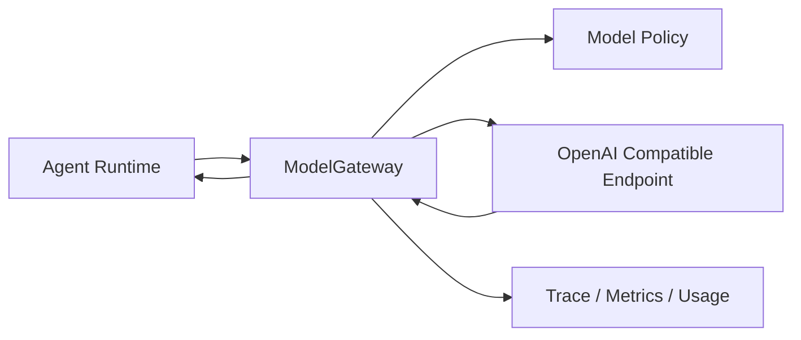
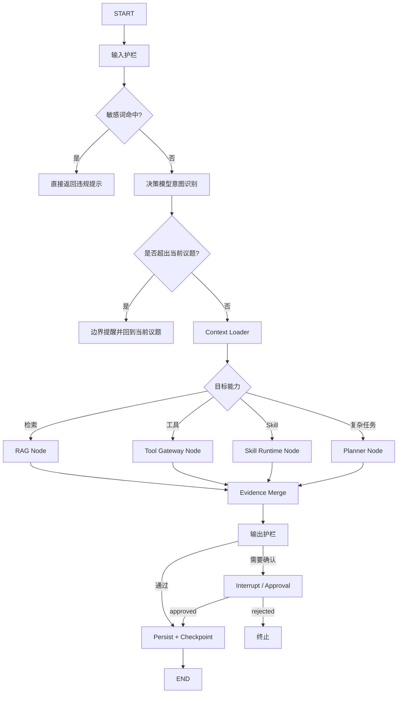
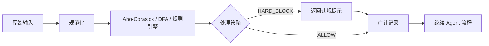
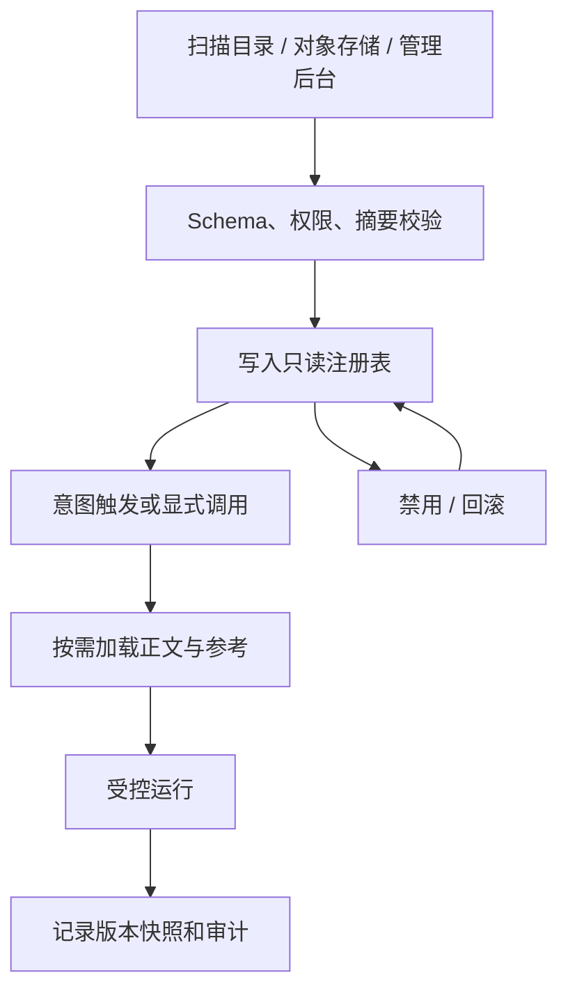

# 技术调研

本文聚焦 LLM 对话 Agent 的通用技术实现，沉淀语言与框架、代码工程结构、LLM 接入与观测、Agent 编排、上下文工程、工具扩展、检索、存储、安全治理和部署方案。业务规则、行业语义和产品功能不作为本文讨论对象。

## 1. 语言与框架选型

### 1.1 选型结论

| 类别 | 推荐选型 | 说明 |
| --- | --- | --- |
| 主运行时 | Python 3.12 | 与 LLM、LangChain、LangGraph、RAG、MCP、文档解析生态一致性最高 |
| Web 框架 | FastAPI + Uvicorn | 原生异步，适合 HTTP、SSE、断线重连和高并发长连接场景 |
| 领域协议 | Pydantic v2 | 请求校验、AgentState、Tool Schema、MCP 工具清单统一建模 |
| LLM 适配 | LangChain + OpenAI Compatible API | 屏蔽模型厂商差异，减少供应商绑定 |
| Agent 编排 | LangGraph | 显式状态图、条件路由、Checkpoint、Interrupt/Resume 原生支持 |
| 数据访问 | SQLAlchemy 2.x async + Alembic | ORM、原生 SQL、JSONB 和迁移均能覆盖 |
| 主数据库 | PostgreSQL 16 | 会话、运行、检查点、消息、审计等事实数据的高可靠主存储 |
| 向量能力 | PostgreSQL + pgvector | 首期降低组件数量，数据一致性和部署复杂度更好 |
| 缓存与协调 | Redis 7 | 热状态、幂等、锁、限流、短时流式事件缓冲 |
| 对象存储 | MinIO / S3 | 原始文档、附件、运行产物、大结果引用 |
| 包管理 | uv + pyproject.toml | 依赖锁文件稳定，构建过程可重复 |
| 质量工具 | pytest + Ruff + mypy | 覆盖行为测试、代码风格检查和静态类型检查 |

Python 是主运行时的优先结论。其优势不是简单的脚本开发效率，而是 Agent 关键能力已经沉淀在 Python 生态中：LangGraph 的图状态与中断恢复、LangChain 的模型与检索适配、MCP Python SDK、文档解析与向量化组件均可以直接复用。这样可以减少运行时之间的状态转换、链路追踪、版本升级和故障定位成本。

Java、Go 或其他语言系统不需要也不应该替换 Agent 主运行时。更稳定的边界是把企业系统、消息、权限、支付等领域能力保留在现有栈中，通过 REST、消息队列或 MCP Server 接入。Agent 服务只依赖协议和领域接口，不依赖这些系统的内部实现。

### 1.2 语言方案对比

| 方案 | 适用性 | 主要限制 |
| --- | --- | --- |
| Python + FastAPI + LangGraph | 适合作为 Agent 主运行时 | 需要严格管理异步、依赖版本、进程隔离和类型边界 |
| 纯 Java Agent 运行时 | 适合强企业合规栈或存量 Java 团队 | LLM Agent、MCP 和 RAG 生态不如 Python，关键能力需要二次建设 |
| 纯 Go Agent 运行时 | 适合高并发网关、连接层 | 通用 LLM 编排和 RAG 生态较弱，不适合作为主 Agent 层 |
| 混合运行时 | 适合已有企业平台继续承载业务能力 | 必须显式划分进程边界、数据契约和错误恢复边界 |

推荐最终形态是“Agent Runtime Python-first，外部能力协议化接入”。主服务内部不引入第二个 Agent 运行时；不同语言可以存在于独立部署单元中，但不能让同一份对话状态在多运行时之间反复同步。

### 1.3 版本与兼容性

1. 使用 `pyproject.toml` + `uv.lock` 固定核心依赖；禁止在生产启动时执行开放式 `pip install` 或动态升级。
2. FastAPI、Pydantic、LangGraph、LangChain、SQLAlchemy、MCP SDK 均作为平台级依赖统一约束，不允许单个功能模块随手重设版本。
3. 与模型供应商保持解耦，优先使用 OpenAI 兼容协议；厂商私有参数放入专门的模型策略配置，不污染领域模型。
4. MCP 传输、协议版本和工具 Schema 做显式版本记录，避免清单变化后无法解释历史运行。
5. 数据库变更只通过 Alembic 迁移文件表达，禁止运行时自动建表、自动修改表结构或隐藏的启动期 schema patch。
6. Prompt、Agent 图、Skill、MCP 工具清单都要版本化。升级不覆盖旧版本，历史运行必须能还原当次使用的版本。

## 2. 代码工程结构

### 2.1 分层架构

| 层 | 核心职责 | 不应该承担 |
| --- | --- | --- |
| API 层 | 鉴权、参数校验、幂等、SSE 协议、限流入口 | 业务编排、数据库 SQL、模型参数拼接 |
| 应用层 | 会话用例、运行用例、恢复用例、权限用例 | 直接理解 Web 协议或第三方模型 SDK |
| 领域层 | Conversation、Message、Run、AgentState、ToolCall、PolicyDecision 等充血模型 | 依赖框架、数据库、HTTP 客户端 |
| Agent Runtime | 状态图、节点、路由、上下文组装、中断恢复 | 直接写库、读配置文件、调用数据库事务 |
| 能力层 | ModelGateway、ToolGateway、RetrievalGateway、SkillRuntime、McpClientManager | 感知 HTTP Controller 或前端展示 |
| 基础设施层 | PostgreSQL、Redis、S3、向量库、消息队列、日志、Trace | 反向依赖应用层或领域层 |

依赖方向保持单向：`api -> application -> domain/runtime -> capabilities/ports -> infrastructure`。领域层和端口接口不依赖具体实现；基础设施通过适配器接入。

### 2.2 推荐目录

```text
agent-platform/
├── pyproject.toml
├── uv.lock
├── src/
│   └── agent_platform/
│       ├── api/
│       │   ├── routes/
│       │   ├── schemas/
│       │   ├── responses/
│       │   └── dependencies.py
│       ├── application/
│       │   ├── conversation/
│       │   ├── run/
│       │   ├── context/
│       │   ├── skill/
│       │   └── mcp/
│       ├── domain/
│       │   ├── conversation.py
│       │   ├── message.py
│       │   ├── run.py
│       │   ├── agent_state.py
│       │   ├── policy.py
│       │   └── tool_call.py
│       ├── runtime/
│       │   ├── graphs/
│       │   ├── nodes/
│       │   ├── state/
│       │   ├── checkpoint/
│       │   └── events/
│       ├── capabilities/
│       │   ├── model/
│       │   ├── tool/
│       │   ├── skill/
│       │   ├── mcp/
│       │   └── retrieval/
│       ├── infrastructure/
│       │   ├── persistence/
│       │   ├── cache/
│       │   ├── object_storage/
│       │   ├── telemetry/
│       │   └── config/
│       └── common/
│           ├── errors/
│           ├── ids/
│           ├── pagination/
│           └── conversion/
├── migrations/
├── skills/
├── tests/
└── docker/
```

### 2.3 关键工程原则

1. **低耦合、高内聚**：一个模块只暴露一个清晰的端口，不把模型 SDK、SQLAlchemy 会话、HTTP Response 泄漏到领域层。
2. **领域模型承载行为**：类似 `Message.can_retry()`、`Run.finish(result)`、`AgentState.merge(next_delta)` 的规则尽量内聚到实体和值对象中，而不是全部堆积在 Service。
3. **空值显式化**：可选字段在类型层使用 `None`，并提供实体级兜底方法，例如 `content_or("")`、`summary_or("无内容")`，避免 Controller 和 Runtime 到处重复判空。
4. **转换独立化**：API DTO、AgentState、数据库模型、模型消息之间的转换放入 `conversion` 或 Adapter，禁止在业务路径中手工构造散乱的字典。
5. **长路径注释节制**：只有上下文组装、Checkpoint 恢复、MCP 清单同步、失败降级这类复杂路径写方法级说明；一目了然的操作不写注释。
6. **异常分类清晰**：领域校验异常、外部网关异常、模型异常、工具异常、网络异常分别建模，统一转为稳定错误码，不能让内部异常直接透给客户端。
7. **并发边界明确**：Run 级别控制取消信号与资源上限；数据库事务不做长时间等待；SSE 生成器不持有长事务。

### 2.4 端口示例

```python
from typing import Protocol, Sequence


class ConversationStore(Protocol):
    async def get_required(self, conversation_id: str) -> Conversation: ...

    async def append(self, message: Message) -> None: ...


class CheckpointStore(Protocol):
    async def save(self, checkpoint: AgentCheckpoint) -> None: ...

    async def load(
        self,
        thread_id: str,
        checkpoint_id: str,
    ) -> AgentCheckpoint | None: ...


class ModelGateway(Protocol):
    async def generate(self, request: ModelRequest) -> ModelResult: ...

    async def stream(self, request: ModelRequest) -> AsyncIterator[ModelDelta]: ...


class ToolGateway(Protocol):
    async def invoke(self, invocation: ToolInvocation) -> ToolResult: ...


class RetrievalGateway(Protocol):
    async def search(self, request: RetrievalRequest) -> RetrievalResult: ...
```

这些接口只表达能力边界。底层可以换成 LangGraph Checkpoint、pgvector、独立向量库或不同模型供应商，但上层状态图和用例不随实现变化。

## 3. LLM 接入

### 3.1 ModelGateway 统一入口

所有 LLM 调用必须经 `ModelGateway`。它负责模型策略选择、请求构造、流式封装、异常标准化、Token/成本上报、取消信号和重试策略。



推荐字段：

- 模型名、供应商、接口版本、Prompt 版本
- 温度、最大输出、超时时间、重试次数
- 输入 Token、输出 Token、费用、首 Token 时延、总耗时
- 是否允许流式、是否可降级、备用模型

### 3.2 请求生命周期

1. Runtime 根据 Agent、租户、能力需求和成本策略选择模型策略。
2. ModelGateway 将统一 `ModelRequest` 转换为厂商请求，不把厂商字段散播到业务层。
3. 非流式调用使用整体超时；流式调用分首包超时、读取间隔超时和总时长控制。
4. 供应商 `429`、临时网络异常、5xx 可以按策略有限重试；请求已经产生的不可重入副作用不能简单重试。
5. 请求取消要向下传播给 HTTP 客户端、生成器、工具调用和事件流。
6. 调用结束时生成 `ModelUsage`，与 `run_id`、`trace_id`、节点名、Prompt 版本关联。

### 3.3 流式输出的边界

SSE 侧只转发稳定事件，不应该把供应商私有 delta 结构直接透给客户端。服务端先把模型返回归一为：

```python
class ModelDelta:
    event_id: str
    type: Literal["text", "reasoning_step", "tool_call_delta", "usage", "error"]
    content: str | None
    metadata: dict
```

最终消息只在完整生成或运行结束时写入主存储；流式碎片进入短时缓冲，不覆盖数据库中的业务消息。客户端断开时，服务端可以继续生成，但最终落库与事件重放要由 `run_id + event_id` 控制。

### 3.4 Prompt 管理

1. Prompt 使用命名、版本和内容哈希管理，运行记录里保存 `prompt_version` 和关键变量摘要。
2. 输出格式要求、可用工具列表、引用规范和安全边界独立管理，不与业务文案混合。
3. 参数模板在渲染后保留结构，方便错误分析和灰度对比。
4. Prompt 更新不能视为代码外的小改动；进入生产前同样需要测试样例、评测集和回滚方案。

## 4. Agent 编排

### 4.1 总原则

Agent 编排优先使用显式状态图，而不是自由循环的 ReAct 链。显式图更容易回答“现在走到哪个节点、上一次为什么失败、中断后能否恢复、工具是否越权、上下文是否被改写”。

LangGraph 承担：

- `StateGraph` 图定义与条件边
- AgentState 的合并策略
- 节点执行与错误传播
- Checkpoint 写入和恢复
- Interrupt/Resume

Agent 服务自己承担：

- 领域校验和权限校验
- 输入护栏、意图路由、内容边界
- 上下文组装
- 工具执行接口
- 事件落库与流式转发

### 4.2 推荐主干



### 4.3 意图识别使用决策模型

常规意图识别不交给大模型自由发挥。应该建立独立的决策模型或决策网关，输出确定性路由结果。

推荐输入：

- 会话状态、用户输入、消息类型、语言
- 当前 Agent 可用能力清单
- 可用 Skill、工具、检索能力的摘要
- 安全状态、权限状态
- 是否处于中断或待补充槽位状态

推荐输出：

```python
class IntentDecision:
    intent: str
    target_node: str
    confidence: float
    matched_features: list[str]
    fallback: bool
    decision_version: str
```

决策模型可以由三层组成：

1. **确定性状态优先**：当前运行已经处于 `WAITING_SLOT`、`WAITING_APPROVAL`、`TOOL_RUNNING` 等状态时，优先恢复原流程，不重新做大范围意图猜测。
2. **规则和特征路由**：基于显式命令、消息类型、可用能力状态、上下文标记进行快速路由。
3. **分类决策模型**：对开放输入分类到 `chat`、`search`、`tool`、`skill`、`clarify`、`reject`、`off_topic` 等目标。

决策结果要求可解释、可版本化、可观测。低置信度时不强行执行高风险工具，应转为澄清或降级。

### 4.4 敏感词过滤硬拦截

敏感词过滤属于输入前置节点，必须在进入 LLM 之前完成。命中违规内容时直接返回标准违规提示，不调用模型，也不进入检索、Skill 或 MCP 执行。

推荐流程：



技术要求：

1. 过滤组件独立成 `InputGuard`，不和大模型 Prompt 混在一起。
2. 词表、规则、动作和版本统一配置；变更必须留版本历史。
3. 对中文、字符变体、空白分隔、大小写、全半角、重复符号做归一化后再匹配。
4. 使用 Aho-Corasick 或 DFA 处理大规模词表，避免逐词正则导致的性能退化。
5. 命中后返回统一错误事件，不向模型请求任何内容。
6. 审计记录只保存命中规则、命中的规范词、处理动作和时间，不落原始敏感文本。
7. 支持动作分级：硬拦截、脱敏后继续、仅审计、仅警告。生产上默认高危内容硬拦截。
8. 过滤结果必须记录 `policy_version`，保证历史响应可审计。

### 4.5 回复内容边界

Agent 必须有明确的当前议题和能力边界。越界请求不应该被委婉回答，也不应该让模型自由兜底。

推荐节点：`TopicScopeGuard`。

检查维度：

1. 当前 Agent 配置声明的功能范围。
2. 会话状态与当前任务目标。
3. 能力清单中是否存在可支撑该请求的检索、Skill 或工具。
4. 决策模型的意图与置信度。

处理方式：

1. 明确越界时直接输出“当前不处理该类问题，请回到 XX 议题”的固定提示。
2. 不调用模型生成边界外内容。
3. 不调用与边界无关的工具。
4. 必要时把当前可支持议题清单作为引导信息返回。
5. 越界判定与提示模板版本化，可观测。

对边界模糊的情况，可以返回澄清问题而不是编造回答。只有决策模型置信度和能力可用性都达标时才进入后续执行节点。

### 4.6 AgentState

```python
class AgentState:
    thread_id: str
    run_id: str
    conversation_id: str
    tenant_id: str
    user_id: str
    policy_version: str
    graph_version: str
    intent: IntentDecision | None
    user_input: UserInput
    history: list[MessageRef]
    summary: str | None
    slot_state: dict[str, SlotValue]
    retrieval_refs: list[EvidenceRef]
    tool_results: list[ToolResultRef]
    approval_state: ApprovalState | None
    error_state: AgentError | None
    usage: UsageReport
```

设计要求：

1. 状态只保存运行必需数据，大文本和大结果存引用。
2. 节点返回增量，由 LangGraph reducer 合并；不能让任意节点直接覆盖整份状态。
3. 每次关键决策保存版本信息。
4. 完成或失败后的状态快照可从 Checkpoint 重建。

### 4.7 单 Agent 与多 Agent

先单主图，只在满足条件时拆子 Agent：

1. 子任务有独立目标、独立上下文和可验证结果。
2. 子 Agent 有独立工具权限或检索范围。
3. 可以并行执行，或者失败后可以单独重试。
4. 子 Agent 的输出可以被合并、验证和限流。

不要为了避免编写清晰节点而把每个业务动作都包装成子 Agent。多 Agent 会增加模型循环、成本、调试难度和状态同步复杂度。

推荐拆分模式：

| 模式 | 适用场景 |
| --- | --- |
| 单主图 | 问答、澄清、轻量工具调用 |
| 主图 + 并行节点 | 检索、多个读工具、多路召回 |
| 主图 + 子图 | 独立流程型 Skill |
| Planner + Executor | 多步骤复杂任务，需要可校验计划 |
| Human Approval 节点 | 写操作、高危动作、人工审核 |

### 4.8 检查点与恢复

生产环境使用 PostgreSQL 持久化 Checkpoint。Redis 只能做短时缓存，不能作为长期状态的唯一事实源。

需要写入 Checkpoint 的时点：

1. 用户输入后、执行不可逆操作前。
2. 调用工具前。
3. 等待用户补充信息前。
4. 等待人工审批前。
5. 关键节点合并状态后。

恢复规则：

1. 以 `run_id + thread_id + checkpoint_id` 定位。
2. 恢复时校验图版本、Prompt 版本、能力清单和权限。
3. 已完成节点不重复执行。
4. 恢复结果发送稳定事件，保证客户端能看到运行被继续而不是重复生成。

### 4.9 中断、取消、超时与重试

| 场景 | 技术处理 |
| --- | --- |
| 需要用户补槽 | 写 Checkpoint，Run 置为 `WAITING_USER`，SSE 发送 `interrupt` |
| 需要人工审批 | 写 Checkpoint，通知审批入口，禁止继续执行下游 |
| 用户取消 | 取消标记传播到模型、节点、工具和事件流 |
| 模型超时 | 按策略重试或切换备用模型 |
| 工具超时 | 读操作可有限重试，写操作走幂等键或进入人工确认 |
 | 循环失控 | 设置最大节点数、工具次数、Token 和费用上限 |

Run 状态建议至少包括 `PENDING`、`RUNNING`、`WAITING_USER`、`WAITING_APPROVAL`、`SUCCEEDED`、`FAILED`、`CANCELLED`。

## 5. 上下文工程

### 5.1 ContextAssembler 统一入口

每次模型调用前，ContextAssembler 是唯一组装入口。Runtime 中不允许各节点自行拼上下文。

推荐优先级：

1. 系统指令和安全策略。
2. 当前 Agent、图版本、Prompt 版本。
3. 可用能力清单和权限范围。
4. 当前任务状态、槽位、审批状态。
5. 当前用户输入。
6. 最近 N 轮消息。
7. 会话摘要。
8. 召回的长期记忆。
9. RAG 证据与引用。
10. 必要的工具中间结果。

### 5.2 Token 预算

每次组装都要有总预算和分段预额。上下文长度不能由检索和工具原始输出决定。

| 部分 | 建议 |
| --- | --- |
| 系统指令 | 固定模板，控制复杂度 |
| 历史窗口 | 优先保留最近轮次，早期轮次做摘要 |
| RAG 证据 | 每条限制长度，保留来源和版本 |
| 工具输出 | 只传入摘要，原始大结果存对象存储 |
| 长记忆 | 按重要性、时效、权限过滤后再注入 |
| 审计元数据 | 模型上下文不直接注入，只保留必要版本 |

预算溢出时按“先裁工具原始输出，再裁旧历史，再裁低分检索证据”的顺序处理，不要破坏任务关键信息。

### 5.3 历史与摘要

1. 最近 N 轮保留完整语义。
2. 早期内容生成摘要，并保留消息 ID 引用。
3. 摘要中不引入外部推测；无法解释的信息不入摘要。
4. 摘要随上下文版本和会话状态更新。
5. 用户显式纠正后，摘要应被修正优先。

### 5.4 长期记忆

长期记忆按作用域、类型、时效、权限过滤。

推荐记忆类型：

| 类型 | 用途 |
| --- | --- |
| `fact` | 稳定事实 |
| `preference` | 用户偏好 |
| `task_state` | 跨轮任务状态 |
| `summary` | 长历史压缩 |
| `restriction` | 用户设定或系统级限制 |

写入规则：

1. 只写入经过验证或用户确认的信息。
2. 每条记忆有作用域、重要性、过期时间和状态。
3. 权限范围不匹配的记忆不进入上下文。
4. 支持读取、修正、删除和失效。
5. 召回结果记录记忆 ID，便于解释上下文来源。

### 5.5 RAG 证据注入

RAG 证据不是自由文本，应该使用结构化引用：

```python
class EvidenceRef:
    evidence_id: str
    doc_id: str
    title: str
    source_url: str | None
    page: int | None
    version: str
    score: float
    excerpt: str
```

进入模型前裁掉无关片段，保留标题、来源、页码和版本。回答要求引用证据。无证据或低置信度时明确拒答，不触发兜底工具编造。

## 6. Skill 与工具扩展

### 6.1 Skill 定位

Skill 是面向 Agent 的行为包，包含触发条件、流程约束、参考资料、权限声明和可选执行器。它不等于工具协议；Skill 可以声明使用本地工具或 MCP 工具。

### 6.2 包结构

```text
skills/plan-review/
├── SKILL.md
├── skill.yaml
├── references/
│   ├── checklist.md
│   └── guardrails.md
├── scripts/
│   └── validate_input.py
├── assets/
├── tests/
└── requirements.txt
```

`skill.yaml` 建议：

```yaml
---
name: plan-review
version: 1.2.0
description: 描述技能适用范围与输出边界
runtime: container
permissions:
  - knowledge:read
  - tool:sample_tool
max_turns: 6
---
```

### 6.3 生命周期



技术要求：

1. 启动只加载元数据，不把全部正文塞入系统提示词。
2. 选择阶段只暴露名称、描述、触发条件、输入输出摘要。
3. 命中后才加载完整说明和参考文件。
4. Skill 版本固定且不可变；运行过程锁定版本。
5. 升级采用新目录、新注册记录或新镜像，不原地覆盖。
6. 禁用、灰度、回滚在管理侧可操作，并产生审计事件。

### 6.4 执行隔离

| 类型 | 执行方式 | 适用 |
| --- | --- | --- |
| Prompt Skill | 只注入说明与参考 | 流程约束、话术模板 |
| Native Skill | 使用受信 Handler | 平台内部稳定逻辑 |
| Script Skill | 独立容器或受限子进程 | 外部脚本、文档处理 |
| MCP Proxy Skill | Skill 描述流程，工具调用交给 MCP | 外部系统能力 |

Script Skill 必须配置：

- CPU、内存、临时磁盘、执行超时和输出上限
- 默认无外网，按白名单开放
- 文件系统只读或最小挂载
- 不注入数据库密码和模型密钥
- 输出统一结构化并校验 Schema

### 6.5 ToolGateway

ToolGateway 是工具调用的唯一入口。

职责：

1. 校验工具存在、启用、命名空间和权限。
2. 校验入参 Schema，处理敏感字段。
3. 区分读操作和写操作。
4. 设置连接、调用和响应体上限。
5. 记录调用审计、耗时、状态和错误码。
6. 大结果摘要化或对象存储化，只向模型返回可读摘要。

## 7. MCP 接入

### 7.1 角色边界

MCP 负责把外部能力标准化暴露；Agent Runtime 只依赖 Client 协议，不依赖某个 Server 的实现语言或内部接口。

### 7.2 Server 注册与发现

`agent_mcp_server` 建议字段：

| 字段 | 说明 |
| --- | --- |
| `id` | 配置 ID |
| `tenant_id` | 租户或环境隔离键 |
| `alias` | 命名空间，例如 `files`、`calendar` |
| `transport` | `STDIO` / `SSE` / `STREAMABLE_HTTP` |
| `endpoint` / `command` / `args` | 远程地址或受信任本地命令 |
| `env_ref` | 密钥引用，不落明文 |
| `protocol_version` | MCP 协议版本 |
| `enabled` | 启用状态 |
| `health_status` | `UP` / `DOWN` / `DEGRADED` |
| `tool_manifest` | 最近一次工具清单 |
| `manifest_hash` | 清单摘要 |
| `last_synced_at` | 对账时间 |

同步流程：

1. 启动或收到变更通知时加载启用配置。
2. 建立 Client，调用 `initialize`。
3. 调用 `tools/list` 获取工具名、描述、输入输出 Schema。
4. 工具名加命名空间避免冲突。
5. 校验 Schema、权限、超时、敏感参数规则。
6. 发布 ToolDescriptor 到 ToolGateway。
7. 监听清单变更或定时对账。
8. 单 Server 异常只标记 `DEGRADED`，不阻塞整个 Agent。

### 7.3 传输选型

| 传输 | 建议 | 限制 |
| --- | --- | --- |
| Streamable HTTP | 生产远程连接首选 | TLS、鉴权、白名单、连接池必须配置 |
| SSE | 兼容旧 Server | 长连接超时、重连、代理缓冲要验证 |
| STDIO | 只用于同主机受信 Server | 禁止执行用户上传或动态拼接命令 |

### 7.4 调用治理

1. 写操作、删除、支付、审批、批量动作默认要求确认。
2. 幂等读可以有限重试；写操作必须依赖业务幂等键。
3. 不允许模型指定任意 URL、命令、文件路径或权限。
4. MCP 出参按不可信数据处理，不能覆盖系统提示词。
5. 工具清单变化要记录版本；历史运行解释时读取调用时的快照。

## 8. RAG 与知识检索

### 8.1 摄入管线


技术要求：

1. 上传的原始文件存对象存储，解析产物可重建。
2. 每个 Chunk 保留文档、标题、页码、段落、版本和租户/空间隔离键。
3. Embedding 模型、维度和版本固定；模型切换时全量重建或双写。
4. 首期使用 PostgreSQL 全文索引和 pgvector 混合检索。
5. 重型解析、OCR 和重排可独立部署，不占用 API 进程资源。

### 8.2 查询流程

1. 对用户查询归一化，可能包含澄清槽位。
2. 按租户、空间、权限、文档版本过滤。
3. 向量召回与关键词召回并行。
4. 使用 RRF 或加权融合。
5. 必要时使用独立 Reranker。
6. 生成结构化证据引用，只把高分片段注入上下文。
7. 低置信度时明确拒答或转人工。

### 8.3 扩展边界

| 情况 | 建议 |
| --- | --- |
| 数据规模、查询延迟超过 PostgreSQL 能力 | 引入 Milvus / Qdrant |
| 需要复杂字段过滤、多语言分词 | 引入 Elasticsearch / OpenSearch |
| 需要多跳关系推理 | 引入图数据库 |
| 需要可替换文档解析 | 抽象 Parser Provider |
| 需要重排升级 | 抽象 Reranker Provider |

业务层始终调用 `RetrievalGateway`，不感知底层向量库。

## 9. 存储与运行状态

### 9.1 状态分层

| 数据 | 存储 | 说明 |
| --- | --- | --- |
| 会话、消息、Run、审计 | PostgreSQL | 事实源，长期保留 |
| LangGraph Checkpoint | PostgreSQL | 图状态与恢复依据 |
| 热状态、锁、限流 | Redis | 短时缓存，可重建 |
| 流式事件缓冲 | Redis Stream | 支持断线重连与事件重放 |
| 文件、附件、大产物 | MinIO / S3 | 数据库只存引用 |
| 向量数据 | PostgreSQL + pgvector | 首期同库，规模需要时替换 |

### 9.2 核心表

#### `agent_conversation`

| 字段 | 说明 |
| --- | --- |
| `id` | 会话 ID |
| `tenant_id` | 租户隔离键 |
| `user_id` | 用户 ID |
| `agent_code` | Agent 定义编码 |
| `title` | 标题 |
| `status` | `ACTIVE` / `ARCHIVED` / `DELETED` |
| `last_message_at` | 最近消息时间 |
| `version` | 乐观锁 |
| `created_at` / `updated_at` | 审计时间 |

#### `agent_message`

| 字段 | 说明 |
| --- | --- |
| `id` | 消息 ID |
| `conversation_id` | 会话 ID |
| `run_id` | 所属运行 |
| `role` | `USER` / `ASSISTANT` / `TOOL` / `SYSTEM` |
| `content_type` | 文本、Markdown、JSON、文件 |
| `content` | 统一消息体 |
| `sequence_no` | 会话内单调序号 |
| `token_count` | Token 计量 |
| `prompt_version` | Prompt 版本 |
| `created_at` | 创建时间 |

#### `agent_run`

| 字段 | 说明 |
| --- | --- |
| `id` | 运行 ID |
| `conversation_id` | 会话 ID |
| `trace_id` | 全链路追踪 ID |
| `status` | 运行状态 |
| `graph_version` | 图版本 |
| `model_policy` | 模型策略 |
| `input_message_id` | 输入消息 |
| `output_message_id` | 输出消息 |
| `error_code` | 标准错误码 |
| `started_at` / `finished_at` | 开始与结束 |

#### `agent_checkpoint`

作为业务索引和审计快照。LangGraph 原生 checkpoint 表由官方 checkpoint 后端维护，本表只补齐 `thread_id`、`checkpoint_id`、`parent_id`、`run_id`、`state_ref`、`metadata`。

#### `agent_tool_call`

| 字段 | 说明 |
| --- | --- |
| `id` | 调用 ID |
| `run_id` | 运行 ID |
| `source` | `NATIVE` / `SKILL` / `MCP` |
| `capability_id` | Skill 或 MCP Server ID |
| `tool_name` | 工具名 |
| `arguments` | 参数摘要 |
| `result` | 结果摘要或对象引用 |
| `status` | 成功、失败、拒绝、超时 |
| `permission_decision` | 允许、拒绝、需审批 |
| `latency_ms` | 耗时 |
| `error_code` | 错误码 |

#### `agent_memory`

按 `scope_type`、`scope_id`、`memory_type`、`content`、`embedding`、`importance`、`expires_at` 定义，支持权限过滤和用户修正。

### 9.3 一致性规则

1. 用户输入先落库，再触发 Run，避免失败后输入丢失。
2. 每轮用户输入对应唯一 `run_id`。
3. 消息表追加写；编辑、重新生成、重试产出新消息或新 Run，不覆盖历史。
4. 会话使用乐观锁和唯一序号，避免并发写入乱序。
5. 检查点在工具调用、HITL 和关键节点后写入。
6. 幂等键统一作用于用户请求、写接口和工具写操作。
7. 对话和运行可归档；敏感数据清理策略独立管理。

## 10. LLM 观测与评估

### 10.1 观测目标

可观测不只是“调用日志打没打出来”。需要能定位：

1. 一次用户输入对应哪次 Run。
2. Agent 走到哪个节点，为什么路由到这里。
3. 上下文由哪些历史、记忆、证据和工具结果组成。
4. 模型和工具的耗时、Token、成本、错误。
5. 敏感词、边界护栏和安全规则命中情况。
6. 历史运行所使用的模型、Prompt、Skill、MCP 和知识版本。

### 10.2 Trace 模型

推荐标识链：

```text
conversation_id
└── run_id
    └── trace_id
        ├── input_guard_span
        ├── intent_decision_span
        ├── context_assembler_span
        ├── model_generation_span
        ├── retrieval_span
        ├── tool_call_span
        ├── output_guard_span
        └── checkpoint_span
```

每个 Span 记录 `start_time`、`end_time`、状态、关键属性和错误码。敏感原文不进入观测系统，只保存哈希、摘要或引用。

### 10.3 平台选型

| 方案 | 定位 | 说明 |
| --- | --- | --- |
| OpenTelemetry | 平台底座 | 统一 HTTP、数据库、缓存、模型和工具 Span |
| Langfuse | LLM 专用自托管观测 | 关注 Prompt、模型输出、检索引用、工具链路和评估 |
| LangSmith | LangChain/LangGraph 快捷观测 | 开发调试和评测方便，注意私有数据出境策略 |

建议以 OpenTelemetry 作为通用底座，LLM 专项观测可叠加 Langfuse 或 LangSmith。平台数据不能只存在观测工具里；`run_id`、`trace_id` 和版本信息必须能落库恢复。

### 10.4 核心指标

| 指标 | 用途 |
| --- | --- |
| 首 Token 时延 | 用户可感知响应速度 |
| Run 总时延 | 模型、检索、工具、护栏的综合表现 |
| Token 与费用 | 控制成本和容量 |
| 检索召回到正确文档比例 | RAG 质量 |
| 工具成功率 | 能力稳定性 |
| 工具拒绝率 | 权限治理 |
| 敏感词拦截率 | 前置护栏效果 |
| 越界提醒率 | 边界控制效果 |
| 低置信拒答率 | 防编造能力 |
| Checkpoint 恢复成功率 | 运行可靠性 |
| HITL 平均等待时间 | 人工介入效率 |

### 10.5 评估

离线评估集至少覆盖：

1. 正常问答和澄清。
2. 检索成功、检索失败和低置信度。
3. 工具读操作、写操作和失败路径。
4. Prompt Injection、不可信工具结果和输出边界。
5. 敏感词命中与硬拦截。
6. 越界请求与回到当前议题。
7. 多轮上下文、记忆、槽位和恢复。
8. 不同模型策略、Prompt 版本和图版本。

线上建议保留少量固定探针或抽检样本，不把原始用户数据和模型输出全量采集到观测系统。

## 11. API 与流式协议

### 11.1 通用接口

| 方法 | 路径 | 说明 |
| --- | --- | --- |
| `POST` | `/v1/conversations` | 创建会话 |
| `GET` | `/v1/conversations` | 会话列表 |
| `GET` | `/v1/conversations/{id}/messages` | 历史消息 |
| `POST` | `/v1/conversations/{id}/messages` | 发送消息，返回 SSE |
| `POST` | `/v1/runs/{run_id}/resume` | 恢复中断运行 |
| `POST` | `/v1/runs/{run_id}/cancel` | 取消运行 |
| `GET` | `/v1/runs/{run_id}` | 查询 Run 状态 |
| `POST` | `/v1/runs/{run_id}/approvals` | 提交审批结果 |
| `POST` | `/v1/skills` | 安装或上传 Skill |
| `PATCH` | `/v1/skills/{id}` | 启停、升级、回滚 |
| `POST` | `/v1/mcp-servers` | 注册 MCP Server |
| `POST` | `/v1/mcp-servers/{id}/sync` | 同步工具清单 |
| `GET` | `/v1/mcp-servers/{id}/tools` | 查看工具清单 |

### 11.2 请求示例

```http
POST /v1/conversations/{conversation_id}/messages
Authorization: Bearer <token>
Idempotency-Key: 4f5c7e8a-8c9a-4f0c-bd18-9a2f5b0e21a2
Accept: text/event-stream
Content-Type: application/json

{
  "content": "请根据计划执行下一步任务",
  "attachments": []
}
```

### 11.3 SSE 事件

| 事件 | 说明 |
| --- | --- |
| `run.started` | 返回 `run_id`、`trace_id` |
| `message.delta` | 文本增量 |
| `reasoning.step` | 阶段状态，不暴露内部思维链 |
| `tool.started` | 工具开始 |
| `tool.completed` | 工具完成或失败 |
| `retrieval.completed` | 检索完成与引用摘要 |
| `policy.blocked` | 敏感词或安全硬拦截 |
| `topic.redirected` | 议题越界提醒 |
| `interrupt` | 等待用户输入或人工审批 |
| `usage` | Token、模型、耗时 |
| `error` | 标准错误 |
| `run.completed` | 运行结束 |

事件字段建议：

```json
{
  "event_id": "evt_01",
  "run_id": "run_01",
  "trace_id": "trace_01",
  "seq": 12,
  "type": "message.delta",
  "payload": {
    "text": "已"
  },
  "created_at": "2026-10-20T10:00:00+08:00"
}
```

断线重连带 `Last-Event-ID`。短时事件使用 Redis Stream 缓冲；最终消息与运行状态以 PostgreSQL 为准。

### 11.4 错误规范

统一结构：

```json
{
  "code": "POLICY_SENSITIVE_BLOCKED",
  "message": "内容包含违规敏感信息，已拒绝处理。",
  "traceId": "trace_9d2a",
  "runId": "run_1c7e",
  "retryable": false,
  "policyVersion": "sensitive-words-v7"
}
```

建议错误域：

- `CONVERSATION_*`
- `MODEL_*`
- `RUNTIME_*`
- `RETRIEVAL_*`
- `SKILL_*`
- `MCP_*`
- `TOOL_*`
- `POLICY_*`
- `SYSTEM_*`

## 12. 安全治理

### 12.1 分层护栏

| 阶段 | 内容 |
| --- | --- |
| 输入护栏 | 敏感词硬拦截、Prompt Injection、越权请求、非法附件 |
| 决策护栏 | 意图低置信、能力不可用、越界、无证据 |
| 过程护栏 | 工具 Schema 校验、MCP 出参隔离、循环与费用上限 |
| 输出护栏 | 不可信引用、敏感输出、越界内容、格式与政策校验 |
| 执行护栏 | Skill 沙箱、MCP 白名单、资源限制 |
| 交互护栏 | HITL、审批、暂停恢复 |

### 12.2 权限模型

权限维度：

1. 租户和环境。
2. 用户角色。
3. Agent 与能力包。
4. Knowledge Base。
5. Skill。
6. MCP Server 与具体 Tool。
7. 文档和数据行级权限。

权限在服务端和 ToolGateway 判断，不信任模型生成的参数或客户端声明。模型只能收到校验通过、已裁剪、可解释的能力列表。

### 12.3 传输与数据保护

1. 所有外部通信使用 TLS。
2. 密钥用环境变量、Secret Manager 或 KMS 引用，不写入配置仓库、数据库和日志。
3. 数据库敏感字段可使用应用层加密或列级加密。
4. 日志默认脱敏，禁止输出完整身份证、手机号、密钥和原始用户敏感输入。
5. 对象存储按最小权限访问，运行产物可设置生命周期。
6. MCP 返回和 Skill 输出都按不可信数据处理，先校验再进入模型上下文。

### 12.4 供应链安全

1. Skill 包校验签名、内容和依赖清单。
2. MCP Server 要求固定版本、来源和镜像摘要。
3. 依赖使用受控仓库和锁文件。
4. 升级前执行权限差异检查、Schema 兼容性检查和沙箱试运行。
5. 生产禁用未知来源动态代码和任意命令执行。

## 13. 部署与资源控制

### 13.1 开发环境

推荐最低组件：

- Agent API/Runtime
- PostgreSQL + pgvector
- Redis
- MinIO
- 可选 MCP Server
- 可选 OpenTelemetry Collector

单机也可以用 SQLite 和本地目录做接口层验证，但不能作为生产部署基线，也不能承载生产 Checkpoint。

### 13.2 生产环境

| 组件 | 部署建议 |
| --- | --- |
| Agent API / Runtime | 无状态扩容，状态全部外置 |
| PostgreSQL | 主备或托管高可用，迁移前置执行 |
| Redis | 哨兵或托管集群，键带租户前缀和 TTL |
| MinIO / S3 | 独立持久化，最小权限 |
 | MCP Server | 独立部署与网络隔离，支持健康检查 |
| Skill Sandbox | 独立命名空间、NetworkPolicy、资源配额 |
 | 可观测组件 | Trace、指标和日志与业务链路关联 |

### 13.3 配置管理

优先级：

1. 环境变量。
2. Secret Manager / KMS。
3. 配置中心。
4. YAML 默认配置。

配置项包括模型策略、护栏策略、工具白名单、资源限额、租户预算、流式超时和知识库权限。运行时配置变更要版本化。

### 13.4 容量控制

1. 每租户并发 Run 数、SSE 连接数、Token 预算可配置。
2. 模型调用设置并发上限、请求超时和熔断。
3. MCP Server 设置连接池、调用超时和最大并发。
4. RAG 设置最大召回数、重排数和上下文预算。
5. Skill 设置 CPU、内存、输出和执行时长上限。
6. Run 设置最大节点数、最大工具次数和总费用上限。

## 14. 关键技术决策与风险

### 14.1 决策表

| 决策 | 结论 | 原因 |
| --- | --- | --- |
| 主运行时 | Python 3.12 | Agent、MCP、RAG、LangGraph 生态一致性最好 |
| Web 框架 | FastAPI + Uvicorn | 异步、SSE、校验和文档完整 |
| 编排 | LangGraph 显式状态图 | 可恢复、可观测、可测试 |
| 意图识别 | 独立决策模型 | 路由结果稳定、低延迟、可审计 |
| 敏感词拦截 | LLM 前置硬拦截 | 命中即终止，不产生模型调用 |
| 越界处理 | 固定提醒回到当前议题 | 防止模型自由兜底和跨议题输出 |
| 对话事实源 | PostgreSQL | 强一致、可审计、方便关联权限和运行 |
| Checkpoint | PostgreSQL | 支持 Run 恢复、HITL 和跨进程扩容 |
| Redis | 热状态与事件缓冲 | 降低数据库压力，支持锁、幂等和限流 |
| 向量能力 | PostgreSQL + pgvector 起步 | 一致性好、组件少，规模需要时再独立化 |
| 模型接入 | OpenAI Compatible + ModelGateway | 降低供应商绑定 |
| 工具接入 | ToolGateway + MCP | 权限、审计、隔离和故障收敛 |
| Skill | 版本化目录包 + 按需加载 | 控制上下文膨胀和升级风险 |
| LLM 观测 | OpenTelemetry + Langfuse/LangSmith | 通用链路和 LLM 专项分层覆盖 |

### 14.2 风险与待确认项

1. **模型策略**：需要确认主模型、备用模型、私有化要求和成本上限。
2. **租户模型**：需要确认是独立数据库、独立 Schema 还是共享表按租户过滤。
3. **敏感词更新频率**：词表变更频繁时要重点设计规则版本、热更新和灰度能力。
4. **意图识别监督数据**：初期需要积累错误路由样本，用于持续训练和评测。
5. **MCP 可用性**：需要确认现有外部系统能否提供稳定 MCP Server；不具备时应先建 Adapter。
6. **Skill 依赖治理**：脚本 Skill 需要标准沙箱镜像、依赖缓存和依赖扫描机制。
7. **知识规模**：pgvector 的规模边界决定是否引入独立向量检索组件。
8. **观测数据合规**：必须决定哪些内容允许进入 Langfuse、LangSmith 或外部分析系统。
9. **团队异步能力**：Python 主运行时要求团队稳定掌握 asyncio、LangGraph、SQLAlchemy async 和 MCP 客户端运维。

### 14.3 未采纳或需谨慎使用的方案

1. **纯 Java 作为 Agent 主运行时**：不是绝对不可行，但会显著增加关键能力二次建设成本。
2. **完全交给 LLM 做意图决策**：不可用作为默认路径，只可作为特定场景的低风险辅助。
3. **Redis 承载长期 Checkpoint**：只适合缓存，不适合作为恢复事实源。
4. **自由循环 Agent**：调试成本和风险高，应默认替换为显式状态图。
5. **Skill 正文全量注入**：容易造成上下文膨胀，应只注入元数据命中后加载。
6. **MCP 输出直接信任**：必须校验 Schema、裁剪内容并按不可信数据处理。

## 15. 附录

### 15.1 来源贡献

主要来源只提取技术模式，不迁移业务语义：

1. 《技术方案调研.md》：语言框架、分层架构、存储模型、Skill/MCP、RAG、SSE、部署和生产化方案。
2. 《对话Agent技术方案.md》：混合语言边界、Skill/MCP 差异、观测与评估思路、落地排期中的技术视角。
3. `chat-agent-platform-design.md`：底座分层、通用安全护栏、观测与评估、MCP 和状态恢复的设计补充。
4. `README.md`：不作为技术方案来源。

### 15.2 已剔除内容

1. 医疗、问诊、群聊、具体角色等业务场景。
2. 具体业务表、业务 Skill 清单、患者授权与医生审核流程。
3. 行业合规描述，只保留平台级权限、审计、脱敏和沙箱治理。

### 15.3 待继续补齐

1. 决策模型训练与线上评测的具体数据管道。
2. 敏感词词表管理、灰度策略和性能基准。
3. 更多 MCP Server 的连接稳定性、断线恢复和清单对账方案。
4. Prompt 版本回滚与模型切换的自动化评测。
5. Skill 沙箱镜像和依赖扫描的工程规范。
6. 多 Agent 编排中并行节点、子 Agent 重试和结果仲裁的更细规则。
