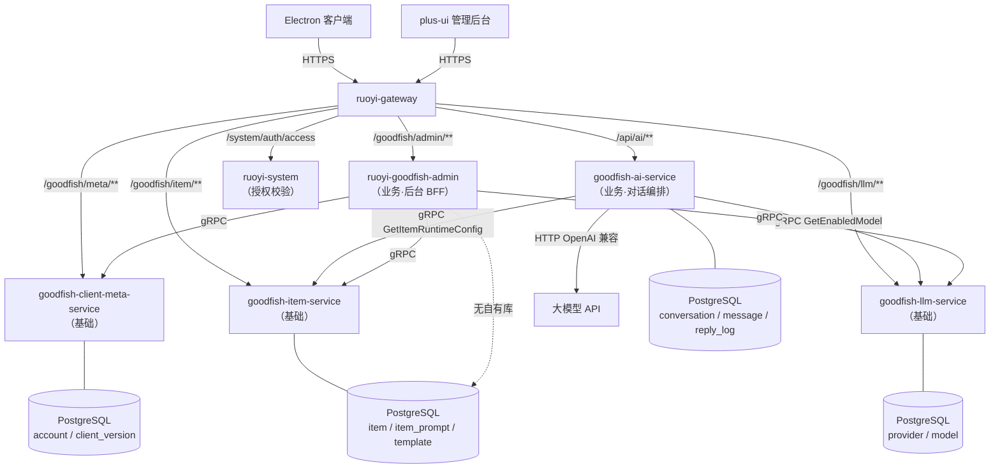

# 闲鱼自动回复系统 云端技术方案

> 版本：v3.4 ｜ 日期：2026-10-05 ｜ 状态：技术设计
> 关联文档：《云端需求.md》、《客户端监听.md》（§3 云端对话服务）、《llm模块实现.md》
> 基础框架：RuoYi-Cloud-Plus 6.0（微服务，非单体）

## v3.4 变更要点

**核心：运行时配置缓存改为"直查缓存 + 编辑即失效"，去掉 version 驱动失效的循环依赖；对话历史改为长期保留。**

| # | 变更点 | v3.3 | v3.4（本版） |
|---|---|---|---|
| 1 | **运行时配置缓存** ★ | 商品 L1 60s + L2 10min，`item_version`/`prompt_version` 驱动失效；模型 `config_version` 驱动失效 | **缓存命中直接用，不做版本回源比较**（原逻辑存在"不回源就拿不到新版本"的循环依赖）；失效 = **双保险（本期均实现）**：① 数据变更方 publish Nacos 版本键（`goodfish.item.revision` / `goodfish.llm.revision`）→ 对话服务监听清缓存 ② TTL 兜底（商品 60s / 模型 5min，防事件丢失）；版本号仅写 `ai_reply_log` 排障 |
| 2 | **对话历史生命周期** | 24h 过期 + 定时清理 | **长期保留，不做清理**（详见《客户端监听.md》§3.9 / §3.12） |

## v3.3 变更要点

**核心：对话链路收口——商品表加闲鱼账号 ID 冗余字段、图片客户端上传后端存本地磁盘、移除 send-result 上报与冗余接口、补齐空提示词/无启用模型错误码。**

| # | 变更点 | v3.2 | v3.3（本版） |
|---|---|---|---|
| 1 | **商品表账号关联** ★ | `account_id BIGINT` 需跨服务解析闲鱼 ID | `goodfish_item` **新增冗余字段 `goodfish_account_id VARCHAR(64)`（闲鱼 ID）**；对话链路按冗余字段直查，不再跨服务解析；`account_id BIGINT` 仍存 `goodfish_account.id`（同步时经 gRPC `GetAccountByGoodfishId` 解析，§7.2） |
| 2 | **图片消息** ★ | 客户端下载压缩转 base64 上报，云端直传大模型 | **图片走 URL，不出现 base64，不使用 `ruoyi-file`**：客户端下载闲鱼图片 → 转 PNG → 上传 `POST /api/ai/image` 拿 URL → `/api/ai/reply` 带 URL；后端存**服务器本地磁盘**（本版本不上云存储）并提供静态访问；对大模型只传 URL（OpenAI 多模态格式）；历史/日志存 URL（《客户端监听.md》§2.4、§3.8.1、§3.9 第 9 步、§3.11） |
| 3 | **send-result 上报** | `/api/ai/send-result`（A19） | **移除**：发送失败仅客户端本地日志（§8.1、《客户端需求.md》§14.3） |
| 4 | **history / clear 接口** | `/api/ai/conversation/history`、`/clear` | **移除**：无页面消费方；对话上下文全部由对话服务维护（§8.2） |
| 5 | **TestPrompt 提示词测试** | REST `/goodfish/llm/model/test-prompt` + gRPC `DialogService.TestPrompt` | **移除**（本期无此功能）；`dialog.proto` 仅保留 `GetConversationStats` 预留（§6.1、§6.4、§8.3.4） |
| 6 | **空提示词 / 无启用模型** | 未定义 | 商品提示词未配置 → **40402**；无启用模型 → **50002**（gRPC `NOT_FOUND`）；均不调大模型，客户端不回复（§6.5） |
| 7 | **议价功能** | `bargain_count` 计数 | **本期不做议价**：删除 `bargain_count` / `is_bargain`；改为关键词意图识别仅记日志；提示词三段场景全嵌入 + 闲聊引导（《客户端监听.md》§3.9/§3.10） |

## v3.2 变更要点

**核心：确认 PostgreSQL 改造完成；提示词内置模板落 Spring 配置；补齐鉴权身份透传与跨服务关联约定。**

| # | 变更点 | v3.1 | v3.2（本版） |
|---|---|---|---|
| 1 | **PostgreSQL** | "RuoYi 侧已切换（另一分支）" | ✅ **确认 RuoYi-Cloud-Plus 已完成改造并切换到 PostgreSQL**，全量 PG |
| 2 | **提示词归属** | 商品表 + `prompt_template` 模板表 | `goodfish_item_prompt` **与商品直接关联**；**提示词模板不建表**，改为商品服务 **Spring 配置文件内置（只读）** |
| 3 | **鉴权身份透传** | 未说明下游如何取用户身份 | 明确：Java 服务用 Sa-Token `LoginHelper`；**Python 服务由网关注入 `userId` / `userName` / `deptId` 请求头**（§3.9.2） |
| 4 | **跨服务数据关联** | 未成体系 | 新增 **§3.10**：禁止跨库 JOIN / 跨库外键，**一律 gRPC**；商品删除不级联、模型名存字符串快照、不引入分布式事务 |
| 5 | **AI 回复走网关** | 表述为"直连"（易误读） | 明确：**经网关转发**（`ruoyi-gateway` 是唯一北向入口），"直连"仅表示**不经 BFF**（§3.5） |
| 6 | **模型服务注册** | "放开已有注册注释即可" | ✅ **确认已集成 Nacos 服务注册**，无开发项 |
| 7 | **客户端随机延迟位置** | 未涉及 | 确定在**请求对话接口之前**随机延迟（原"响应后延迟"作废），见《客户端监听.md》§2.3 |

## v3.1 变更要点

**核心：按"避免透传、按需 BFF"原则精简服务数量；数据库全量统一 PostgreSQL。**

| # | 变更点 | v3.0 | v3.1（本版） |
|---|---|---|---|
| 1 | **基础微服务数量** | 4 个 | **3 个**：`goodfish-item-service` / `goodfish-client-meta-service`（账号+版本合并）/ `goodfish-llm-service` |
| 2 | **业务微服务数量** | 3 个（含 `goodfish-client-bff`） | **2 个**：**取消 `goodfish-client-bff`**，客户端各场景直连对应服务（理由见 §3.5） |
| 3 | **BFF 使用原则** | 未明确 | 明确：**只有"跨域聚合"才走 BFF，单域读写一律直连**；BFF 仅保留 `ruoyi-goodfish-admin`（后台聚合读） |
| 4 | **鉴权与授权** | 未定义落点 | **鉴权**：所有北向接口必须带 token（网关统一校验），失败 **401** → 客户端删 token + 跳登录页；**授权**：客户端主动调用，**网关不做兜底**，失败 **403** → 冻结应用。详见 §3.9 |
| 5 | **数据库** | MySQL + PostgreSQL 混用 | **全量 PostgreSQL**（RuoYi 侧已切换；模型服务 / 对话服务原生 PG）；表字段类型全部改为 PG 口径 |
| 6 | **gRPC TLS** | 待确认 | **不使用**（内网明文）；跨 VPC 时再评估 mTLS |

## v3.0 变更要点

**核心：从「RuoYi 单模块」升级为「基础微服务 + 业务微服务」的两层划分；业务微服务只做编排；服务间调用统一 gRPC。**

| # | 变更点 | v2.0 | v3.0（本版） |
|---|---|---|---|
| 1 | **架构形态** | 全部业务塞进 `ruoyi-goodfish` 一个 Java 模块 | 拆为 **4 个基础微服务 + 3 个业务微服务**；RuoYi goodfish 模块退化为**纯编排的 BFF**（无自己的表） |
| 2 | **服务间通信** | 未定义（隐含为 Dubbo/HTTP） | **统一 gRPC**：除调用大模型 API 外，所有东西向调用一律 gRPC |
| 3 | **分层原则** | 无 | 明确 **基础服务 = 单一领域能力（对应 manager 层）/ 业务服务 = 跨服务编排（对应 service 层）** |
| 4 | **对话执行链路** | 未定义 | 收敛为三段式：**① gRPC 查询商品信息 → ② 本地组装提示词 → ③ 发送对话**（详见《客户端监听.md》§3.9） |
| 5 | **提示词数据模型** | `goodfish_item.prompt_content` 单字段（装不下场景化结构） | 拆出独立表 **`goodfish_item_prompt`**（系统 + 3 场景 + 3 参数 + `prompt_version`） |
| 6 | **服务注册** | 未定义 | 每服务**双实例注册**：HTTP（北向）+ gRPC（东西向），`metadata.protocol` 区分 |
| 7 | **模型配置读取** | 未定义 | `config_version` 驱动的长缓存，稳态下对话链路上不再有模型服务这一跳 |

> 说明：`E:\project\my-biz\java\ai` 下的 `ai-goodfish` / `item` / `chat_memory` / `message_history` / `ai_model_config` 为**学习模块**，本方案参考其概念（如 `memoryId = itemId + buyerId`、按 `itemId` 计 Token），**不沿用其结构**。

---

## 一、整体架构

### 1.1 架构总览

```
┌──────────────────────────────────────────────────────────────────────┐
│                            北向（南北向）                              │
│   Electron 客户端            plus-ui 管理后台                          │
│        │ HTTPS                    │ HTTPS                             │
│        └────────────┬─────────────┘                                   │
│                     ▼                                                 │
│            ┌─────────────────┐                                        │
│            │  ruoyi-gateway  │  统一 token 鉴权 / 路由 / 限流           │
│            └────────┬────────┘                                        │
│                     │                                                 │
│   客户端与后台**全部直连**目标服务（无客户端 BFF）                       │
│   /api/ai/**  /goodfish/item/**  /goodfish/meta/**                   │
│   /goodfish/llm/**  /goodfish/admin/**  /system/auth/**              │
├─────────────────────┼────────────────────────────────────────────────┤
│                     ▼          业务微服务（只做编排）                    │
│        ┌────────────────────┐   ┌──────────────────────┐              │
│        │  goodfish-          │   │  ruoyi-goodfish-     │              │
│        │  ai-service         │   │  admin（后台 BFF）    │              │
│        │  对话编排            │   │  跨域聚合读，无自有表  │              │
│        └─────────┬──────────┘   └──────────┬───────────┘              │
│                  │       gRPC（东西向）      │                         │
│                  └───────────┬─────────────┘                          │
│                              ▼                                        │
│  ┌─────── 基础微服务（只提供能力，不做编排）───────────────────────┐    │
│  │  goodfish-item-service          商品 + 提示词配置 + 模板库       │    │
│  │  goodfish-client-meta-service   闲鱼账号 + 客户端版本            │    │
│  │  goodfish-llm-service           供应商 / 模型                   │    │
│  └────────────────────────────────────────────────────────────────┘    │
│                                                                       │
│   Nacos 注册/配置中心  ·  Redis  ·  PostgreSQL（全量统一）  ·  对象存储   │
│   复用：ruoyi-system（用户/权限/授权校验）  文件一律服务器本地磁盘（不用 ruoyi-file）│
└──────────────────────────────────────────────────────────────────────┘
```

### 1.2 设计原则

| 原则 | 说明 |
|---|---|
| **分层清晰** | 基础服务只提供单一领域能力，**不做任何跨域编排**；业务服务只做编排，**不拥有业务主数据** |
| **按需 BFF** | 只有**跨域聚合**才走 BFF（当前仅后台 `ruoyi-goodfish-admin`）；**单域读写一律直连**，透传式 BFF 是净负债（§3.5） |
| **数据归属单一** | 一张表只属于一个服务，其他服务**只能通过 gRPC 访问，禁止跨库直连** |
| **数据库统一** | 全量 PostgreSQL，每服务独立库 |
| **协议统一** | 东西向全部 gRPC；北向全部 REST + 网关鉴权；唯一例外是调用大模型 API（OpenAI 兼容 HTTP） |
| **复用 RuoYi** | 用户、权限、菜单、网关、鉴权、文件、字典等**不重复开发** |
| **无 Cookie 上天** | 云端任何服务都不存储闲鱼 Cookie（A10） |

---

## 二、技术栈

| 层级 | 选型 |
|------|------|
| 基础框架 | RuoYi-Cloud-Plus 6.0（Spring Cloud Alibaba） |
| 服务间通信 | **gRPC**（Java：`grpc-spring-boot-starter`；Go：Kratos 原生；Python：`grpcio` + `grpc.aio`） |
| 接口定义 | Protocol Buffers v3（统一放 `proto/` 目录，各服务共享） |
| 网关 | Spring Cloud Gateway |
| 注册/配置中心 | Nacos 3.2 |
| 数据库 | **PostgreSQL 全量统一**（RuoYi-Cloud-Plus 侧已切换至 PG；模型服务 / 对话服务原生 PG） |
| 缓存 | Redis 7 |
| ORM | MyBatis-Plus（Java）／GORM（Go）／SQLAlchemy async + asyncpg（Python） |
| 前端 | plus-ui（Vue3 + Element Plus） |
| 文件存储 | 服务器本地磁盘（安装包、图片） |

**PostgreSQL 落地说明**：

| 项 | 说明 |
|---|---|
| RuoYi 侧支持 | ✅ **已完成改造并切换到 PostgreSQL（在独立分支）**。官方另提供 PG 建表脚本 `script/sql/postgres/postgres_ry_cloud.sql`、`_job.sql`、`_ai.sql`、`_workflow.sql`；`ruoyi-common-mybatis` 内置 PG 驱动与方言（`DataBaseType.POSTGRE_SQL`）；数据源配置见 `script/config/nacos/datasource.yml` |
| ⚠️ 建库脚本 | **严禁使用 `script/sql/ry-cloud.sql`（MySQL 语法）**，必须用 `postgres/` 目录下脚本 |
| 分库策略 | 沿用 RuoYi 惯例：**每服务独立库** |
| 类型映射（统一口径） | `BIGINT AUTO_INCREMENT` → `BIGSERIAL`；`DATETIME` → `TIMESTAMP`；`BIT(1)` → `BOOLEAN`；`TINYINT` → `SMALLINT`；`TEXT` 不变 |
| 主键策略 | MyBatis-Plus `IdType.AUTO` 对应 PG 的 `BIGSERIAL` |
| 大小写 | PG 默认折叠为小写，Mapper XML 中避免裸大写字段名 |
| 分布式事务 | **不引入**。跨服务写操作不做强一致，各服务用本地事务 |

---

## 三、服务划分

### 3.1 划分原则：基础微服务 vs 业务微服务

| 维度 | 基础微服务（Foundation） | 业务微服务（Business） |
|---|---|---|
| **定位** | 单一领域的**能力提供方** | 面向场景的**编排方** |
| **职责** | 本领域数据的 CRUD + 查询 | 参数校验、跨服务编排、事务边界、错误码封装 |
| **依赖** | **不依赖任何其他业务服务**（最多依赖同层或基础设施） | 依赖多个基础服务 |
| **对外协议** | gRPC（东西向）＋ REST（北向，供后台/客户端） | REST（北向，经网关）＋ gRPC（被后台调用） |
| **拥有表** | 拥有本领域**全部**业务主数据表 | 只拥有**自己的过程数据表**（对话历史等） |
| **类比** | 进程内的 **manager 层** | 进程内的 **service 层** |

> 这与项目 `AGENTS.md` 的分层准则同源：**基础服务 = manager（原子能力），业务服务 = service（业务编排）**，只是从进程内分层上升为进程间分层。

### 3.2 基础微服务清单（3 个）

| 服务 | 服务名 | 领域职责 | 拥有的表 | 实现 |
|---|---|---|---|---|
| **商品服务** | `goodfish-item-service` | 商品信息的写入（客户端同步）与查询；**提示词配置**的编辑与查询；内置提示词模板（Spring 配置，只读） | `goodfish_item`、`goodfish_item_prompt`（**模板不入库**，见 §7.2） | Java / Spring Boot |
| **客户端元数据服务** | `goodfish-client-meta-service` | 闲鱼账号信息上报与查询（**不含 Cookie**）；客户端版本发布与更新检查 | `goodfish_account`、`client_version` | Java / Spring Boot |
| **模型服务** | `goodfish-llm-service` | 大模型供应商与模型的 CRUD、连接测试、全局启用 | `llm_provider`、`llm_model` | Go / Kratos（复用 `llm-manage`） |

> **关于"客户端元数据服务"**：账号与版本各只有 1 张表、接口极少、QPS 极低（客户端启动时各调一次），拆成两个进程不划算，故合并为一个部署单元。
> 但**契约仍按领域拆分为两个 proto**（`account.proto` / `version.proto`），由同一进程实现 —— 即「**契约按领域拆，部署按成本合**」。将来任一方需要独立扩容时，拆成两个进程即可，**调用方无需改动**。

**明确不拆的**：

| 候选 | 决策 | 理由 |
|---|---|---|
| 提示词独立成服务 | ❌ 不拆 | 与商品 1:1 强关联；拆开后对话服务要调两次，违背"一次批量拿全" |
| 账号 / 版本 各成服务 | ❌ 不拆 | 表小、接口少、QPS 低（见上方说明） |
| 文件独立成服务 | ❌ 不拆 | **不使用 `ruoyi-file`**（v3.3：只用 RuoYi 基础管理功能）；文件由归属服务存服务器本地磁盘并自行提供上传/下载（§十一） |
| 授权独立成服务 | ❌ 不拆 | 复用 `ruoyi-system` 用户表（《云端需求.md》§4.4 已明确） |

### 3.3 复用 RuoYi 自带能力（不重复开发）

| 能力 | 提供方 | 说明 |
|---|---|---|
| 登录 / 鉴权 / Token | `ruoyi-system` + 网关 | A2、A27、A40 |
| 授权校验 | `ruoyi-system` | 独立接口 `/system/auth/access`，客户端主动调用；**网关不做兜底**（见 §3.9）；A41、A42、A43 |
| 用户 / 部门 / 岗位 / 角色 | `ruoyi-system` | 管理后台账号体系 |
| ~~文件上传 / 下载~~ | ~~`ruoyi-file`~~ | **不使用**（v3.3）：安装包、商品图片、聊天图片一律由归属服务存服务器本地磁盘（§十一） |
| 字典 / 操作日志 | `ruoyi-system` | 状态枚举、审计 |

### 3.4 业务微服务清单（2 个，全部只做编排）

| 服务 | 服务名 | 编排的基础服务 | 拥有的表 |
|---|---|---|---|
| **大模型对话服务** | `goodfish-ai-service` | 商品服务（取商品+提示词）＋ 模型服务（取启用模型）＋ 大模型 API | `ai_conversation`、`ai_conversation_message`、`ai_reply_log` |
| **管理后台服务（BFF）** | `ruoyi-goodfish-admin` | 商品 ＋ 模型 ＋ 客户端元数据（跨域聚合读） | 无 |

> **`ruoyi-goodfish-admin` 就是原 `ruoyi-goodfish` 模块**，但**不再持有任何表**——它从"业务实现模块"降级为"后台 BFF"，所有数据访问改为 gRPC 调用基础服务。这是本次架构最大的变化。

### 3.5 BFF 使用原则与直连裁定（v3.1 确定）

> **规则：只有「跨域聚合」或「为特定端裁剪」才走 BFF；单域读写一律直连。**

| | 说明 |
|---|---|
| **BFF 的价值** | 聚合多次跨服务调用；为特定端定制响应；集中横切关注点（鉴权 / 错误码 / 限流）；作为后端演进的缓冲 |
| **BFF 的代价** | 多一跳（延迟 + 故障点）；极易长成"上帝服务"；**纯透传是净负债** |

据此逐个场景裁定：

> **"直连"的准确含义**：客户端与后台**始终经网关**（`ruoyi-gateway` 是唯一北向入口）；这里的"直连"指**不经 BFF**、由网关直接转发到目标服务。

| 场景 | 类型 | 走法 | 理由 |
|---|---|---|---|
| **AI 回复** `/api/ai/reply` | 写 · 核心 | 客户端 → **网关转发** → `goodfish-ai-service` | 经网关鉴权后转发；**不落 BFF**（无聚合需求）；发送结果不上报云端（v3.3） |
| 账号上报 | 写 · 单域 | 客户端 → **网关转发** → 客户端元数据服务 | 透传无收益 |
| 商品同步 | 写 · 单域 | 客户端 → **网关转发** → 商品服务 | 透传无收益 |
| 版本检查 | 读 · 单域 | 客户端 → **网关转发** → 客户端元数据服务 | 透传无收益 |
| 授权校验 | 读 · 单域 | 客户端 → **网关转发** → `ruoyi-system` | 客户端主动调用（启动 + 每小时）；网关只校验 token，不做授权兜底（§3.9） |
| **仪表盘统计** | 读 · 跨域 | plus-ui → 网关 → **admin BFF** | 真聚合：账号数 + 商品数 |
| **商品列表（带账号名）** | 读 · 跨域 | plus-ui → 网关 → **admin BFF** | 真聚合：商品 + 账号 |
| 商品编辑 / 删除 / 复制提示词 | 写 · 单域 | plus-ui → **网关转发** → 商品服务 | 单域 CRUD |
| 提示词模板查看 | 读 · 单域 | plus-ui → **网关转发** → 商品服务 | 模板来自 Spring 配置，只读（§4.1） |
| 模型 / 供应商 CRUD | 写 · 单域 | plus-ui → **网关转发** → 模型服务 | 单域 CRUD |

**结论：不设客户端 BFF。**

- 原 v3.0 的 `goodfish-client-bff` **取消**
- 客户端场景**几乎全是单域**；即使"启动初始化"（授权 + 账号 + 版本）用 3 个并发请求，成本也远低于维护一个常驻服务
- 后台保留 `ruoyi-goodfish-admin` 作为 BFF，因为它确实存在跨域聚合读

### 3.6 编排关系图



> **客户端不经过任何 BFF**：AI 回复直连对话服务，账号/商品/版本直连对应基础服务，授权校验直连 `ruoyi-system`。

### 3.7 服务调用矩阵

| 调用方 | 被调方 | 协议 | 通道 | 鉴权 | 超时 | 缓存 |
|---|---|---|---|---|---|---|
| 客户端 | 网关 | HTTPS | 北向 | login token | 90s | — |
| 网关 | ai-service / 商品 / 客户端元数据 / 模型 / admin BFF / system | HTTP | 北向 | token 透传 | 75s | — |
| **ai-service** | **商品服务** | **gRPC** | Nacos 直连 | 身份透传 | 3s | 缓存命中即用；失效双保险：**编辑即失效**（publish `goodfish.item.revision`）+ **TTL 60s** |
| **ai-service** | **模型服务** | **gRPC** | Nacos 直连 | 身份透传 | 3s | 缓存命中即用；失效双保险：**变更即失效**（publish `goodfish.llm.revision`）+ **TTL 5min** |
| ai-service | 大模型 API | HTTPS | 外网 | API Key | 单次 30s，总 ≤ 65s | — |
| admin BFF | 商品 / 模型 / 客户端元数据 | **gRPC** | Nacos 直连 | 身份透传 | 5s | — |
| admin BFF | `ruoyi-system` | gRPC | Nacos 直连 | 身份透传 | 3s | — |

> **超时预算**：客户端 90s > 网关 75s > 对话服务最坏路径 65s，逐层收窄，避免"网关先超时而下游仍在跑"引发重试风暴。
>
> **内部 gRPC 的"鉴权"**：**不引入自定义服务间令牌**。调用方通过 gRPC Metadata 透传统一的身份头 `X-User-Id` / `X-User-Info` / `Authorization` / `X-Client-Id`（`X-Client-Id` 取服务名），服务端拦截器还原用户上下文——对齐 `xxs-micro/doc/架构.md` §3.1 的统一身份透传规范。**内部接口的保护方式是网络隔离**：不过网关，只在集群内网暴露 gRPC 端口（K8s NetworkPolicy / 安全组限制来源）。Python 侧对称实现见《gRPC与Nacos服务发现技术方案.md》§6.6。
>
> **网关不做授权兜底**：网关只做 token 有效性校验（RuoYi 自带能力），**不引入业务授权判定**——详见 §3.9。

### 3.8 服务注册与端口约定

> **详细实现见《gRPC与Nacos服务发现技术方案.md》**（含可复用 Python 库 `xxs-nacos-grpc` 的设计、代码与验证清单）。本节只定义**跨语言的注册契约**。

每个服务**同时暴露两个端口**，因此**注册成两个独立的 Nacos 服务**（不是同一服务名下的两个实例）：

| Nacos 服务名 | port | 协议 | 消费方 |
|---|---|---|---|
| `{app}` | 8000 / 8080 | HTTP | 网关（北向 `lb://{app}`） |
| `{app}-grpc` | 9000 | gRPC | 内部服务（东西向，直连） |

例：`goodfish-item-service` / `goodfish-item-service-grpc`、`goodfish-llm-service` / `goodfish-llm-service-grpc`。

**注册契约**：

| 项 | 约定 |
|---|---|
| **服务名规则** | `{app}`（HTTP）/ `{app}-grpc`（gRPC），**后缀仅用于注册时推断 `metadata.protocol`** |
| **group** | `DEFAULT_GROUP` |
| **namespace** | 按环境隔离（`goodfish-dev` / `goodfish-test` / `goodfish-prod`） |
| **metadata** | `protocol`（http/grpc）、`secure`、`cluster`；可追加 `env`、`version` |
| **ephemeral** | `True`（临时实例，依赖客户端心跳保活；**不设 False**，否则 Nacos 会主动探 `healthUrl`） |
| **注册 IP** | 真实网卡 IP，**禁止 `0.0.0.0`** |

消费规则：
- **网关**用 `lb://{app}` 消费 HTTP 服务名
- **内部 gRPC 客户端**订阅 `{app}-grpc`，**只按服务名 + group + namespace 查询**，并在客户端做 `enabled and healthy` 过滤
- **发现侧不解析后缀、不按 metadata 过滤**——唯一的硬性要求是「提供方注册的服务名 == 消费方配置的服务名」，一字不差

> **不要用"同一服务名 + `metadata.protocol` 过滤"的方案**：gRPC 客户端无法在 target 里表达 metadata 条件，会退化成"查到 HTTP 实例却发现端口不通"，且订阅侧过滤逻辑各语言实现不一致，极易踩坑。

### 3.9 鉴权与授权（v3.1 确定）

#### 3.9.1 两个层次必须分清

| 层次 | 判定对象 | 谁来做 | 失败响应 | 客户端处理 |
|---|---|---|---|---|
| **鉴权**（Authentication） | token 是否有效 / 是否过期 | **网关统一校验**（RuoYi 自带） | HTTP **401** | **删除本地 token + 跳转登录页**，不自动重登（A27） |
| **授权**（Authorization） | 该用户是否有使用权限（是否在授权期内） | **客户端主动调用** | HTTP **403** + 业务码 `40301` | **停止所有监听 + 弹窗 + 冻结应用**，只允许退出（A42） |

> **为什么必须区分**：401 是"没登录 / 登录过期"，**重新登录可解决**；403 是"登录了但没权限"，**重新登录解决不了**，必须联系管理员。两者若混用同一错误码，客户端会出现"跳到登录页—重登—又被拒"的死循环。

#### 3.9.2 鉴权：所有接口必须带 token

| 项 | 约定 |
|---|---|
| **覆盖范围** | 除白名单外，**所有北向接口都必须携带 token**（客户端接口 + 管理后台接口） |
| **白名单** | 由 RuoYi 网关配置 `security.ignore.whites` 管理（登录、验证码等）；`/favicon.ico`、`/actuator/**`、`/error` 已内置放行 |
| **传递方式** | HTTP Header：`Authorization: Bearer <token>` |
| **校验位置** | **网关统一校验** —— RuoYi-Cloud-Plus 6.x 由 `AuthFilter`（Sa-Token `SaServletFilter`）执行 `StpUtil.checkLogin()`，**零开发项** |
| **附加校验** | 网关还会校验 `clientid` 请求头与 token 是否匹配（RuoYi 内置 `LoginHelper.CLIENT_KEY`） |
| **失败响应** | Sa-Token 抛 `NotLoginException` → 网关返回 **401**（RuoYi `HttpStatus.UNAUTHORIZED`） |

**下游服务如何拿到用户身份**：

| 下游类型 | 方式 |
|---|---|
| **Java 服务**（商品 / 客户端元数据 / 模型 / admin BFF） | 直接使用 Sa-Token：`LoginHelper.getUserId()` / `LoginHelper.getLoginUser()`，**不重复解析 token**（token 已在 header 中透传，Sa-Token 从共享 Redis 取 session） |
| **Python 服务**（`goodfish-ai-service`） | 无法使用 Sa-Token SDK → **由网关在转发时注入用户身份请求头**，Python 侧直接读取 |

**网关转发的请求头清单**：

| 请求头 | 含义 | 来源 |
|---|---|---|
| `Authorization` | 原始 token（透传） | 客户端 |
| `clientid` | 客户端 ID | 客户端 |
| `userId` | 登录用户 ID | 网关从 Sa-Token session 提取（头名沿用 `LoginHelper.USER_KEY`） |
| `userName` | 登录用户名 | 同上（`LoginHelper.USER_NAME_KEY`） |
| `deptId` | 部门 ID | 同上（`LoginHelper.DEPT_KEY`） |

> **改造量**：网关侧新增/扩展一个 filter，在 `AuthFilter` 校验通过后把上述身份字段写入请求头（**约十行代码，仅"搬运身份"，不含任何授权判定**）。
>
> Python 服务把 `userId` 存入请求上下文（用于日志与审计）；**业务标识仍用请求体里的 `goodfish_account_id`，不依赖 `userId`**。

### 3.10 跨服务数据关联约定

> **原则：不允许跨库 JOIN，也不允许跨库外键；跨服务关联一律通过 gRPC 调用。**

#### 3.10.1 各关联场景的处理

| 场景 | 约定 |
|---|---|
| **商品 ↔ 对话历史** | 对话历史在对话服务、商品在商品服务。**不建外键**；对话表只存 `account_id` + `item_id` |
| **商品删除** | 商品服务**软删除**，**不级联删除对话历史**。如需清理，由 **admin BFF 编排**：先调商品服务删除 → 再调对话服务清理该商品历史（两步非事务，最终一致） |
| **商品被删后仍有消息进来** | 对话服务 gRPC 取配置返回 `NOT_FOUND` → 返回 40401 → 客户端不回复 |
| **模型 ↔ 供应商** | 同库同服务（`llm_provider` / `llm_model`），**服务内**用外键/应用层校验；删除供应商前校验是否存在关联模型 |
| **模型 ↔ 对话历史** | 对话消息表只存 `model_name`（**字符串快照**），不存 `model_id`；模型被删不影响历史可读 |
| **模型启用状态变更** | 模型服务递增 `config_version` **并 publish Nacos 版本键 `goodfish.llm.revision`**；对话服务监听后清缓存（v3.4 改为事件驱动，替代原"按版本回源比较"） |
| **账号 ↔ 商品** | 商品表存 `account_id`；删除账号前校验是否仍有商品（由 admin BFF 编排），**不级联删商品** |
| **后台的关联查询** | 「商品 + 账号名」由 admin BFF **分别 gRPC 调用后内存拼装**，不在数据库层关联 |

#### 3.10.2 ID 引用还是字符串快照

| 数据类型 | 约定 | 理由 |
|---|---|---|
| 需要**跨服务实时取明细**的（如商品） | 存 **ID**，实时 gRPC 查询 | 保证数据最新 |
| 只需**展示历史快照**的（如模型名、账号昵称） | 存 **字符串快照** | 避免下游删除/改名导致历史记录残缺 |

#### 3.10.3 事务策略

**不引入分布式事务（Seata 等）。**

- 跨服务写操作不做强一致，采用「**先完成主体操作，再尽力清理**」的最终一致策略
- 失败可重试；清理失败不影响主流程可用性（记日志 + 告警）
- 各服务内部仍使用**本地事务**（如对话服务的「落消息 + 更新会话」在同一事务）

#### 3.9.3 授权：客户端主动校验

**决策：网关不做业务授权判定**（不引入授权状态查询、不加兜底 filter）。

| 理由 | 说明 |
|---|---|
| 职责边界 | 网关只做"认证 + 路由 + 限流"；授权是**业务语义**，放入网关会让基础设施依赖业务数据 |
| 成本 | 网关为每个请求查一次授权状态（或维护缓存），收益不匹配 |
| 已有覆盖 | token 校验已覆盖"未登录 / 登录过期"；客户端每小时主动校验覆盖"授权到期" |

**授权校验接口**：

| 接口 | 方法 | 提供方 | 返回 |
|---|---|---|---|
| `/system/auth/access` | GET | `ruoyi-system` | 授权状态：有效 / 过期 / 未授权 |

**客户端调用时机**（对应 A40、A41）：

```
1. 应用启动时调用一次
2. 运行中每小时调用一次
```

**授权失效的处理时序**（A42）：

```
客户端收到 403 / 40301（授权过期或未授权）
  ├─ 删除本地 token（无权限，留着无意义）
  ├─ 调本地 POST /api/account/stop-all  → 停止所有监听
  ├─ 弹窗"授权已过期"（不提供重新登录入口）
  ├─ 应用冻结，只允许退出
  └─ 不再发起任何云端调用
```

**接口不可用（云端异常）**（A43）：按 A43 处理 —— 停止所有监听 + 弹窗"服务器异常，请联系管理员" + 冻结应用。**用与 403 不同的错误码**（503 类），避免与"授权过期"混淆。

#### 3.9.4 已签发 token 的处理（不做特殊处理）

**决策：用户被禁用 / 授权过期后，已签发的 token 不做主动失效处理。**

| 场景 | 处理 |
|---|---|
| 用户被禁用 / 授权过期 | 客户端在**下一次授权校验**（启动时或每小时）得到无权限 → **删除本地 token** + 停止监听 + 冻结应用 |
| 已签发但仍有效的 token | **不主动失效**，不做特殊处理 |
| 后续若因此出现问题 | 届时再处理（本期不做） |

> 即：**不引入"服务端 token 黑名单 / 强制下线"机制**，依赖客户端主动校验兜住。客户端校验是 A40/A41 的验收项，不可省略。

---

## 四、基础微服务详细设计

### 4.1 商品服务 `goodfish-item-service`

| 项 | 内容 |
|---|---|
| **职责** | ① 商品同步落库（客户端上报，upsert）② 商品查询 ③ **提示词配置** CRUD（**随商品直接关联**）④ 提供**商品 + 提示词运行时配置**（供对话服务 gRPC 查询） |
| **不负责** | 不渲染提示词、不调用大模型、不感知对话 |
| **拥有的表** | `goodfish_item`、`goodfish_item_prompt`（**与商品一对一直接关联**） |
| **提示词模板** | **不建表**：内置模板放在 **Spring 配置文件**（如 `goodfish-prompt-templates.yml`），应用启动加载为**只读**常量，供后台"从模板导入"使用；不提供模板增删改 |
| **gRPC** | `GetItemRuntimeConfig`、`BatchGetItemRuntimeConfig` —— **对话服务通过 gRPC 查询商品与提示词** |
| **REST（北向）** | `/goodfish/item/**`（后台 CRUD）、`/goodfish/item/client/sync`（客户端同步，经网关转发） |
| **关键逻辑** | 同步只增不删（A11）；已存在商品**保留提示词配置**；商品 `version` 与提示词 `prompt_version` 每次变更 +1 |

**与对话服务的数据边界（明确）**：

- 对话服务**不直连本服务的库**，也不拉取整表；只通过 `ItemService.GetItemRuntimeConfig` 按 `(account_id, item_id)` 取**单条**运行时配置
- 商品或提示词变更后，**由本服务 publish Nacos 版本键 `goodfish.item.revision`**，对话服务监听后清空本地缓存；`item_version` / `prompt_version` 递增仅用于排障对账（v3.4）
- 商品被删除后，`GetItemRuntimeConfig` 返回 `NOT_FOUND` → 对话服务返回 40401，客户端不回复

### 4.2 客户端元数据服务 `goodfish-client-meta-service`

**一个部署单元，两个 gRPC 服务**（契约按领域拆、部署按成本合，见 §3.2 说明）。

| 项 | 内容 |
|---|---|
| **职责** | ① 闲鱼账号信息 upsert（客户端上报）② 账号列表/详情查询、备注修改、最后活跃时间维护<br/>③ 客户端版本发布（版本号、更新说明、强升标记、安装包地址与大小）④ 更新检查 |
| **不负责** | **绝不存储 Cookie**（A10）；不做登录鉴权；不做授权判定（那是 `ruoyi-system`，见 §3.9） |
| **拥有的表** | `goodfish_account`、`client_version` |
| **gRPC（账号域）** | `AccountService.UpsertAccount` / `GetAccount` / `ListAccounts` |
| **gRPC（版本域）** | `VersionService.CheckUpdate` |
| **REST（北向）** | `/goodfish/meta/account/**`、`/goodfish/meta/version/**`（后台 + 客户端**直连**） |
| **关键逻辑** | 账号按 `goodfish_id` upsert（已有则更新昵称/备注/有效性）；强升版本无"以后再说"（A15）；安装包存服务器本地磁盘，由本服务提供上传/下载（§十一） |

### 4.3 模型服务 `goodfish-llm-service`

| 项 | 内容 |
|---|---|
| **职责** | ① 供应商 CRUD（名称、base_url、api_key 加密）② 模型 CRUD ③ 连接测试 ④ 全局启用（同一时间仅一个模型启用）⑤ 提供**启用模型完整配置**（含解密后 API Key） |
| **不负责** | 不做对话编排、不持久化对话、不做提示词 |
| **拥有的表** | `llm_provider`、`llm_model` |
| **gRPC** | `GetEnabledModel`、`ReportUsage`（Token 计量回传，可选） |
| **REST（北向）** | `/goodfish/llm/**`（后台 CRUD + 测试连接，经网关转发） |
| **服务注册** | ✅ **已集成 Nacos 服务注册**（Go/Kratos 侧已接入，无需开发项）；需按 §3.8 注册 **HTTP + gRPC 双实例** |
| **实现** | 复用现有 `backend/llm-manage`（Go/Kratos）；详见《llm模块实现.md》 |

---

## 五、业务微服务详细设计

### 5.1 大模型对话服务 `goodfish-ai-service`

**核心编排服务，三段式执行链路。**

```
┌─── ① 查询商品信息（gRPC）───┐
│  ItemService.GetItemRuntimeConfig(account_id, item_id)
│  → 商品(title/desc/price/stock_status) + 提示词(system/price/tech/default + 3 参数 + versions)
└──────────────┬──────────────┘
               ▼
┌─── ② 组装提示词（本地）────┐
│  取/建对话 → 取历史 → 意图识别(仅记日志) → 变量替换 + 三段场景全嵌入
│  → messages = [system, ...history, 当前消息(含图片)]
└──────────────┬──────────────┘
               ▼
┌─── ③ 发送对话 ────────────┐
│  LlmService.GetEnabledModel()（缓存命中则跳过）
│  → 调大模型（HTTP，OpenAI 兼容）
│  → 落库（对话消息 + Token + 回复日志）→ 写幂等 → 返回
└───────────────────────────┘
```

| 项 | 内容 |
|---|---|
| **职责** | 对话编排、提示词渲染、大模型调用、对话历史维护、Token 统计、幂等 |
| **不负责** | 不存商品、不存提示词配置、不存模型配置 |
| **拥有的表** | `ai_conversation`、`ai_conversation_message`、`ai_reply_log` |
| **REST（北向）** | `POST /api/ai/reply`（唯一北向业务接口；原 history / clear 已移除，v3.3） |
| **gRPC（被后台调用）** | `GetConversationStats`（预留，本期未启用；原 TestPrompt 已移除） |
| **详细设计** | 见《客户端监听.md》§3（执行链路 §3.9、Nacos §3.4、幂等 §3.8.4、表 §3.11） |

### 5.2 管理后台服务 `ruoyi-goodfish-admin`

| 项 | 内容 |
|---|---|
| **职责** | 原 `ruoyi-goodfish` 模块，**降级为后台 BFF**：为 plus-ui 提供页面接口，数据全部通过 gRPC 从基础服务获取 |
| **拥有表** | **无**（这是本次架构最大的变化） |
| **编排场景** | ① 仪表盘统计：账号数（客户端元数据服务）＋ 商品数（商品服务）<br/>② 商品列表：商品服务 + 客户端元数据服务（拼账号名、账号昵称）<br/>③ 提示词复制到其他商品：商品服务（保持"复制后独立编辑"语义）<br/>④ 版本发布：客户端元数据服务（安装包上传存本地磁盘） |
| **保留** | RuoYi 的登录鉴权、菜单权限、操作日志 |
| **不承担** | 模型/供应商管理的**透传**——plus-ui 直连模型服务（§3.5 裁定） |

#### 5.2.1 为什么不设客户端 BFF

原 v3.0 计划过 `goodfish-client-bff`，v3.1 **取消**，理由：

| 论点 | 说明 |
|---|---|
| 客户端场景几乎全是单域 | AI 回复、账号上报、商品同步、版本检查、授权校验，每个都只落在一个服务上，**BFF 只能做透传** |
| 透传是净负债 | 多一跳延迟 + 多一个故障点 + 多一套部署，却没有任何聚合收益 |
| 启动初始化不值得 | "授权 + 账号 + 版本"用 3 个并发请求即可，成本远低于维护常驻服务 |
| 客户端只多记几个前缀 | 用统一前缀族解决：`/api/ai/**`、`/goodfish/item/**`、`/goodfish/meta/**`、`/goodfish/llm/**`，封装在客户端一个 `CloudClient` 里，对 UI 无感 |

> 若后续真的出现"客户端需要一次拿到多域聚合数据"的场景，再按 §3.5 规则单独引入 BFF，届时不改动任何基础服务。

---

## 六、gRPC 契约

### 6.1 契约清单

| proto 文件 | 服务 | 方法 | 提供方 |
|---|---|---|---|
| `item/v1/item.proto` | `item.v1.ItemService` | `GetItemRuntimeConfig`、`BatchGetItemRuntimeConfig` | `goodfish-item-service` |
| `llm/v1/llm.proto` | `llm.v1.LlmService` | `GetEnabledModel`、`ReportUsage` | `goodfish-llm-service` |
| `account/v1/account.proto` | `account.v1.AccountService` | `UpsertAccount`、`GetAccount`、`GetAccountByGoodfishId`、`ListAccounts` | `goodfish-client-meta-service` |
| `version/v1/version.proto` | `version.v1.VersionService` | `CheckUpdate` | `goodfish-client-meta-service`（**同进程，两个 proto**） |
| `dialog/v1/dialog.proto` | `dialog.v1.DialogService` | `GetConversationStats`（`TestPrompt` 已移除，v3.3） | `goodfish-ai-service` |

> - proto 统一放在仓库根 `proto/` 目录，各服务通过 Maven / Go module / Python 包引用同一份定义，**避免契约漂移**
> - **契约按领域拆、部署按成本合**：`account.proto` 与 `version.proto` 由同一个 `goodfish-client-meta-service` 进程实现；将来若要拆成两个进程，**调用方无需改动**
> - **服务发现**：gRPC 调用经 Nacos 发现，注册/发现契约与 Python 侧统一约定见《gRPC与Nacos服务发现技术方案.md》
> - ⚠️ `dialog.v1.DialogService`（由 `goodfish-ai-service` 提供）**本期尚未启用**——当前只有「Python → Java」方向的 gRPC 调用；该服务启用时，`goodfish-ai-service` 才需要额外注册 `goodfish-ai-service-grpc`

### 6.2 item.proto（商品服务）

```protobuf
// proto/item/v1/item.proto
syntax = "proto3";
package item.v1;

service ItemService {
  // 单商品运行时配置（对话服务主用）
  rpc GetItemRuntimeConfig(GetItemRuntimeConfigRequest) returns (ItemRuntimeConfig);
  // 批量（预留：后台批量测试 / 预热）
  rpc BatchGetItemRuntimeConfig(BatchGetItemRuntimeConfigRequest)
      returns (BatchGetItemRuntimeConfigResponse);
}

message GetItemRuntimeConfigRequest {
  string account_id = 1;   // 闲鱼账号 ID（商品按账号隔离）
  string item_id    = 2;   // 闲鱼商品 ID
}

message ItemRuntimeConfig {
  string item_id      = 1;
  string title        = 2;
  string description  = 3;
  string price        = 4;   // 用 string 避免浮点精度问题（如 199.90）
  string stock_status = 5;
  string image_url    = 6;
  PromptConfig prompt = 7;
  int64  item_version = 8;   // 商品数据版本，用于排查缓存不一致
}

message PromptConfig {
  string system_prompt    = 1;   // 系统提示词（人设 + 核心原则）
  string price_prompt     = 2;   // 议价场景
  string tech_prompt      = 3;   // 技术场景
  string default_prompt   = 4;   // 默认场景
  int32  max_reply_length = 5;   // 默认 50
  double temperature      = 6;   // 默认 0.7
  int32  max_tokens       = 7;   // 默认 2048
  int64  prompt_version   = 8;   // 提示词版本，驱动对话服务缓存失效
}

message BatchGetItemRuntimeConfigRequest {
  string account_id = 1;
  repeated string item_ids = 2;
}

message BatchGetItemRuntimeConfigResponse {
  repeated ItemRuntimeConfig configs = 1;
}
```

### 6.3 llm.proto（模型服务）

```protobuf
// proto/llm/v1/llm.proto
syntax = "proto3";
package llm.v1;

service LlmService {
  // 获取当前启用的模型完整配置（含解密后 API Key，仅内网）
  // 无启用模型时返回 NOT_FOUND → 对话服务映射为 50002（客户端不回复，v3.3）
  rpc GetEnabledModel(GetEnabledModelRequest) returns (EnabledModel);
  // Token 用量回传（可选，用于成本核算）
  rpc ReportUsage(ReportUsageRequest) returns (ReportUsageResponse);
}

message GetEnabledModelRequest {
  int64 known_version = 1;   // 仅作参考；v3.4 起不再用于"未变更"短路（缓存失效改由版本键事件驱动）
}

message EnabledModel {
  int64  id            = 1;
  string provider_name = 2;
  string base_url      = 3;
  string api_key       = 4;   // 明文，仅内网传输，不入日志
  string model_name    = 5;   // 如 gpt-4o / qwen-max
  double temperature   = 6;
  int32  max_tokens    = 7;
  int64  config_version = 8;  // 配置版本（排障用；v3.4 起缓存失效改由版本键事件驱动）
}

message ReportUsageRequest {
  string item_id = 1;
  string model_name = 2;
  int32 prompt_tokens = 3;
  int32 completion_tokens = 4;
}

message ReportUsageResponse { bool success = 1; }
```

### 6.4 account.proto / version.proto / dialog.proto

```protobuf
// proto/account/v1/account.proto
syntax = "proto3";
package account.v1;

service AccountService {
  rpc UpsertAccount(UpsertAccountRequest) returns (AccountInfo);
  rpc GetAccount(GetAccountRequest) returns (AccountInfo);
  // 按闲鱼 ID 查账号（v3.3：商品同步落库时解析 account_id 用，消除跨库映射空白）
  rpc GetAccountByGoodfishId(GetAccountByGoodfishIdRequest) returns (AccountInfo);
  rpc ListAccounts(ListAccountsRequest) returns (ListAccountsResponse);
}

message UpsertAccountRequest {
  string goodfish_id       = 1;
  string goodfish_nickname = 2;
  string remark            = 3;
  bool   is_valid          = 4;
}
message AccountInfo {
  int64  id = 1;
  string goodfish_id = 2;
  string goodfish_nickname = 3;
  string remark = 4;
  bool   is_valid = 5;
  string last_active_at = 6;
}
message GetAccountRequest { int64 id = 1; }
message GetAccountByGoodfishIdRequest { string goodfish_id = 1; }
message ListAccountsRequest { int32 page = 1; int32 page_size = 2; }
message ListAccountsResponse { repeated AccountInfo list = 1; int64 total = 2; }
```

```protobuf
// proto/version/v1/version.proto
syntax = "proto3";
package version.v1;

service VersionService {
  rpc CheckUpdate(CheckUpdateRequest) returns (CheckUpdateResponse);
}

message CheckUpdateRequest { string current_version = 1; }

message CheckUpdateResponse {
  bool   has_update     = 1;
  string latest_version = 2;
  string release_notes  = 3;
  bool   force_update   = 4;
  string download_url   = 5;
  int64  file_size      = 6;
}
```

```protobuf
// proto/dialog/v1/dialog.proto
syntax = "proto3";
package dialog.v1;

// 供管理后台调用（统计；TestPrompt 已移除，v3.3）
service DialogService {
  rpc GetConversationStats(GetConversationStatsRequest) returns (GetConversationStatsResponse);
}

message GetConversationStatsRequest { int64 days = 1; }
message GetConversationStatsResponse { int64 conversation_count = 1; int64 message_count = 2; }
```

### 6.5 gRPC 状态码 → 业务错误码映射

| gRPC Status | 业务错误码 | 客户端处理 |
|---|---|---|
| `OK` | 0 | 发送回复 |
| `UNAUTHENTICATED` | 40101 | **删 token + 跳登录页**（A27，§3.9.3） |
| `PERMISSION_DENIED` | 40301 | **停止监听 + 冻结应用**（A42，§3.9.3） |
| `NOT_FOUND`（商品服务） | 40401 | 不回复（A30） |
| `NOT_FOUND`（模型服务，无启用模型）★ | 50002 | 不回复、不重试，记日志（云端配置错误，管理端需启用模型，v3.3） |
| `INVALID_ARGUMENT` | 40001 | 不回复，记日志（属客户端 Bug） |
| `DEADLINE_EXCEEDED` | 50301 | 重试 3 次，仍失败进入"仅监听不回复"（A21） |
| `UNAVAILABLE` | 50301 | 同上 |
| 其他 | 50001 | 不回复（TODO：降级策略） |

> 另有 **40402（商品未配置提示词）**：商品服务返回配置但 `system_prompt` 为空时由对话服务自身判定返回，不调大模型，客户端不回复（v3.3）。

---

## 七、数据库表设计

### 7.1 表归属总览

**全量 PostgreSQL，每服务独立库。**

| 服务 | 拥有的表 | 库 |
|---|---|---|
| `goodfish-item-service`（商品服务） | `goodfish_item`、`goodfish_item_prompt`（提示词模板不建表，见 §7.2） | PostgreSQL |
| `goodfish-client-meta-service`（客户端元数据服务） | `goodfish_account`、`client_version` | PostgreSQL |
| `goodfish-llm-service`（模型服务） | `llm_provider`、`llm_model` | PostgreSQL |
| `goodfish-ai-service`（对话服务） | `ai_conversation`、`ai_conversation_message`、`ai_reply_log` | PostgreSQL |
| `ruoyi-system` 等 RuoYi 各服务 | `sys_*` 等（RuoYi 自带） | PostgreSQL |

> **两条红线**：
> 1. 任何服务都不得直连不属于自己的库
> 2. RuoYi 侧建库必须用 `script/sql/postgres/postgres_ry_*.sql`，**不得用 MySQL 脚本**

### 7.2 商品服务表

**表：`goodfish_item`（商品表）**

| 字段 | 类型（PG） | 说明 |
|------|------|------|
| id | BIGSERIAL | 主键，自增 |
| account_id | BIGINT | 关联 `goodfish_account.id`（业务主键，同步时经 gRPC `GetAccountByGoodfishId` 解析） |
| goodfish_account_id | VARCHAR(64) | ★v3.3 冗余字段：闲鱼账号 ID——**对话链路按此字段直查**（`GetItemRuntimeConfig.account_id` 即闲鱼 ID），不做跨服务解析 |
| goodfish_item_id | VARCHAR(64) | 闲鱼商品 ID |
| title | VARCHAR(256) | 商品标题 |
| description | TEXT | 商品描述 |
| price | NUMERIC(10,2) | 价格 |
| stock_status | VARCHAR(32) | 库存状态 |
| image_url | VARCHAR(500) | 商品主图 |
| version | BIGINT | 数据版本，每次同步变更 +1（缓存失效依据） |
| sync_time | TIMESTAMP | 最后同步时间 |
| create_dept / create_by / create_time / update_by / update_time | — | RuoYi 自带字段（`*_time` 均为 `TIMESTAMP`） |

**索引**：`uk_gfid_item(goodfish_account_id, goodfish_item_id)` 联合唯一索引（v3.3：以闲鱼 ID 冗余字段为准）；`account_id` 保留普通索引供后台按账号聚合

> **冗余字段一致性**：`goodfish_account_id` 与账号表 `goodfish_account.goodfish_id` 同源（客户端上报），账号昵称变更不影响该 ID；后台改名等操作不触碰此字段，无同步负担。

> ⚠️ 原 `prompt_content TEXT` 字段**已移除**，提示词迁至独立表（见下）。

**表：`goodfish_item_prompt`（商品提示词配置）** ★新增

| 字段 | 类型（PG） | 说明 |
|------|------|------|
| id | BIGSERIAL | 主键，自增 |
| item_id | BIGINT | 关联 `goodfish_item.id`，**唯一索引**（一对一） |
| system_prompt | TEXT | 系统提示词（人设 + 核心原则） |
| price_prompt | TEXT | 议价场景提示词 |
| tech_prompt | TEXT | 技术场景提示词 |
| default_prompt | TEXT | 默认场景提示词 |
| max_reply_length | INTEGER | 最大回复字数，默认 50 |
| temperature | NUMERIC(3,2) | 温度，默认 0.70 |
| max_tokens | INTEGER | 最大输出 token，默认 2048 |
| prompt_version | BIGINT | 每次编辑 +1，作为 gRPC 返回值驱动对话服务缓存失效 |
| create_dept / create_by / create_time / update_by / update_time | — | RuoYi 自带字段 |

**提示词模板（不建表，放 Spring 配置文件）**

内置模板放在**商品服务的 Spring 配置文件**（如 `goodfish-prompt-templates.yml`），应用启动时加载为只读常量：

```yaml
# goodfish-item-service: src/main/resources/goodfish-prompt-templates.yml
goodfish:
  prompt-templates:
    - code: default_kefu
      name: 通用客服
      content: |
        你是一位专业的闲鱼客服AI助手。请根据用户消息和上下文，直接生成合适的回复。
        ## 商品信息
        标题：{{item_title}}
        描述：{{item_desc}}
        价格：{{item_price}}
        ## 核心原则
        ……
    - code: price_bargain
      name: 议价场景
      content: |
        （议价场景提示词……）
```

| 项 | 说明 |
|---|---|
| **用途** | 仅用于后台「从模板导入」填充到商品的 `goodfish_item_prompt`；**运行时链路不读取** |
| **可编辑性** | **只读**：调整模板需改配置文件后重新发布 |
| **为什么不建表** | 模板是**系统内置的少量固定内容**，不需要用户在页面上维护；放配置可随版本走、可纳入代码评审 |
| **演进** | 若后续确需"用户自定义模板库"，再新建表并补 CRUD —— **接口不变**，仅数据来源从配置切到表 |

### 7.3 模型服务表

**表：`llm_provider`（大模型供应商表）**

| 字段 | 类型 | 说明 |
|------|------|------|
| id | BIGSERIAL | 主键，自增 |
| name | VARCHAR(64) | 供应商名称（OpenAI / DeepSeek / 通义千问） |
| base_url | VARCHAR(256) | 接口地址 |
| api_key | VARCHAR(256) | API 密钥（AES-256-GCM 加密存储） |
| status | SMALLINT | 状态：1=启用，0=停用 |
| created_at / updated_at / deleted_at | TIMESTAMPTZ | 时间戳（GORM 软删除） |

**表：`llm_model`（大模型表）**

| 字段 | 类型 | 说明 |
|------|------|------|
| id | BIGSERIAL | 主键，自增 |
| provider_id | BIGINT | 关联 `llm_provider.id` |
| display_name | VARCHAR(64) | 模型显示名称（如 GPT-4o） |
| model_name | VARCHAR(64) | 实际模型名（如 gpt-4o） |
| temperature | DOUBLE PRECISION | 温度参数，默认 0.7 |
| max_tokens | INTEGER | 最大输出 token，默认 2048 |
| status | SMALLINT | 状态：1=启用，0=停用 |
| **config_version** | BIGINT | ★新增：启用状态或参数变更时 +1，写 `ai_reply_log` 供排障（缓存失效改由版本键事件驱动，v3.4） |
| created_at / updated_at / deleted_at | TIMESTAMPTZ | 时间戳 |

> 详细字段与加密方案见《llm模块实现.md》§4、§7.2。
> 本服务表由 GORM `AutoMigrate` 生成，**实际类型以生成结果为准**（上表为设计口径）。

### 7.4 客户端元数据服务表

**表：`goodfish_account`（闲鱼账号表）**

存储本机上报的闲鱼账号信息，**不存储 Cookie**。

| 字段 | 类型（PG） | 说明 |
|------|------|------|
| id | BIGSERIAL | 主键，自增 |
| goodfish_id | VARCHAR(64) | 闲鱼用户 ID，唯一索引 |
| goodfish_nickname | VARCHAR(128) | 闲鱼昵称 |
| remark | VARCHAR(256) | 备注 |
| is_valid | BOOLEAN | 是否有效 |
| last_active_at | TIMESTAMP | 最后活跃时间 |
| create_dept / create_by / create_time / update_by / update_time | — | RuoYi 自带字段 |

**表：`client_version`（客户端版本表）**

| 字段 | 类型（PG） | 说明 |
|------|------|------|
| id | BIGSERIAL | 主键，自增 |
| version | VARCHAR(32) | 版本号，唯一索引 |
| release_notes | TEXT | 更新说明 |
| force_update | BOOLEAN | 是否强制更新 |
| download_url | VARCHAR(256) | 安装包下载地址 |
| file_size | BIGINT | 安装包大小（字节） |
| create_dept / create_by / create_time / update_by / update_time | — | RuoYi 自带字段 |

### 7.5 对话服务表

对话服务表设计详见《客户端监听.md》§3.11 与 §3.16：

| 表 | 说明 |
|---|---|
| `ai_conversation` | 对话主表（`conversation_id = item_id + buyer_id`，含 `last_message_at`；原 `bargain_count` 已移除，v3.3） |
| `ai_conversation_message` | 对话消息表（role / content / message_type / request_id / model_name / token / latency；**图片存转存后 URL**） |
| `ai_reply_log` | 回复决策日志（渲染后提示词、意图 intent、耗时、Token），默认保留 30 天 |

---

## 八、API 接口清单

> **鉴权约定（全部接口通用）**：除白名单（`/auth/login`、`/auth/captcha`、`/health`）外，**所有接口必须携带 `Authorization: Bearer <token>`**。网关统一校验，失败返回 **401**（业务码 `40101`）→ 客户端**删除 token + 跳转登录页**；授权相关失败返回 **403**（业务码 `40301`）→ 客户端**冻结应用**。详见 §3.9。

### 8.1 客户端接口（经网关，**全部直连，不经 BFF**）

| 客户端能力 | 接口 | 方法 | 直达服务 | 说明 |
|------|------|---------|------|------|
| 授权校验 | `/system/auth/access` | GET | `ruoyi-system` | A40 / A41 / A43（见 §3.9） |
| 账号上报 | `/goodfish/meta/account/report` | POST | 客户端元数据服务 | 上报闲鱼账号信息 |
| 商品同步 | `/goodfish/item/client/sync` | POST | 商品服务 | 全量同步（A33） |
| 版本检查 | `/goodfish/meta/version/check` | GET | 客户端元数据服务 | A14 / A15 |

> **v3.3 移除**：原「消息发送结果上报 `/api/ai/send-result`」已删除——发送失败仅客户端本地记日志（A19 调整），云端不感知发送结果。

### 8.2 对话服务接口（经网关，直达 `goodfish-ai-service`）

| 接口 | 方法 | 说明 |
|------|------|------|
| `/api/ai/reply` | POST | 生成 AI 回复（核心接口，详见《客户端监听.md》§3.8.3） |
| `/api/ai/image` | POST | 图片上传（v3.3）：客户端上传 PNG，存服务器本地磁盘，返回访问 URL |
| `/api/ai/image/{filename}` | GET | 图片静态访问（v3.3）：**免鉴权**（加网关白名单，供大模型厂商拉取）；UUID 文件名 |

> **v3.3 移除**：原 `/api/ai/conversation/history`、`/api/ai/conversation/clear` 已删除——无页面消费方，对话上下文全部由对话服务维护。

### 8.3 管理后台接口

按 §3.5 规则拆分：**跨域聚合读走 admin BFF，单域 CRUD 直连基础服务。**

#### 8.3.1 经 `ruoyi-goodfish-admin`（跨域聚合）

| 接口 | 方法 | 聚合来源 |
|------|------|---------|
| `/goodfish/admin/dashboard/stats` | GET | 客户端元数据服务（账号数）＋ 商品服务（商品数） |
| `/goodfish/admin/item/list` | GET | 商品服务 ＋ 客户端元数据服务（拼账号名/昵称） |

#### 8.3.2 直连商品服务

| 接口 | 方法 | 说明 |
|------|------|------|
| `/goodfish/item/{id}` | GET | 商品详情（含提示词配置） |
| `/goodfish/item` | PUT | 更新商品 + `goodfish_item_prompt` |
| `/goodfish/item/{id}` | DELETE | 删除商品 |
| `/goodfish/item/copy-prompt` | POST | 复制提示词到其他商品（复制后独立可编辑） |
| `/goodfish/item/template/list` | GET | 提示词模板列表（**只读**，来自 Spring 配置，见 §7.2） |

#### 8.3.3 直连客户端元数据服务

| 接口 | 方法 | 说明 |
|------|------|------|
| `/goodfish/meta/account/list` | GET | 账号列表（分页） |
| `/goodfish/meta/account/{id}` | GET | 账号详情 |
| `/goodfish/meta/account` | PUT | 更新账号备注 |
| `/goodfish/meta/account/{id}` | DELETE | 删除账号 |
| `/goodfish/meta/version/list` | GET | 版本列表 |
| `/goodfish/meta/version` | POST | 发布新版本（安装包上传存服务器本地磁盘，§十一） |
| `/goodfish/meta/version/force/{id}` | PUT | 设置强制更新 |
| `/goodfish/meta/version/{id}` | DELETE | 删除版本 |

#### 8.3.4 直连模型服务

| 接口 | 方法 | 说明 |
|------|------|------|
| `/goodfish/llm/provider/list` | GET | 供应商列表 |
| `/goodfish/llm/provider` | POST / PUT | 新增 / 更新供应商 |
| `/goodfish/llm/provider/{id}` | DELETE | 删除供应商 |
| `/goodfish/llm/provider/test` | POST | 测试连接 |
| `/goodfish/llm/model/list` | GET | 模型列表 |
| `/goodfish/llm/model` | POST / PUT | 新增 / 更新模型 |
| `/goodfish/llm/model/{id}` | DELETE | 删除模型 |
| `/goodfish/llm/model/enable/{id}` | PUT | 启用模型（自动停用其他） |

---

## 九、前端页面设计（plus-ui）

在 plus-ui 前端项目中新增页面，代码路径：`E:\project\ruoyi\plus-ui\src\views\goodfish`

### 9.1 目录结构

```
plus-ui/src/views/goodfish/
├── dashboard/           # 仪表盘
│   └── index.vue
├── account/             # 账号管理
│   └── index.vue
├── item/                # 商品管理（含提示词编辑）
│   └── index.vue
├── template/            # 提示词模板
│   └── index.vue
├── provider/            # 模型供应商
│   └── index.vue
├── model/               # 模型管理
│   └── index.vue
└── version/             # 版本管理
    └── index.vue
```

### 9.2 菜单结构

```
闲鱼管理
├── 仪表盘
├── 账号管理
├── 商品管理
├── 提示词模板（只读）
├── 模型管理
└── 版本管理
```

> **提示词模板页面为只读**：数据来自商品服务的 Spring 配置文件（`goodfish-prompt-templates.yml`，见 §7.2），仅支持「查看」与「导入到商品」，**不提供新增 / 编辑 / 删除**。

### 9.3 接口前缀与归属（前端需知）

前端调用的接口按 §3.5 裁定分两类：

| 页面 | 接口前缀 | 归属 |
|---|---|---|
| 仪表盘 | `/goodfish/admin/dashboard/**` | **admin BFF**（跨域聚合） |
| 商品管理·列表 | `/goodfish/admin/item/list` | **admin BFF**（跨域聚合） |
| 商品管理·编辑/删除/复制提示词 | `/goodfish/item/**` | 直连商品服务 |
| 提示词模板 | `/goodfish/item/template/**` | 直连商品服务 |
| 账号管理 | `/goodfish/meta/account/**` | 直连客户端元数据服务 |
| 版本管理 | `/goodfish/meta/version/**` | 直连客户端元数据服务 |
| 模型管理 | `/goodfish/llm/**` | 直连模型服务 |

> **与 v3.0 相比的前缀变化（前端需同步调整）**：
> - 模型管理：`/goodfish/provider/**`、`/goodfish/model/**` → **`/goodfish/llm/**`**
> - 账号管理：`/goodfish/account/**` → **`/goodfish/meta/account/**`**
> - 版本管理：`/goodfish/version/**` → **`/goodfish/meta/version/**`**
> - 提示词模板：`/goodfish/template/**` → **`/goodfish/item/template/**`**

---

## 十、RuoYi 复用说明

直接复用 RuoYi-Cloud-Plus 已有功能，不重复开发：

| 功能 | 说明 |
|------|------|
| 登录鉴权 | 用户登录、token 校验、**网关统一鉴权**（所有北向接口必须带 token，§3.9.2） |
| 授权校验 | 复用用户表，提供授权状态查询接口 `/system/auth/access`（§3.9.3） |
| 用户管理 | 管理员账号管理 |
| 权限管理 | 菜单、按钮权限 |
| 操作日志 | 接口操作日志记录 |
| ~~文件上传~~ | **不使用 `ruoyi-file`**（v3.3）；文件存本地磁盘由各归属服务自理（§十一） |
| 字典管理 | 库存状态、模型状态等枚举值 |
| 代码生成 | 基础服务 CRUD 代码自动生成 |
| 部门管理 | 数据权限隔离 |
| 岗位管理 | 系统岗位 |
| **PostgreSQL** | 本项目已切换至 PG（另一分支）；**建表必须用 `script/sql/postgres/postgres_ry_*.sql`** |

**需新增的基础设施依赖**：

| 依赖 | 用途 |
|---|---|
| `grpc-spring-boot-starter` | Java 服务暴露 / 调用 gRPC |
| `protobuf-maven-plugin` | 由 `proto/` 生成 Java stub |
| gRPC 健康检查 | `grpc-health-checking`，供 Nacos 探活与运维 |

> **不需要改网关**：鉴权直接复用 RuoYi 网关自带的 token 校验；**不新增授权兜底 filter**（§3.9.3）。

---

## 十一、文件存储

> **v3.3 原则：只用 RuoYi 的基础管理功能（登录/鉴权/用户/权限/字典等），不使用 `ruoyi-file` 模块；所有文件一律存【服务器本地磁盘】，本版本不上云存储。** 文件由**归属服务**自行提供上传与下载接口。

| 文件类型 | 归属服务 | 存储与访问 |
|---|---|---|
| 客户端安装包 | 客户端元数据服务 | 发布新版本时上传至本服务 → 存本地磁盘（如 `/data/goodfish/pkg`）→ `client_version.download_url` 存本服务下载地址；客户端带 token 下载 |
| 商品图片 | 商品服务 | 客户端同步时如带图片 → 商品服务存本地磁盘 → 仅存 URL |
| **买家聊天图片** ★ | **对话服务（goodfish-ai-service）** | 详见下 |

**买家聊天图片（v3.3 确定链路）**：

```
客户端用闲鱼 Cookie 下载图片 → 转 PNG → POST /api/ai/image（带 token）上传
    ↓
对话服务存服务器本地磁盘（image.storage_dir，UUID 文件名）→ 返回访问 URL
    ↓
/api/ai/reply 携带 {"type":"image","url":"<对话服务图片URL>"}
    ↓
对大模型传该 URL（OpenAI 多模态格式 {"type":"image_url","image_url":{"url":...}}）
```

- **静态访问免鉴权**：`GET /api/ai/image/{filename}` 需加入网关白名单（`security.ignore.whites`）——大模型厂商拉取图片无法携带 token；文件名用 UUID，不可枚举，目录不可列
- `public_base_url` 指向经网关的公网域名（厂商侧拉取需公网可达）
- `ai_conversation_message.content` 存该 URL；历史回放复用同一 URL，**不重复上传**
- 过期清理：`tasks/cleanup.py` 按 `image.retention_hours`（默认 72h）删除过期文件
- 客户端下载 / 上传失败降级为占位文本 `[图片]`，不阻断回复流程
- 详见《客户端监听.md》§2.4、§3.8.1、§3.9 第 9 步与 §3.5.1 `image` 配置

---

## 附：已确认决策（v3.1）

| # | 事项 | 结论 | 影响 |
|---|---|---|---|
| 1 | 基础服务拆分粒度 | **3 个**：商品 / 客户端元数据（账号+版本）/ 模型 | 部署 3 个新服务（非"并入 RuoYi 单体"——RuoYi-Cloud-Plus 本身即微服务，不存在单体形态） |
| 2 | 客户端 BFF | **取消**，只保留后台 BFF `ruoyi-goodfish-admin` | 客户端直连各服务；多域聚合需求出现时再按 §3.5 规则引入 |
| 3 | **鉴权** | **所有北向接口必须带 token**（`Authorization: Bearer`），网关统一校验；失败 **401** → 客户端**删 token + 跳登录页**，不自动重登（A27） | 复用 RuoYi 网关自带能力，**零开发项**（§3.9.2） |
| 4 | **授权** | **客户端主动调用** `/system/auth/access`（启动 + 每小时）；**网关不做授权兜底**；失败 **403** → **删 token + 停监听 + 冻结应用**（A42） | 网关零改动（§3.9.3）；**已签发 token 不做特殊处理**（§3.9.4） |
| 5 | 数据库 | **全量 PostgreSQL**（RuoYi 侧已切换，另一分支） | 建库用 `postgres_ry_*.sql`；每服务独立库；类型按 PG 口径 |
| 6 | gRPC TLS | **不使用**（内网明文） | 跨 VPC / 跨机房时再评估 mTLS |
| 7 | 客户端元数据服务 REST 前缀 | 定为 **`/goodfish/meta/**`**（不再变更） | 前端按此对接 |
| 8 | 商品列表聚合 | **不下沉**，保持走 admin BFF 聚合 | 不引入商品服务冗余账号昵称 |

**无遗留待办。** 业务错误码 `40101` / `40301` 已确认**与 RuoYi 内置码不冲突**。
