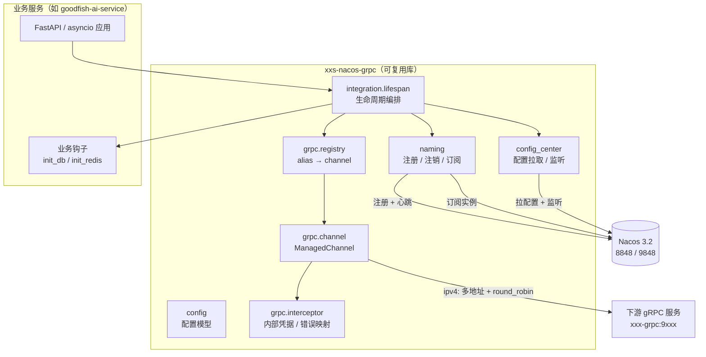
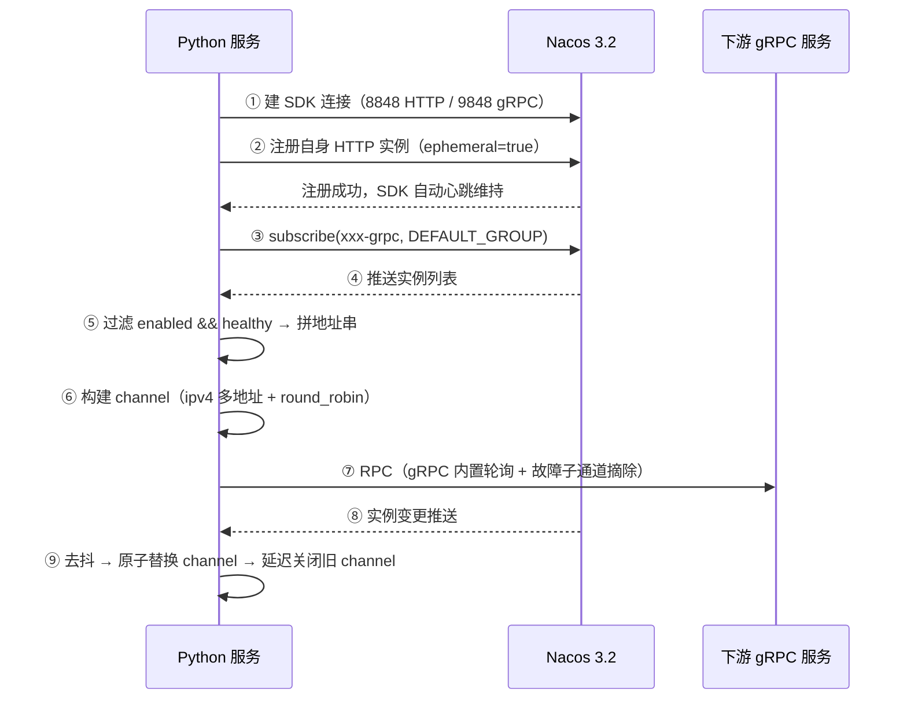

# 技术方案-云端-gRPC发现库xxs-nacos-grpc-已实现

> 来源：《gRPC与Nacos服务发现技术方案.md》§一~§六、§八~§十五（内容重组收录，原文件保留未动；原 §七「注册契约」收录于[技术方案-云端-服务注册与发现-已实现](技术方案-云端-服务注册与发现-已实现.md)）
> 关联：[技术方案-云端-服务注册与发现-已实现](技术方案-云端-服务注册与发现-已实现.md) ｜ [技术方案-云端-对话服务-框架与生命周期](技术方案-云端-对话服务-框架与生命周期.md)

## 一、功能与职责（总）

### 1.1 功能定位

把「Nacos 接入」+「gRPC 服务发现」封装成**与业务完全解耦的可复用 Python 库** `xxs-nacos-grpc`（导入名 `xxs_nacos_grpc`），供任何 Python 服务直接复用。

**背景问题**——Python 侧要接入 Nacos + gRPC，现状有三个痛点：

| # | 痛点 | 说明 |
|---|---|---|
| 1 | **无现成集成库** | Java 有 `grpc-spring-boot-starter` + Nacos discovery，Go 有 Kratos `registry/nacos`，**Python 没有对应物**。且 gRPC Python 未开放自定义 NameResolver API，无法用 `target="nacos://xxx"` 一把梭 |
| 2 | **胶水代码会重复** | 每个 Python 服务都要写"连 Nacos → 注册 → 订阅 → 建 channel → 负载均衡 → 优雅关闭"，复制粘贴必然漂移 |
| 3 | **跨语言契约易错** | 服务名、group、namespace、metadata、ephemeral 语义若不统一，Java 与 Python 之间会"注册了但发现不到"，且极难排查 |

**目标**：

| # | 目标 |
|---|---|
| 1 | 把「Nacos 接入」+「gRPC 服务发现」封装成**与业务完全解耦的可复用 Python 库** |
| 2 | 业务服务接入成本降到 **3 步**（引入 → 配置 → 挂 lifespan） |
| 3 | 与 Java/Quarkus 侧形成**统一的注册契约**，跨语言互发现零障碍 |
| 4 | 覆盖连接重试、快照降级、实例变更、负载均衡、优雅上下线、异常映射的全链路 |

**包定位与命名**：

| 项 | 值 |
|---|---|
| 包名 | `xxs-nacos-grpc` |
| 导入名 | `xxs_nacos_grpc` |
| 定位 | 内部通用底座库，**任何 Python 服务可直接复用** |
| 首个使用方 | `goodfish-ai-service`（对话服务） |
| 命名理由 | 与 Java 侧 `com.bigbear` / `xxs-*` 前缀保持一致 |

### 1.2 职责边界（非目标）

- ❌ 不做配置中心的业务配置模型（库只负责"取到 YAML/文本"，解析交给业务）
- ❌ 不做服务网格 / sidecar
- ❌ 不做 Nacos 3.x 的 AI 能力（MCP / A2A）接入
- ❌ 不引入注册中心抽象层（不做"可切换 Consul/Eureka"的设计，避免过度抽象）

### 1.3 与其他模块的关系

- **对齐基准**：`xxs-quarkus-template` / `xxs-quarkus-nacos-discovery`（Java 侧已跑通的注册发现实现）；契约与 Java 侧完全一致，统一注册契约见[技术方案-云端-服务注册与发现-已实现](技术方案-云端-服务注册与发现-已实现.md)
- **身份透传规范**：以 `xxs-micro/doc/架构.md` §3.1 为准（`X-User-Id` / `X-User-Info` / `Authorization` / `X-Client-Id`），Python 侧实现见本文 §2.6.6
- **首个使用方**：`goodfish-ai-service`（对话服务），生命周期编排见[技术方案-云端-对话服务-框架与生命周期](技术方案-云端-对话服务-框架与生命周期.md)
- **gRPC 错误映射**：对齐[技术方案-云端-gRPC契约-已实现](技术方案-云端-gRPC契约-已实现.md)的状态码 → 业务错误码映射

## 二、逻辑实现（分）

### 2.1 设计原则

| # | 原则 | 说明 |
|---|---|---|
| 1 | **库与业务解耦** | 库只依赖 `nacos-sdk-python` + `grpcio`；**不依赖 FastAPI / SQLAlchemy / Redis**。框架集成通过可选模块 + 钩子实现 |
| 2 | **契约对齐 Java** | 服务名规则、group、namespace、metadata、ephemeral 语义与 `xxs-quarkus-nacos-discovery` 完全一致 |
| 3 | **配置驱动** | 下游服务清单、超时、keepalive、去抖等全部走配置，业务代码零硬编码 |
| 4 | **一切异步** | 全链路 `asyncio`；库内禁止同步阻塞调用 |
| 5 | **订阅优于轮询** | 实例变更靠 Nacos push；轮询仅作兜底 |
| 6 | **启动 fail-fast，运行 fail-safe** | 启动期 Nacos 不可用 → 拒绝启动；运行期下游不可用 → 快速失败并返回业务码，不拖垮自身 |
| 7 | **可观测** | 注册/注销/实例变更/降级全部有结构化日志，便于排障 |
| 8 | **身份透传统一** | 复用项目既有的 `X-User-Id` / `X-User-Info` / `Authorization` / `X-Client-Id` 规范（`架构.md` §3.1）；HTTP 头 → ContextVar → gRPC Metadata 全程同名。**不引入自定义服务间令牌**（见 §6.6.3） |
| 9 | **开发用路径依赖，部署用 wheel** | 本地开发 editable 路径依赖（改码即时生效），镜像/CI 装 wheel（可复现、可审计）。详见 §4.7 |

### 2.2 总体架构



| 层 | 职责 | 是否感知业务 |
|---|---|---|
| `config` | 配置模型与加载（bootstrap + 远程） | ❌ |
| `naming` | 服务注册、注销、实例订阅 | ❌ |
| `config_center` | 配置拉取与热更新监听 | ❌ |
| `grpc` | channel 管理、负载均衡、拦截器 | ❌ |
| `integration` | ASGI/FastAPI 生命周期编排 + 业务钩子 | ⭕ 仅钩子接口 |

### 2.3 库设计（目录结构、公开 API、使用示例、远程配置、测试）

#### 4.2 目录结构

```
xxs-nacos-grpc/
├── pyproject.toml
├── README.md
├── Makefile                     # build / test / publish（见 §4.7）
├── dist/                        # wheel 产出（见 §4.7）
├── src/xxs_nacos_grpc/
│   ├── __init__.py              # 公开 API 导出
│   ├── _version.py              # __version__（与 pyproject 单一来源）
│   ├── py.typed
│   ├── config.py                # NacosSettings / SelfRegistrationSettings
│   │                            # DiscoverySettings / GrpcChannelSettings
│   ├── errors.py                # 领域异常
│   ├── runtime.py               # NacosGrpcRuntime（门面）
│   ├── naming/
│   │   ├── client.py            # NacosNamingClient：连接 / 注册 / 注销 / 订阅
│   │   └── watcher.py           # InstanceWatcher：实例过滤 + 变更回调
│   ├── config_center/
│   │   └── client.py            # NacosConfigCenter：get / watch
│   ├── grpc/
│   │   ├── channel.py           # ManagedChannel：ipv4 多地址 + round_robin
│   │   ├── registry.py          # GrpcChannelRegistry：alias → ManagedChannel
│   │   └── interceptor.py       # 身份透传（UserContext*）/ ErrorMapping（见 6.6）
│   └── integration/
│       ├── lifespan.py          # NacosGrpcRuntime.lifespan()
│       └── fastapi.py           # 可选：UserContextMiddleware + install(app, runtime)
└── tests/
    ├── unit/
    └── integration/
```

> **依赖边界**：`integration/fastapi.py` 是**可选模块**——只依赖 `integration/lifespan.py` 的服务不需要安装 FastAPI。库的 `dependencies` 仅 `nacos-sdk-python` + `grpcio` + `pydantic`。

#### 4.3 公开 API

```python
# src/xxs_nacos_grpc/__init__.py
from .config import (
    NacosSettings,
    SelfRegistrationSettings,
    DiscoverySettings,
    GrpcChannelSettings,
)
from .errors import (
    DiscoveryError,
    ServiceUnavailableError,
    NacosConnectionError,
    ConfigNotFoundError,
)
from .runtime import NacosGrpcRuntime

__all__ = [
    "NacosSettings",
    "SelfRegistrationSettings",
    "DiscoverySettings",
    "GrpcChannelSettings",
    "NacosGrpcRuntime",
    "DiscoveryError",
    "ServiceUnavailableError",
    "NacosConnectionError",
    "ConfigNotFoundError",
]
```

**门面类 `NacosGrpcRuntime`** —— 使用方唯一需要接触的对象：

| 成员 | 类型 | 说明 |
|---|---|---|
| `runtime.naming` | `NacosNamingClient` | 注册 / 注销 / 手动订阅 |
| `runtime.config` | `NacosConfigCenter` | 拉取 / 监听远程配置 |
| `runtime.grpc` | `GrpcChannelRegistry` | `channel(alias)` / `stub(alias, factory)` |
| `runtime.lifespan()` | async context manager | 一键编排启动与优雅关闭 |
| `runtime.on_startup(fn)` | 钩子注册 | 业务初始化（DB / Redis / 迁移） |
| `runtime.on_shutdown(fn)` | 钩子注册 | 业务清理（逆序执行） |

#### 4.4 使用示例（接入三步）

**第 1 步：配置**

```yaml
# config/bootstrap.yaml
app:
  env: dev

self_registration:
  service_name: "goodfish-ai-service"     # 只注册 HTTP；无 -grpc
  port: 8000

nacos:
  server_address: "192.168.50.45:8848"
  group: "DEFAULT_GROUP"
  # namespace 缺省 goodfish-{app.env}
```

**第 2 步：应用内挂载**

```python
from contextlib import asynccontextmanager
from fastapi import FastAPI

from xxs_nacos_grpc import NacosGrpcRuntime

runtime = NacosGrpcRuntime.from_bootstrap("config/bootstrap.yaml")


@asynccontextmanager
async def lifespan(app: FastAPI):
    runtime.on_startup(init_db)          # 业务钩子，库不感知 DB
    runtime.on_startup(init_redis)
    runtime.on_shutdown(close_redis)

    async with runtime.lifespan():
        app.state.grpc = runtime.grpc
        yield


app = FastAPI(title="goodfish-ai-service", lifespan=lifespan)
```

**第 3 步：调用下游**

```python
async def get_item_runtime_config(account_id: str, item_id: str):
    stub = runtime.grpc.stub("item", item_pb2_grpc.ItemServiceStub)
    return await stub.GetItemRuntimeConfig(
        GetItemRuntimeConfigRequest(account_id=account_id, item_id=item_id),
        timeout=3.0,
    )
```

> 业务代码**不出现**任何 Nacos / channel / 负载均衡相关逻辑 —— 这就是"可复用"的验收标准。

#### 4.5 远程配置（Nacos 中，`goodfish-ai-service.<env>.yaml`）

```yaml
grpc:
  discovery:
    services:                          # alias → Nacos 服务名（下游必须带 -grpc）
      item: "goodfish-item-service-grpc"
      # llm: "goodfish-llm-service-grpc"
    debounce_ms: 1500                  # 实例变更去抖（滚动发布会连推）
    close_grace_seconds: 30            # 旧 channel 延迟关闭
    reconcile_interval_seconds: 60     # 兜底重查（防丢推送）

  channel:
    lb_policy: "round_robin"           # 或 "pick_first"
    keepalive_time_ms: 30000
    keepalive_timeout_ms: 10000
    keepalive_permit_without_calls: 1
    max_message_mb: 16                 # 默认 4MB 不够
    health_check: false                # 下游有标准 health service 时置 true

  client:
    default_timeout_ms: 3000
    client_id: "goodfish-ai-service"     # 服务间调用标识 → gRPC metadata X-Client-Id
```

#### 4.6 测试

| 用例 | 命令 |
|---|---|
| 单元测试 | `pytest tests/unit` |
| 集成测试 | `docker compose up -d nacos && pytest tests/integration` |
| 故障注入 | 杀掉实例 / 断 Nacos / 清空实例，验证降级路径 |

**库必须覆盖的单元用例**：

1. 实例列表 → 地址串拼接（排序稳定、过滤 `enabled and healthy`）
2. 去抖生效（连续 3 次变更只重建 1 次）
3. 空列表不清空 channel
4. channel 原子替换 + 旧 channel 延迟关闭
5. stub 缓存随 channel 更换而重建
6. 注册 IP 探测失败 → 报错而非回退 `0.0.0.0`
7. 配置回调签名 `(tenant, group, data_id, content)` 解析正确
8. 优雅关闭顺序（注销 → 关 channel → 关连接）
9. 身份中间件：从请求头读入 → `ContextVar` 生效；请求结束 `reset`（防串号）
10. 客户端拦截器：`ContextVar` 有值 → metadata 携带 `x-user-id` / `x-user-info` / `authorization` / `x-client-id`；无值 → 不携带且不报错

### 2.4 包的引用与分发

**结论：开发期用路径依赖（editable），镜像 / CI 用 wheel。**

#### 4.7.1 目录位置

```
E:\project\my-biz\
├── java\
│   └── xxs-micro\xxs-common-quarkus\xxs-quarkus-modules\   ← Java 共享模块（现状）
├── python\                                                  ← Python 共享库区
│   ├── xxs-nacos-grpc\                                      # 本库
│   │   ├── pyproject.toml
│   │   ├── Makefile                                         # build / test / publish
│   │   ├── src\xxs_nacos_grpc\
│   │   ├── tests\
│   │   └── dist\                                            # wheel 产出
│   └── (将来) xxs-common-python\                            # 日志 / 异常 / 配置基类
└── xianyu\backend\python\goodfish-ai-service\               ← 使用方
```

> 与 Java 侧对称：Java 的共享模块放 `xxs-quarkus-modules/`，Python 的共享库放 `python/`。
> 目录名用横杠（`xxs-nacos-grpc`）、包名用下划线（`xxs_nacos_grpc`），符合 Python 惯例。

#### 4.7.2 方案对比

| 方案 | 使用方写法 | 优点 | 缺点 | 适用阶段 |
|---|---|---|---|---|
| **A 路径依赖（editable）** | `{ path = "../../python/xxs-nacos-grpc", editable = true }` | 改库代码立即生效，调试最爽 | ❌ 源码必须留在镜像里；❌ 多阶段构建不可用；❌ 版本不可复现；❌ 构建上下文被迫扩大到仓库根 | **本地开发** |
| **B uv workspace** | 根目录 `[tool.uv.workspace] members = [...]` | 单一 `uv.lock`，路径依赖成为一等公民 | 全仓需统一用 uv；**不解决 Docker 问题** | 单仓多包 |
| **C wheel（本地 / 共享目录）** | `pip install --find-links ../python/dist xxs-nacos-grpc==1.0.0` | ✅ 可复现；✅ 可离线；✅ Docker 干净；✅ 装完可删 | 需一条发布命令（脚本化即可） | **部署 / CI** |
| **D 内部 PyPI** | `xxs-nacos-grpc==1.0.0` | 标准做法，CI/CD 最干净，多服务共享 | 需维护私服 | 多服务规模化 |
| E git 依赖 | `{ git = "ssh://…", tag = "v1.0.0" }` | 无需私服 | 需 git 凭据、构建慢、不能离线 | 兜底 |

**选用：开发期 A + 部署 C**，规模上来再切 D。三者切换只改 `pyproject.toml` 一行。

#### 4.7.3 为什么 A 不能上生产镜像

`pip install -e` **不复制代码**，只在 `site-packages` 写一个指向源码目录的 `.pth` / finder：

| 维度 | A（editable） | C（wheel） |
|---|---|---|
| 代码位于 | 仍在原源码目录 | `site-packages/xxs_nacos_grpc/` |
| 源码目录能否删 | ❌ 不能（已变成**运行期依赖**） | ✅ 能（装完即焚） |
| 多阶段构建 | ❌ 不可用（`.pth` 是绝对路径，跨阶段断） | ✅ 天然支持 |
| 版本可复现 | ❌ 无版本概念，`pip freeze` 为 `@ file:///...` | ✅ `xxs-nacos-grpc==1.0.0` |
| Docker 缓存 | 改库代码 → COPY 层变 → 后续全击穿 | 库没发新版 → wheel 不变 → 缓存命中 |
| 源码是否进最终镜像 | 是（含 `tests/`、dev 依赖） | 否 |

> 核心一句话：**A 把"构建期依赖"变成了"运行期依赖"**。

#### 4.7.4 落地工作流

```bash
# ── 库：发版 ───────────────────────────────
cd my-biz/python/xxs-nacos-grpc
uv build                                  # → dist/xxs_nacos_grpc-1.0.0-py3-none-any.whl

# ── 使用方：本地开发（一次性）─────────────
uv add --editable ../../python/xxs-nacos-grpc
#   → 之后改库代码，服务侧立即生效，无需重新 build

# ── 使用方：Dockerfile（装完即焚）────────
COPY python/dist/xxs_nacos_grpc-1.0.0-py3-none-any.whl /tmp/
RUN pip install --no-cache-dir /tmp/xxs_nacos_grpc-1.0.0-py3-none-any.whl \
 && rm -f /tmp/xxs_nacos_grpc-1.0.0-py3-none-any.whl
```

私服就绪后可简化为一行（连 `dist/` 都不进构建上下文）：

```dockerfile
RUN pip install --no-cache-dir xxs-nacos-grpc==1.0.0 --index-url http://nexus/…
```

#### 4.7.5 三条约束

| # | 约束 | 说明 |
|---|---|---|
| 1 | **禁止 `sys.path` 挂目录** | 隐式依赖：本地能跑、构建即崩，且 pip 装不上（依赖声明丢失）。**必须走 `pyproject.toml` 声明** |
| 2 | **版本单一来源** | `_version.py` 的 `__version__` 与 `pyproject.toml` 不得两边手写漂移，用单测校验。**注册到 Nacos 的 metadata 带上库版本**，便于排查"某实例用的是哪个版本的库" |
| 3 | **Docker 构建上下文** | 用 A 时 context 必须覆盖 `python/` 与使用方目录；用 C 时只需覆盖本服务 + wheel。**推荐 C**，构建上下文更小 |

#### 4.7.6 CI

| 环节 | 动作 |
|---|---|
| 库自身 | `make test` → `make build`，wheel 作为构建产物（artifact） |
| 使用方 | 先取库 wheel（artifact / 私服）再跑集成测试，避免"库改了把使用方搞崩" |

### 2.5 Nacos 接入层

#### 5.1 SDK 选型（Nacos 3.2）

| 项 | 值 | 说明 |
|---|---|---|
| 包名 | `nacos-sdk-python` | 官方 SDK |
| 版本 | **`== 3.2.0`** | 必须 ≥ 3.0.3；**3.0.0 / 3.0.1 / 3.0.2 已被 PyPI yanked**（"断连后无法重新注册"缺陷） |
| 导入路径 | **`from v2.nacos import ...`** | 模块名是 `v2`，与 1.x 的 `import nacos` 完全不同的 API |
| 调用方式 | 全异步 | `create_xxx_service()` 异步工厂 + `await` |
| Python | ≥ 3.10 | — |
| Nacos 服务端 | **3.2** | — |

**端口约定（Nacos 3.x）**：

| 端口 | 用途 | 是否填进 SDK |
|---|---|---|
| **8848** | SDK / HTTP 端口 | ✅ `server_address` 填这个 |
| **9848** | gRPC 端口（= 8848 + 1000） | ❌ 由 SDK 自动推导，防火墙需放行 |
| **8080** | 控制台 | ❌ **不要填进 SDK** |

#### 5.2 连接管理

```python
# src/xxs_nacos_grpc/naming/client.py
import asyncio
import logging

from v2.nacos import (
    ClientConfigBuilder,
    GRPCConfig,
    NacosConfigService,
    NacosNamingService,
)

from ..config import NacosSettings
from ..errors import NacosConnectionError

logger = logging.getLogger(__name__)


class NacosClients:
    """Nacos SDK 客户端持有者：连接、重试、关闭。

    连接粒度为「一个 Runtime 一份」（server_address + namespace 固定），
    与 Java 侧 NacosNamingClient 的 serverAddr|namespace 缓存语义一致。
    """

    def __init__(self, settings: NacosSettings) -> None:
        self._settings = settings
        self.naming: NacosNamingService | None = None
        self.config: NacosConfigService | None = None

    async def connect(self) -> None:
        builder = (
            ClientConfigBuilder()
            .server_address(self._settings.server_address)
            .namespace_id(self._settings.namespace)          # 环境隔离的关键
            .username(self._settings.username)
            .password(self._settings.password)
            .log_level(self._settings.log_level)
            .cache_dir(self._settings.cache_dir)             # 快照目录（降级来源）
            .log_dir(self._settings.log_dir)
            .grpc_config(GRPCConfig(grpc_timeout=self._settings.grpc_timeout_ms))
        )
        if self._settings.context_path:
            builder.context_path(self._settings.context_path)  # 自定义 context-path
        client_config = builder.build()

        last_error: Exception | None = None
        for attempt in range(1, self._settings.connect_retry_attempts + 1):
            try:
                self.config = await NacosConfigService.create_config_service(client_config)
                self.naming = await NacosNamingService.create_naming_service(client_config)
                logger.info(
                    "Nacos 连接成功: addr=%s namespace=%s",
                    self._settings.server_address, self._settings.namespace,
                )
                return
            except Exception as exc:                          # 连接类异常统一重试
                last_error = exc
                logger.warning(
                    "Nacos 连接失败（%s/%s）: %s",
                    attempt, self._settings.connect_retry_attempts, exc,
                )
                await asyncio.sleep(self._settings.connect_retry_delay_seconds)

        # 配置中心是强依赖：重试耗尽即快速失败，避免"半启动"服务注册上去放大故障
        raise NacosConnectionError("Nacos 连接失败，服务拒绝启动") from last_error

    async def close(self) -> None:
        if self.naming is not None:
            await self.naming.shutdown()
        if self.config is not None:
            await self.config.shutdown()
```

**降级策略**：

| 阶段 | Nacos 不可用 | 行为 |
|---|---|---|
| 启动 | 连接失败 | 重试 3 次（间隔 2s）→ 仍失败**拒绝启动** |
| 运行 | 连接断开 | SDK 自动重连；配置读 `cache_dir` 快照；实例列表沿用内存最后一次 |
| 运行 | 配置拉取失败 | 保留内存中最后一次有效配置 + 告警 |

#### 5.3 配置中心

```python
# src/xxs_nacos_grpc/config_center/client.py
import inspect
import logging
from typing import Awaitable, Callable

from v2.nacos import ConfigParam

logger = logging.getLogger(__name__)

# 配置监听回调的真实签名
ConfigListener = Callable[[str, str, str, str], Awaitable[None]]


class NacosConfigCenter:
    def __init__(self, clients, settings) -> None:
        self._clients = clients
        self._settings = settings

    async def get_text(self, data_id: str, group: str | None = None) -> str:
        content = await self._clients.config.get_config(ConfigParam(
            data_id=data_id, group=group or self._settings.group,
        ))
        if not content:
            raise ConfigNotFoundError(
                f"配置不存在 data_id={data_id} group={group or self._settings.group} "
                f"namespace={self._settings.namespace}"
            )
        return content

    async def watch(self, data_id: str, listener: ConfigListener,
                    group: str | None = None) -> None:
        """注册配置监听。

        ★ 回调真实签名是 (tenant, group, data_id, content) —— 以 SDK 源码
        `SubscribeCacheData.execute_listener()` 为准。
        官方 README 示例写成 (tenant, data_id, group, content) 是错的，照抄会串参。
        """

        async def _safe_listener(*args: str) -> None:
            try:
                result = listener(*args)
                if inspect.isawaitable(result):        # 兼容同步 / 异步监听器
                    await result
            except Exception:                          # 回调内异常不能影响 SDK 监听
                logger.exception("配置变更处理失败，保留旧配置 data_id=%s", data_id)

        await self._clients.config.add_listener(
            data_id, group or self._settings.group, _safe_listener,
        )
        logger.info("已监听配置变更: data_id=%s", data_id)
```

> **配置分层**（低 → 高）：代码默认值 → `bootstrap.yaml` → 环境变量 → Nacos 远程配置 →（业务侧可再叠加 DB）。
> 库只负责到 Nacos 这一层；`${VAR}` 占位符的展开也由库提供工具函数，但**必须先解析 YAML 再递归展开**（否则含 `:` / `#` 的密码会破坏结构）。

#### 5.4 注册中心

```python
# src/xxs_nacos_grpc/naming/client.py（续）
import inspect
import socket

from v2.nacos import (
    RegisterInstanceParam,
    DeregisterInstanceParam,
    SubscribeServiceParam,
    ListInstanceParam,
)


class NacosNamingClient:
    def __init__(self, clients, settings, self_reg) -> None:
        self._clients = clients
        self._settings = settings
        self._self_reg = self_reg
        self._registered: list[RegisterInstanceParam] = []

    # ---------- 注册 ----------
    async def register_self(self) -> None:
        if not self._self_reg.enabled:
            logger.info("自身注册已关闭，跳过")
            return
        param = RegisterInstanceParam(
            service_name=self._self_reg.service_name,
            group_name=self._settings.group,
            ip=resolve_register_ip(self._self_reg.ip),
            port=self._self_reg.port,
            weight=self._self_reg.weight,
            ephemeral=True,        # ★ 必须 True：依赖 SDK 心跳保活
            enabled=True,
            metadata={
                "protocol": resolve_protocol(self._self_reg.service_name),
                "secure": "false",
                "cluster": self._settings.cluster,
                **(self._self_reg.metadata or {}),
            },
        )
        await self._clients.naming.register_instance(request=param)
        self._registered.append(param)
        logger.info(
            "已注册到 Nacos: service=%s %s:%s namespace=%s",
            param.service_name, param.ip, param.port, self._settings.namespace,
        )

    async def deregister_all(self) -> None:
        for p in self._registered:
            try:
                await self._clients.naming.deregister_instance(
                    request=DeregisterInstanceParam(
                        service_name=p.service_name,
                        group_name=p.group_name,
                        ip=p.ip, port=p.port, ephemeral=True,
                    )
                )
                logger.info("已从 Nacos 注销: service=%s %s:%s",
                            p.service_name, p.ip, p.port)
            except Exception:
                logger.exception("注销实例失败: %s", p.service_name)
        self._registered.clear()

    # ---------- 订阅 ----------
    async def subscribe(self, service_name: str, on_change) -> None:
        """订阅实例变更；回调收到全量实例列表（**未做健康过滤**，需自行过滤）。"""

        async def _safe(instances: list) -> None:
            try:
                result = on_change(instances)
                if inspect.isawaitable(result):
                    await result
            except Exception:
                logger.exception("实例变更回调异常: service=%s", service_name)

        await self._clients.naming.subscribe(SubscribeServiceParam(
            service_name=service_name,
            group_name=self._settings.group,
            subscribe_callback=_safe,
        ))
        logger.info("已订阅实例变更: service=%s", service_name)

    # ---------- 兜底重查 ----------
    async def list_instances(self, service_name: str) -> list:
        """主动查询实例（供兜底 reconcile）。

        `healthy_only=True` 由 Nacos 侧过滤；订阅推送不保证只含健康实例，
        因此 `subscribe` 回调里仍需客户端再过滤一次。
        """
        return await self._clients.naming.list_instances(ListInstanceParam(
            service_name=service_name,
            group_name=self._settings.group,
            healthy_only=True,
        ))


def resolve_protocol(service_name: str, suffix: str = "-grpc") -> str:
    """按服务名后缀推断协议 —— 对齐 Java 侧 NacosConvert.resolveProtocol。"""
    return "grpc" if service_name.endswith(suffix) else "http"


def resolve_register_ip(override: str) -> str:
    """注册 IP：优先显式配置（容器/K8s 必填），否则探测本机出口 IP。

    注册 IP 绝不能是 0.0.0.0，否则消费方拿到也连不上。
    """
    if override:
        return override
    try:
        with socket.socket(socket.AF_INET, socket.SOCK_DGRAM) as sock:
            sock.settimeout(1.0)
            sock.connect(("8.8.8.8", 80))      # 不实际发包，仅借路由表取出口 IP
            return sock.getsockname()[0]
    except OSError:
        # 无外网/无默认路由的隔离环境：退化为主机名解析
        return socket.gethostbyname(socket.gethostname())
```

#### 5.5 多环境（dev / test / prod）

**只把"引导配置"放本地，业务配置全放 Nacos。**

| 维度 | dev | test | prod | 是否随环境变 |
|---|---|---|---|---|
| `NACOS_SERVER_ADDRESS` | `nacos-dev:8848` | `nacos-test:8848` | `nacos:8848` | 是 |
| `NACOS_NAMESPACE` | `goodfish-dev` | `goodfish-test` | `goodfish-prod` | **是（隔离核心）** |
| `NACOS_GROUP` | `DEFAULT_GROUP` | 同左 | 同左 | 否 |
| `NACOS_USERNAME` / `PASSWORD` | dev 账号 | test 账号 | prod 账号 | 是 |
| `NACOS_CACHE_DIR` | `./.nacos/cache/dev` | `./.nacos/cache/test` | 容器可写卷 | 是 |
| `NACOS_LOG_DIR` | `./.nacos/log` | 同左 | 容器可写卷 | 是 |
| `NACOS_REGISTER_IP` | 留空自动探测 | 容器显式指定 | 容器显式指定 | 视部署 |

> **关键坑**：Nacos 控制台创建 namespace 时必须**手工指定 ID = 环境名**（默认会生成 UUID），否则与 bootstrap 里的 `namespace` 对不上。

```ini
# .env.dev（不进 git）
APP_ENV=dev
NACOS_SERVER_ADDRESS=192.168.50.45:8848
NACOS_NAMESPACE=goodfish-dev
NACOS_GROUP=DEFAULT_GROUP
NACOS_CACHE_DIR=./.nacos/cache/dev
SELF_REGISTRATION_PORT=8000
```

#### 5.6 关键坑清单

| # | 坑 | 后果 | 对策 |
|---|---|---|---|
| 1 | 用 1.x 的 `import nacos` + `NacosClient` | 与 Nacos 3.2 完全不匹配 | 必须 `from v2.nacos import ...` |
| 2 | 装 `nacos-sdk-python==3.0.2` | PyPI 已 yanked，pip 解析不到 | 钉死 `3.2.0` |
| 3 | `server_address` 填 8080（控制台） | 连不上 | 填 **8848** |
| 4 | 未放行 9848 | SDK 长连接建不上，报错却指向 8848 | 防火墙/安全组放行 **8848 + 9848** |
| 5 | namespace 用名称而非 ID | 配置/实例全查不到 | 创建时手工指定 ID |
| 6 | 配置回调按 README 的 `(tenant, data_id, group, content)` | 参数串位 | 按源码 **`(tenant, group, data_id, content)`** |
| 7 | 注册 IP 是 `0.0.0.0` | 消费方连不上 | 探测真实网卡 IP，失败则报错退出 |
| 8 | 注册成非临时实例（`ephemeral=False`） | Nacos 去探 `healthUrl`，本服务没有该接口 → 实例长期不健康 | **保持 `ephemeral=True`** |
| 9 | 依赖版本冲突 | 安装即失败 | `nacos-sdk-python` 自带 `grpcio` / `protobuf`，**先查其版本区间**再定自己的版本 |
| 10 | 镜像体积 | 3.2.0 带入约 11 个运行时依赖（`grpcio`/`protobuf`/`aiohttp`/`a2a-sdk`/`alibabacloud_kms20160120` 等） | 基础镜像用 `python:3.12-slim` + 分阶段构建 |

### 2.6 gRPC 服务发现（核心）

#### 6.1 发现链路时序



#### 6.2 发现规则（逐条）

| # | 规则 | 说明 |
|---|---|---|
| 1 | **只按 `服务名 + group + namespace` 查** | 不解析后缀、不按 metadata 过滤（对齐 Java 侧 `selectInstances(..., healthyOnly=true)` 语义） |
| 2 | **客户端做健康过滤** | Nacos 的 subscribe 推**全量**实例，健康过滤必须在客户端：`i.enabled and i.healthy` |
| 3 | **地址串用 `ipv4:` scheme 多地址拼接** | `ipv4:10.0.0.5:9000,10.0.0.6:9000`。C-core 原生支持，**Python 专属便利**（Go 侧没有 `ipv4` resolver，必须自定义 resolver） |
| 4 | **负载均衡交给 gRPC 内置 `round_robin`** | 不自己写 pick/drop；子通道故障由 C-core 自动摘除 |
| 5 | **实例变更必须去抖** | 滚动发布会连推 `[a]` → `[a,b]` → `[b]`，不去抖会连建 3 个 channel |
| 6 | **channel 原子替换 + 旧 channel 延迟关闭** | 立即关会掐断在途 RPC → `UNAVAILABLE` |
| 7 | **空列表不清空 channel** | 全部不健康时保留旧 channel，让调用以 `UNAVAILABLE` 快速失败（映射 50301），避免抖动导致反复重建 |
| 8 | **回调内不做重活** | Nacos 回调在事件循环内，只做去抖调度，重建放独立 task |
| 9 | **地址列表排序稳定** | `sorted()` 后再比较，避免"顺序变了但集合没变"触发无谓重建（对齐 Java 侧"实例 id 稳定"的用意） |
| 10 | **订阅 + 兜底轮询** | subscribe 为主；`reconcile_interval_seconds` 定期重查防丢推送 |

#### 6.3 ManagedChannel 实现

```python
# src/xxs_nacos_grpc/grpc/channel.py
import asyncio
import json
import logging

import grpc

from ..config import DiscoverySettings, GrpcChannelSettings
from ..errors import ServiceUnavailableError

logger = logging.getLogger(__name__)


class ManagedChannel:
    """一个下游服务 = 一个 channel。

    地址来自 Nacos，负载均衡交给 gRPC 内置策略（默认 round_robin），
    库自身不实现实例挑选与故障摘除。
    """

    def __init__(self, alias: str, service_name: str,
                 discovery: DiscoverySettings, channel_cfg: GrpcChannelSettings,
                 interceptors: list | None = None) -> None:
        self._alias = alias
        self._service_name = service_name
        self._discovery = discovery
        self._cfg = channel_cfg
        self._interceptors = interceptors or []
        self._channel: grpc.aio.Channel | None = None
        self._addresses: tuple[str, ...] = ()
        self._lock = asyncio.Lock()
        self._debounce_task: asyncio.Task | None = None
        self._stub: object | None = None
        self._stub_channel: grpc.aio.Channel | None = None

    # ========== 规则 8：回调内只做去抖 ==========
    def on_instances_change(self, instances: list) -> None:
        # ========== 规则 2 + 9：健康过滤 + 排序稳定 ==========
        addresses = tuple(sorted(
            f"{i.ip}:{i.port}" for i in instances if i.enabled and i.healthy
        ))
        if self._debounce_task is not None and not self._debounce_task.done():
            self._debounce_task.cancel()                      # ========== 规则 5 ==========
        self._debounce_task = asyncio.create_task(self._rebuild(addresses))

    async def _rebuild(self, addresses: tuple[str, ...]) -> None:
        await asyncio.sleep(self._discovery.debounce_ms / 1000)

        # ========== 规则 7：空列表保留旧 channel ==========
        if not addresses:
            logger.warning("实例列表为空，保留旧 channel: service=%s", self._service_name)
            return

        if addresses == self._addresses and self._channel is not None:
            return

        async with self._lock:                                # ========== 规则 6 ==========
            old, self._channel = self._channel, self._build(addresses)
            self._addresses = addresses

        if old is not None:
            asyncio.create_task(self._close_later(old))
        logger.info("gRPC channel 更新: alias=%s targets=%s",
                    self._alias, ",".join(addresses))

    def _build(self, addresses: tuple[str, ...]) -> grpc.aio.Channel:
        # ========== 规则 3 + 4：ipv4: 多地址 + 内置负载均衡 ==========
        target = "ipv4:" + ",".join(addresses)
        max_bytes = self._cfg.max_message_mb * 1024 * 1024
        options: list[tuple[str, object]] = [
            ("grpc.keepalive_time_ms", self._cfg.keepalive_time_ms),
            ("grpc.keepalive_timeout_ms", self._cfg.keepalive_timeout_ms),
            ("grpc.keepalive_permit_without_calls", self._cfg.keepalive_permit_without_calls),
            ("grpc.http2.max_pings_without_data", 0),
            ("grpc.max_receive_message_length", max_bytes),
            ("grpc.max_send_message_length", max_bytes),
        ]
        if self._cfg.health_check:
            # 下游实现标准 grpc.health.v1 时，由 gRPC 主动探活 + 自动摘除不健康子通道
            options.append(("grpc.service_config", json.dumps({
                "loadBalancingConfig": [{self._cfg.lb_policy: {}}],
                "healthCheckConfig": {"serviceName": ""},
            })))
        else:
            options.append(("grpc.lb_policy_name", self._cfg.lb_policy))
        return grpc.aio.insecure_channel(
            target, options=options, interceptors=self._interceptors,
        )

    async def _close_later(self, channel: grpc.aio.Channel) -> None:
        """延迟关闭，给在途 RPC 收敛时间。"""
        await asyncio.sleep(self._discovery.close_grace_seconds)
        try:
            await channel.close()
        except Exception:
            logger.exception("关闭 gRPC channel 失败: %s", self._alias)

    # ========== 对外 ----------
    def channel(self) -> grpc.aio.Channel:
        if self._channel is None:
            raise ServiceUnavailableError(f"下游无可用实例: {self._service_name}")
        return self._channel

    def stub(self, factory):
        """stub 缓存：channel 更换时自动重建（stub 绑定在 channel 上）。"""
        if self._stub is None or self._stub_channel is not self._channel:
            self._stub = factory(self.channel())
            self._stub_channel = self._channel
        return self._stub

    async def close(self) -> None:
        if self._debounce_task is not None:
            self._debounce_task.cancel()
        if self._channel is not None:
            await self._channel.close()
```

#### 6.4 GrpcChannelRegistry（alias → channel）

```python
# src/xxs_nacos_grpc/grpc/registry.py
import asyncio
import logging

from ..config import DiscoverySettings, GrpcChannelSettings
from ..errors import ServiceUnavailableError
from .channel import ManagedChannel

logger = logging.getLogger(__name__)


class GrpcChannelRegistry:
    """按配置装配所有下游服务的 ManagedChannel，业务侧通过 alias 取用。"""

    def __init__(self, discovery: DiscoverySettings, channel_cfg: GrpcChannelSettings,
                 interceptors: list | None = None) -> None:
        self._discovery = discovery
        self._cfg = channel_cfg
        self._channels: dict[str, ManagedChannel] = {
            alias: ManagedChannel(alias, service_name, discovery, channel_cfg, interceptors)
            for alias, service_name in discovery.services.items()
        }
        self._reconcile_task: asyncio.Task | None = None

    async def start(self, naming) -> None:
        for channel in self._channels.values():
            await naming.subscribe(channel._service_name, channel.on_instances_change)
        if self._discovery.reconcile_interval_seconds > 0:
            self._reconcile_task = asyncio.create_task(self._reconcile(naming))

    async def _reconcile(self, naming) -> None:
        """规则 10：兜底重查，防止订阅推送丢失导致实例列表长期不更新。"""
        while True:
            await asyncio.sleep(self._discovery.reconcile_interval_seconds)
            for channel in self._channels.values():
                try:
                    instances = await naming.list_instances(channel._service_name)
                    channel.on_instances_change(instances)
                except Exception:
                    logger.exception("兜底重查失败: %s", channel._service_name)

    # ---------- 对外 ----------
    def channel(self, alias: str):
        return self._get(alias).channel()

    def stub(self, alias: str, factory):
        return self._get(alias).stub(factory)

    def _get(self, alias: str) -> ManagedChannel:
        channel = self._channels.get(alias)
        if channel is None:
            raise ServiceUnavailableError(f"未配置的下游服务别名: {alias}")
        return channel

    async def close(self) -> None:
        if self._reconcile_task is not None:
            self._reconcile_task.cancel()
        for channel in self._channels.values():
            await channel.close()
```

#### 6.5 与 Java 侧（Stork）语义对照

| Java（Stork） | 本方案 | 是否等价 |
|---|---|---|
| `NacosServiceDiscovery extends CachingServiceDiscovery` | `ManagedChannel` + 订阅回调 | ✅ |
| 构造期 `namingClient.subscribe(...)` → `invalidate()` | `naming.subscribe(...)` → 去抖重建 | ✅ |
| `refresh-period`（默认 5M）周期兜底刷新 | `reconcile_interval_seconds` 兜底重查 | ✅ |
| `selectInstances(..., healthyOnly=true)` | 回调内 `enabled and healthy` 过滤 | ✅ |
| `NacosConvert.toServiceInstance()` 保 ip:port → id 稳定 | 地址列表 `sorted()` 保证顺序稳定 | ✅ 同目的 |
| Stork `round-robin` 负载均衡器 | gRPC 内置 `round_robin` | ✅ |
| `application` 别名可覆盖查询名 | `discovery.services.<alias>` 别名映射 | ✅ |
| 连接信息回退读 `quarkus.config.source.nacos.*` | `NacosClients` 统一持有，注册/订阅共用 | ✅ |
| 注册参数 `parameters.host/port` | `SelfRegistrationSettings.ip / port` | ✅ |
| `NacosConvert.resolveProtocol` 按 `-grpc` 推断 | `resolve_protocol()` 同逻辑 | ✅ |

#### 6.6 拦截器

```python
# src/xxs_nacos_grpc/grpc/interceptor.py
import contextvars

import grpc

from ..errors import ServiceUnavailableError

# 与 Java 侧 GrpcHeaders / CommonConstants 完全一致的 metadata key
HEADER_USER_ID = "X-User-Id"
HEADER_USER_INFO = "X-User-Info"
HEADER_TOKEN = "Authorization"
HEADER_CLIENT_ID = "X-Client-Id"

# 当前请求身份载体（asyncio 上下文变量，类比 Java 的 Context.Key）
current_user_id: contextvars.ContextVar[str | None] = contextvars.ContextVar("user_id", default=None)
current_user_info: contextvars.ContextVar[str | None] = contextvars.ContextVar("user_info", default=None)
current_token: contextvars.ContextVar[str | None] = contextvars.ContextVar("token", default=None)


class UserContextClientInterceptor(grpc.aio.UnaryUnaryClientInterceptor):
    """把当前请求身份写入 gRPC Metadata 透传给下游。

    对齐《架构.md》§3.1 的统一头约定：X-User-Id / X-User-Info / Authorization / X-Client-Id。
    下游（Java AuthServerInterceptor / Go kratos middleware）读 Metadata 即可还原 LoginUser，零解析。
    """

    def __init__(self, client_id: str) -> None:
        self._client_id = client_id          # 服务名，如 goodfish-ai-service

    async def intercept_unary_unary(self, continuation, client_call_details, request):
        metadata = list(client_call_details.metadata or [])
        for key, value in (
            (HEADER_USER_ID, current_user_id.get()),
            (HEADER_USER_INFO, current_user_info.get()),
            (HEADER_TOKEN, current_token.get()),
            (HEADER_CLIENT_ID, self._client_id),
        ):
            if value:
                metadata.append((key, value))
        return await continuation(
            client_call_details._replace(metadata=metadata), request,
        )


class UserContextServerInterceptor(grpc.aio.ServerInterceptor):
    """【预留】服务端：从 Metadata 还原当前用户。

    对等 Java 侧 `AuthServerInterceptor`。本期 Python 不提供 gRPC 服务端，
    保留以便将来启用 `DialogService` 时直接复用。
    """

    async def intercept_service(self, continuation, handler_call_details):
        md = dict(handler_call_details.invocation_metadata or [])
        current_user_id.set(md.get(HEADER_USER_ID))
        current_user_info.set(md.get(HEADER_USER_INFO))
        current_token.set(md.get(HEADER_TOKEN))
        return await continuation(handler_call_details)


class ErrorMappingInterceptor(grpc.aio.UnaryUnaryClientInterceptor):
    """把 gRPC 状态码映射为领域异常（对齐《云端技术方案》§6.5）。"""

    _MAPPING = {
        grpc.StatusCode.UNAVAILABLE: ServiceUnavailableError,
        grpc.StatusCode.DEADLINE_EXCEEDED: ServiceUnavailableError,
    }

    async def intercept_unary_unary(self, continuation, client_call_details, request):
        try:
            return await continuation(client_call_details, request)
        except grpc.aio.AioRpcError as exc:
            mapped = self._MAPPING.get(exc.code())
            if mapped is not None:
                raise mapped(str(exc)) from exc
            raise
```

> 拦截器由 `GrpcChannelRegistry(..., interceptors=[...])` 注入，在 `ManagedChannel._build()` 中传给 `insecure_channel`，channel 重建时自动带上。业务侧无需处理 `AioRpcError`。

##### 6.6.1 HTTP 入口：读头写入上下文

网关注入的 `X-User-Id` / `X-User-Info` 落在 **HTTP 请求头**上，而 gRPC 拦截器读的是 **ContextVar**，中间需要一次"搬运"：

```python
# src/xxs_nacos_grpc/integration/fastapi.py
from starlette.middleware.base import BaseHTTPMiddleware

from ..grpc.interceptor import (
    HEADER_TOKEN, HEADER_USER_ID, HEADER_USER_INFO,
    current_token, current_user_id, current_user_info,
)


class UserContextMiddleware(BaseHTTPMiddleware):
    """把网关注入的身份头搬进 ContextVar，供 gRPC 客户端拦截器透传。

    对齐 Java 侧 RequestUserUtils / Quarkus HeaderUtils：下游只读头，零解析。
    """

    async def dispatch(self, request, call_next):
        set_tokens = [
            current_user_id.set(request.headers.get(HEADER_USER_ID)),
            current_user_info.set(request.headers.get(HEADER_USER_INFO)),
            current_token.set(request.headers.get(HEADER_TOKEN)),
        ]
        try:
            return await call_next(request)
        finally:
            for var, set_token in zip(
                (current_user_id, current_user_info, current_token), set_tokens,
            ):
                var.reset(set_token)          # 防止请求间串身份
```

> **为什么必须 reset**：`ContextVar` 按 task 隔离，但连接复用场景下若不 reset，可能出现"上一个请求的用户身份泄漏给下一个请求"。这是安全边界，不是洁癖。

**四种语言的对称实现**：

| 语言 | 取头工具类 | gRPC 服务端拦截器 | gRPC 客户端拦截器 |
|---|---|---|---|
| Spring Boot | `RequestUserUtils` | `AuthServerInterceptor` | `AuthClientInterceptor` |
| Quarkus | `HeaderUtils` | `MetadataInterceptor`（`xxs-quarkus-grpc`） | `AuthClientInterceptor` |
| Go / kratos | middleware 内部 | server middleware | client middleware |
| **Python** | **`UserContextMiddleware`** | **`UserContextServerInterceptor`**（预留） | **`UserContextClientInterceptor`** |

##### 6.6.2 三个必须联调验证的坑

| # | 坑 | 现象 | 对策 |
|---|---|---|---|
| 1 | **gRPC metadata key 大小写** ★ | HTTP 透传正常，但下游取不到用户 → "身份静默丢失" | HTTP/2 规定 header 名小写；Java `Metadata.Key.of("X-User-Id", …)` 内部会小写化。**发送端与接收端都要做大小写归一**；联调时英文名 + 中文名各跑一次 |
| 2 | **`X-User-Info` 含非 ASCII** ★ | grpc-java 抛异常（`ASCII_STRING` 校验失败） | Java 侧用的是 `Metadata.Key.of(name, ASCII_STRING)`，**值里有中文就会炸**。约定 `X-User-Info` 只放 ASCII 字段，或对 value 做 base64 / URL-encode（两端一致） |
| 3 | **metadata 体积** | `X-User-Info`(JSON) + `Authorization` 一起透传，逼近 HTTP/2 默认 8KB 上限 | 只透传必要字段（如 `userId` + `roles`），别塞全量用户信息 |

> 这三个的共同特征是 **"HTTP 正常、gRPC 侧身份异常"**，排查成本高。建议联调第一周就用最小用例各验一遍。

##### 6.6.3 不再引入自定义服务间令牌

**曾提出 `X-Internal-Token`（服务间凭据），已撤回。** 原因：

- 项目原有规范（`架构.md` §3.1）中，服务间身份由 **`X-Client-Id`** 表达，已有三语言实现，无需第四套机制
- 内部接口（如返回明文 API Key 的 `GetEnabledModel`）的保护方式是**网络隔离**——不过网关、只在集群内网暴露 gRPC 端口（K8s NetworkPolicy / 安全组限制来源），而非自定义 token
- `Authorization` 原始 token 已按需透传，可满足需要下游再鉴权的场景

### 2.7 框架集成

#### 8.1 Runtime 门面与生命周期

```python
# src/xxs_nacos_grpc/runtime.py
import inspect
import logging
from contextlib import asynccontextmanager

import yaml

from .config import DiscoverySettings, GrpcChannelSettings, load_bootstrap
from .config_center.client import NacosConfigCenter
from .grpc.interceptor import ErrorMappingInterceptor, UserContextClientInterceptor
from .grpc.registry import GrpcChannelRegistry
from .naming.client import NacosClients, NacosNamingClient

logger = logging.getLogger(__name__)


async def _maybe_await(value):
    """业务钩子允许同步或异步实现。"""
    if inspect.isawaitable(value):
        return await value
    return value


class NacosGrpcRuntime:
    """Nacos + gRPC 服务发现运行时门面。业务侧只与本类交互。"""

    def __init__(self, bootstrap) -> None:
        self._bootstrap = bootstrap
        self._clients = NacosClients(bootstrap.nacos)
        self._naming = NacosNamingClient(self._clients, bootstrap.nacos,
                                         bootstrap.self_registration)
        self._config = NacosConfigCenter(self._clients, bootstrap.nacos)
        self._grpc: GrpcChannelRegistry | None = None
        self._startup_hooks: list = []
        self._shutdown_hooks: list = []

    @classmethod
    def from_bootstrap(cls, path: str = "config/bootstrap.yaml") -> "NacosGrpcRuntime":
        return cls(load_bootstrap(path))

    # ---- 业务钩子（库不感知 DB/Redis） ----
    def on_startup(self, hook) -> None:
        self._startup_hooks.append(hook)

    def on_shutdown(self, hook) -> None:
        self._shutdown_hooks.append(hook)

    @property
    def naming(self) -> NacosNamingClient:
        return self._naming

    @property
    def config(self) -> NacosConfigCenter:
        return self._config

    @property
    def grpc(self) -> GrpcChannelRegistry:
        if self._grpc is None:
            raise RuntimeError("Runtime 未启动")
        return self._grpc

    # ---- 拦截器 ----
    def _build_interceptors(self) -> list:
        """身份透传 + 错误映射（详见 §6.6）。"""
        return [
            UserContextClientInterceptor(client_id=self._bootstrap.client_id),
            ErrorMappingInterceptor(),
        ]

    # ---- 生命周期 ----
    @asynccontextmanager
    async def lifespan(self):
        await self._clients.connect()                          # 1. 连 Nacos（重试 3 次）

        raw = await self._config.get_text(self._bootstrap.remote_config_data_id)
        remote = yaml.safe_load(raw) or {}                     # 2. 拉远程配置

        for hook in self._startup_hooks:                       # 3. 业务初始化（DB/Redis）
            await _maybe_await(hook())

        self._grpc = GrpcChannelRegistry(
            DiscoverySettings.from_remote(remote),
            GrpcChannelSettings.from_remote(remote),
            interceptors=self._build_interceptors(),   # 身份透传 + gRPC 错误映射
        )
        await self._grpc.start(self._naming)                   # 4. 订阅下游（拿初始实例）

        await self._naming.register_self()                     # 5. 注册自身（最后一步）

        await self._config.watch(                              # 6. 配置热更新监听
            self._bootstrap.remote_config_data_id,
            self._on_config_changed,
        )
        logger.info("NacosGrpcRuntime 启动完成")
        try:
            yield self
        finally:
            await self._naming.deregister_all()                # a. 先摘流量
            await self._grpc.close()                           # b. 关所有 channel
            for hook in reversed(self._shutdown_hooks):         # c. 业务清理（逆序）
                await _maybe_await(hook())
            await self._clients.close()                        # d. 关 Nacos 连接
            logger.info("NacosGrpcRuntime 已优雅退出")

    async def _on_config_changed(self, tenant: str, group: str,
                                data_id: str, content: str) -> None:
        """★ 真实签名 (tenant, group, data_id, content)。"""
        logger.info("远程配置变更: data_id=%s", data_id)
        # 约定：连接类参数变更只标 dirty + 告警（需重启）；运行参数热更新
```

#### 8.2 启动 / 关闭顺序（不可乱）

**启动**：

```
1. 加载 bootstrap（本地）→ 初始化日志
2. 连 Nacos（重试 3 次）                      ← 失败即拒绝启动
3. 拉远程配置 → 初始化业务依赖（钩子）
4. 订阅下游 -grpc（构建 channel）             ← 先有"能调别人"的能力
5. 注册自身 HTTP 实例                         ← 最后才"被别人调"
6. 挂配置监听
7. HTTP 服务开始 accept
```

**关闭**（逆序）：

```
a. 注销实例          ← 先摘流量，网关不再转发
b. 关闭所有 channel（延迟容忍在途）
c. 业务清理钩子（逆序）
d. 关闭 Nacos 连接
```

> **注册时机说明**：FastAPI 的 lifespan startup 在 uvicorn 开始 accept 之前执行，存在毫秒级"已注册但未 accept"窗口。实践中可接受；若要严格，可加 `/health` readiness 预热或延迟数百毫秒注册。

#### 8.3 可选 FastAPI 模块

```python
# src/xxs_nacos_grpc/integration/fastapi.py
def install(app, runtime: NacosGrpcRuntime) -> None:
    """一键接入：注册身份搬运中间件 + 暴露 runtime 到 app.state。"""
    app.add_middleware(UserContextMiddleware)      # 网关注入的头 → ContextVar（见 6.6.1）
    app.state.grpc = runtime.grpc
```

### 2.8 落地步骤

| 阶段 | 内容 | 产出 |
|---|---|---|
| 1 | 建库骨架：`pyproject.toml` + `Makefile` + `config` / `errors` + 单元测试框架（wheel 可产出） | 可安装的空库 + wheel |
| 2 | 实现 `naming`（连接 / 注册 / 注销 / 订阅）+ 单元测试 | 注册发现可用 |
| 3 | 实现 `config_center`（get / watch + 占位符展开）+ 单元测试 | 配置可用 |
| 4 | 实现 `grpc`（ManagedChannel / Registry）+ 单元测试 | gRPC 发现可用 |
| 5 | 实现身份透传（`UserContextMiddleware` + `UserContextClientInterceptor`）+ 单元测试 | 跨语言身份打通 |
| 6 | 实现 `runtime.lifespan()` + 业务钩子 | 一键接入 |
| 7 | 集成测试：docker Nacos 3.2 + echo 服务，跑通全链路 | 集成用例通过 |
| 8 | `goodfish-ai-service` 接入（3 步）+ 与 Java 侧联调（含身份透传互操作） | 真实链路跑通 |
| 9 | 补健康检查、指标、告警 | 可观测完备 |

### 2.9 测试与验证

#### 12.1 测试策略

| 层级 | 内容 | 手段 |
|---|---|---|
| **单元** | 地址拼接、健康过滤、去抖、空列表、channel 替换、stub 缓存、IP 探测、回调签名解析、关闭顺序、**身份中间件读头与 reset**、**拦截器 metadata 拼装** | `pytest` + 假 naming 对象 |
| **集成** | 真实 Nacos 3.2 + 一个 gRPC echo 服务：注册 → 发现 → 调用 → 扩容 → 缩容 → 优雅关闭 | `docker compose` + `pytest-asyncio` |
| **故障注入** | ① 杀掉全部实例 ② 断 Nacos ③ 订阅推送不触发（只走兜底） ④ 在途 RPC 时实例下线 | 集成测试脚本 |
| **契约测试** | 与 Java 侧交叉验证：Java 注册 `xxx-grpc` → Python 能否发现并调用；Python 注册 `xxx` → Java 能否发现 | 联调环境 |
| **互操作测试** ★ | 身份透传（英文名 / **中文名** / 无身份 / 并发不串号），跨语言验证 metadata key 与编码 | 联调环境（对齐 Java `AuthServerInterceptor`） |

#### 12.2 验证清单

| # | 验证项 | 期望 |
|---|---|---|
| 1 | Nacos 3.2 控制台 → 服务列表 | 出现 `goodfish-ai-service`，`protocol=http`，IP 为真实网卡 IP |
| 2 | 实例类型 | **临时实例**（ephemeral），有健康心跳 |
| 3 | 网关调用 | 经 `lb://goodfish-ai-service` 正常转发 |
| 4 | 调下游 gRPC | 成功返回；日志 `channel 更新: alias=item targets=...` |
| 5 | 下游扩到 2 实例 | 去抖后 target 变两个地址，流量轮询 |
| 6 | 杀掉 1 个下游实例 | target 变 1 个；调用不断流 |
| 7 | 杀掉全部下游实例 | 返回 50301，且**不**反复重建 channel |
| 8 | 滚动重启 Nacos | 服务不中断（重连 + 快照降级） |
| 9 | 配置热更新 | 改 Nacos 配置 → 日志出现变更记录 |
| 10 | 优雅关闭 | 先注销，Nacos 控制台实例消失，无在途报错 |
| 11 | `SIGKILL` 进程 | Nacos 自动摘除实例（临时实例特性） |
| 12 | 与 Java 交叉验证 | Java 侧能发现 Python 注册的实例（若开启 `-grpc`） |
| 13 | **身份透传**（英文名） | HTTP 带 `X-User-Id` / `X-User-Info` 调 → 下游 Java 侧取到同一用户 |
| 14 | **身份透传**（中文名）★ | 同上但用户名含中文 → 不抛异常（验证 §6.6.2 坑 2） |
| 15 | 无身份调用 | 不带身份头调用 → 下游取到空用户且**不报错**（白名单场景） |
| 16 | **身份不串号** ★ | 并发两个不同用户的请求 → 下游各自取到正确身份（验证 ContextVar reset） |
| 17 | Docker 镜像可复现 | 用 wheel 构建两次，`pip freeze` 中 `xxs-nacos-grpc==1.0.0` 一致 |

## 五、异常与容错

### 5.1 异常与降级矩阵

| 场景 | 行为 | 对外表现 |
|---|---|---|
| Nacos 连接失败（启动） | 重试 3 次 → 拒绝启动 | 启动失败，日志明确 |
| Nacos 连接断开（运行） | SDK 自动重连；配置读快照，实例列表沿用内存 | 无感 |
| 配置不存在 / namespace 错 | 启动抛 `ConfigNotFoundError` | 启动失败，日志含 data_id/group/namespace |
| 注册 IP 探测失败 | 退化主机名解析；再失败报错退出 | 启动失败，**绝不以 `0.0.0.0` 注册** |
| 下游无健康实例 | `ServiceUnavailableError` | 业务码 **50301** |
| 下游波动（部分实例不可用） | gRPC 摘除故障子通道，流量打到其余实例 | 无感 |
| 下游全部不可用 | `UNAVAILABLE` → `ServiceUnavailableError` | 业务码 **50301** |
| 实例列表瞬时为空 | 保留旧 channel | 调用以 50301 快速失败，避免抖动反复重建 |
| 订阅推送丢失 | `reconcile_interval_seconds` 兜底重查 | 自愈 |
| 业务钩子异常（启动期） | 启动失败（fail-fast） | 启动失败，日志定位到钩子 |
| 业务钩子异常（关闭期） | 记异常，继续执行后续关闭步骤 | 关闭完成 |
| 进程被 SIGKILL | ephemeral 实例随连接断开被 Nacos 自动摘除 | 网关自动摘流量 |

### 5.2 可观测

| 项 | 方案 |
|---|---|
| **注册/注销** | INFO：`已注册到 Nacos: service=... ip:port namespace=...` |
| **channel 变更** | INFO：`gRPC channel 更新: alias=... targets=ip:port,ip:port` |
| **降级** | WARN：实例列表为空 / 保留旧 channel / 兜底重查失败 |
| **异常** | ERROR + 堆栈；**日志中不得出现明文凭据** |
| **健康检查** | 库提供 `runtime.health()`：返回 Nacos 连接状态 + 各 alias 的 target 数与 channel 状态，业务可挂到 `/health` |
| **指标（预留）** | 各 alias 的调用次数/失败次数/延迟直方图，可接 OpenTelemetry（对齐 Java 侧已启用的 otel） |

## 六、配置项

### 6.1 bootstrap（本地，唯一）

```yaml
app:
  env: dev

# 身份透传用：服务间调用标识 → gRPC metadata X-Client-Id
client_id: "goodfish-ai-service"

self_registration:
  enabled: true
  service_name: "goodfish-ai-service"   # HTTP 名，不带 -grpc
  ip: ""                       # 留空自动探测
  port: 8000
  weight: 1.0
  metadata:
    env: dev
    version: "1.0.0"           # 业务版本；建议追加 lib_version（见 §4.7.5）

nacos:
  server_address: "192.168.50.45:8848"
  namespace: ""                # 留空 → goodfish-{app.env}
  group: "DEFAULT_GROUP"
  username: "nacos"
  password: "nacos"
  log_level: "WARNING"
  cache_dir: "./.nacos/cache"
  log_dir: "./.nacos/log"
  cluster: "DEFAULT"

remote_config_data_id: "goodfish-ai-service.yaml"
```

### 6.2 配置分层优先级（低 → 高）

| 层 | 载体 | 内容 |
|---|---|---|
| 1 | 库内代码默认值 | 兜底常量 |
| 2 | `bootstrap.yaml` | 部署属性（Nacos 连接、自身服务名与端口） |
| 3 | 环境变量 | `NACOS_*` / `SELF_REGISTRATION_*` 覆盖 |
| 4 | Nacos 远程配置 | 下游服务清单、gRPC 参数、业务配置 |
| 5 | 业务侧自管（如 DB config 表） | 业务自行叠加，库不参与 |

**划分原则**：
- 「部署相关的」→ bootstrap / 环境变量（Nacos 地址、namespace、监听端口）
- 「运行可调的」→ Nacos 远程配置（下游服务清单、超时、keepalive、去抖）
- 「恒定不变的」→ 代码常量

### 6.3 依赖清单

```txt
# 库自身
nacos-sdk-python==3.2.0
grpcio>=1.63
pydantic>=2.10
PyYAML>=6.0

# 使用方（业务服务）
fastapi>=0.115
uvicorn[standard]>=0.30
httpx>=0.27
sqlalchemy[asyncio]>=2.0
asyncpg>=0.30
redis[hiredis]>=5.0
```

> ⚠️ **必须先核对 `nacos-sdk-python` 自带的 `grpcio` / `protobuf` 版本区间**，再定业务侧版本，否则会冲突。

## 七、TODO（待优化）

> 源文档「开放项」收录如下（含已关闭项的决策结论）：

| # | 项 | 说明 |
|---|---|---|
| 1 | **Java 侧 nacos-client 版本** | Quarkus 模板中为 `2.5.1`，服务端已升级到 3.2。2.x client 通常兼容 3.x server，但建议同步升级以对齐特性 |
| 2 | **下游是否实现标准 gRPC health service** | 若实现，把 `health_check: true` 打开，由 gRPC 主动探活（更省事）；否则用 `lb_policy` |
| 3 | ~~内部凭据来源~~ | **已关闭**：不再引入 `X-Internal-Token`；身份透传用既有 `X-User-Id` / `X-User-Info` / `Authorization` / `X-Client-Id`（`X-Client-Id` **取服务名**），内部接口靠网络隔离。见 §6.6.3 |
| 4 | ~~库的分发方式~~ | **已确定**：开发期 A（editable 路径依赖）+ 部署/CI 用 C（wheel），规模上来切 D（内部 PyPI）。见 §4.7 |
| 5 | **`dialog.v1.DialogService` 归属** | [技术方案-云端-gRPC契约-已实现](技术方案-云端-gRPC契约-已实现.md) 中该服务由 `goodfish-ai-service` 提供，但本期 Java→Python 链路尚未启用。当前决定：**延后，不注册 `-grpc`**；启用时再打开并注册 `goodfish-ai-service-grpc` |
| 6 | **指标接入** | 是否接 OpenTelemetry（Java 侧已启用 `quarkus.otel.*`） |
| 7 | **身份透传三坑联调** ★ | §6.6.2 的 metadata 大小写 / `X-User-Info` 非 ASCII / 8KB 上限，需在联调第一周用最小用例各验一遍 |
| 8 | **`X-User-Info` 字段裁剪** | 是否只透传 `userId` + `roles` 等必要字段（而非全量 JSON），需与 Java/Go 侧约定一致 |
