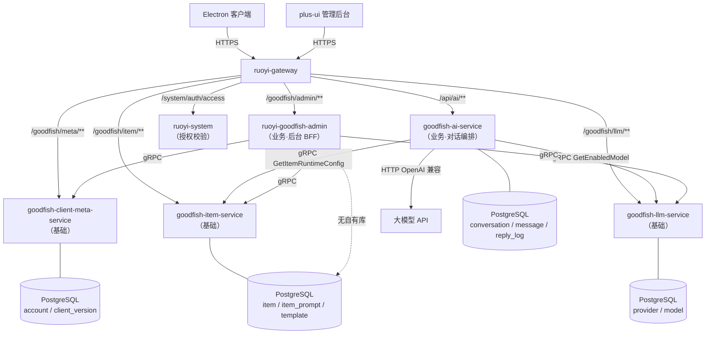

# 技术方案-云端-架构总览

> 来源：《云端技术方案.md》§一、§二、§三、§十、附录「已确认决策」、《客户端监听.md》§1.1~§1.4（内容重组收录，原文件保留未动）
> 关联：[技术方案-云端-gRPC契约](技术方案-云端-gRPC契约.md) ｜ [技术方案-云端-鉴权与授权](技术方案-云端-鉴权与授权.md)

## 一、架构总览

### 1.1 云端架构总览图

```
┌──────────────────────────────────────────────────────────────────────┐
│                            北向（南北向）                              │
│   Electron 客户端            plus-ui 管理后台                          │
│        │ HTTPS                    │ HTTPS                             │
│        └────────────┬─────────────┘                                   │
│                     ▼                                                 │
│            ┌─────────────────┐                                        │
│            │  ruoyi-gateway  │  统一 token 鉴权 / 路由 / 限流           │
│            └────────┬────────┘                                        │
│                     │                                                 │
│   客户端与后台**全部直连**目标服务（无客户端 BFF）                       │
│   /api/ai/**  /goodfish/item/**  /goodfish/meta/**                   │
│   /goodfish/llm/**  /goodfish/admin/**  /system/auth/**              │
├─────────────────────┼────────────────────────────────────────────────┤
│                     ▼          业务微服务（只做编排）                    │
│        ┌────────────────────┐   ┌──────────────────────┐              │
│        │  goodfish-          │   │  ruoyi-goodfish-     │              │
│        │  ai-service         │   │  admin（后台 BFF）    │              │
│        │  对话编排            │   │  跨域聚合读，无自有表  │              │
│        └─────────┬──────────┘   └──────────┬───────────┘              │
│                  │       gRPC（东西向）      │                         │
│                  └───────────┬─────────────┘                          │
│                              ▼                                        │
│  ┌─────── 基础微服务（只提供能力，不做编排）───────────────────────┐    │
│  │  goodfish-item-service          商品 + 提示词配置 + 模板库       │    │
│  │  goodfish-client-meta-service   闲鱼账号 + 客户端版本            │    │
│  │  goodfish-llm-service           供应商 / 模型                   │    │
│  └────────────────────────────────────────────────────────────────┘    │
│                                                                       │
│   Nacos 注册/配置中心  ·  Redis  ·  PostgreSQL（全量统一）  ·  对象存储   │
│   复用：ruoyi-system（用户/权限/授权校验）  文件一律服务器本地磁盘（不用 ruoyi-file）│
└──────────────────────────────────────────────────────────────────────┘
```

### 1.2 系统架构图（含客户端与云端边界）

```
┌───────────────────────────────────────────────────────────────┐
│                     用户桌面（Windows）                         │
│                                                               │
│  ┌─────────────────────────────────────────────────────────┐  │
│  │        Electron（Vue3 + Element Plus，单入口 UI 壳）       │  │
│  └──────────────────────────┬──────────────────────────────┘  │
│                             │ child_process 守护               │
│  ┌──────────────────────────▼──────────────────────────────┐  │
│  │      Python 本地监听服务（FastAPI，仅绑定 127.0.0.1）       │  │
│  │  CookieManager / XianyuLive / MessagePipeline /          │  │
│  │  ItemSyncer / LogManager          本地 SQLite（加密）     │  │
│  └──────────────────────────┬──────────────────────────────┘  │
└─────────────────────────────┼─────────────────────────────────┘
                              │ HTTPS（携带管理后台登录 token）
                              ▼
┌───────────────────────────────────────────────────────────────────────┐
│                           云端（Spring Cloud Alibaba）                  │
│                                                                       │
│  ┌──────────────┐  /api/ai/**         /goodfish/item/**                │
│  │ SC Gateway   │  /goodfish/meta/**   /goodfish/llm/**                │
│  │  网关 / 鉴权  │  /goodfish/admin/**  /system/auth/**                 │
│  └──────┬───────┘                                                      │
│         │  客户端与后台**全部直连**目标服务（不再经客户端 BFF）           │
│         ▼                                                              │
│  ┌───── 业务微服务（只做编排，不拥有业务主数据）──────────────────────┐   │
│  │  goodfish-ai-service        对话编排  【PG：conversation/reply_log】│   │
│  │  ruoyi-goodfish-admin       后台 BFF（跨域聚合读，【无自有库】）     │   │
│  └────────────────────────────┬──────────────────────────────────────┘   │
│                               │ gRPC（东西向）                            │
│  ┌───── 基础微服务（只提供能力、不做编排）──────────────────────────┐    │
│  │  goodfish-item-service          商品 + 提示词配置 + 模板库         │    │
│  │  goodfish-client-meta-service   闲鱼账号（不含 Cookie）+ 客户端版本 │    │
│  │  goodfish-llm-service           供应商 / 模型                     │    │
│  │                     【全部 PostgreSQL，每服务独立库】              │    │
│  └──────────────────────────────────────────────────────────────────┘    │
│                                                                       │
│  ┌──────────────┐  ┌──────────────┐  ┌─────────────────────────────┐  │
│  │ Nacos 3.2    │  │ Redis 7      │  │ ruoyi-system（文件本地磁盘）│  │
│  │ 注册 + 配置中心│  │ 缓存 / 幂等   │  │ 用户权限 / 授权校验 / 文件    │  │
│  └──────────────┘  └──────────────┘  └─────────────────────────────┘  │
│                            │                                          │
│                            ▼                                          │
│          大模型 API（OpenAI 兼容 /v1/chat/completions，HTTPS）          │
└───────────────────────────────────────────────────────────────────────┘
```

**关键边界**：

- 客户端（Electron / Python 本地服务）**只通过 HTTPS 访问 SC Gateway**，绝不直连 Nacos
- **客户端不经任何 BFF**，直连目标服务（只有跨域聚合读才走 `ruoyi-goodfish-admin`）
- **东西向（服务间）调用一律 gRPC**，不过网关；唯一例外是调用大模型 API（OpenAI 兼容 HTTPS）
- **数据库全量 PostgreSQL**，每服务独立库，禁止跨库
- Nacos 是云端内部基础设施，客户端零感知
- 完整服务划分见本文 §二；gRPC 契约见[技术方案-云端-gRPC契约](技术方案-云端-gRPC契约.md)；调用矩阵见本文 §四

### 1.3 设计原则

**云端设计原则**：

| 原则 | 说明 |
|---|---|
| **分层清晰** | 基础服务只提供单一领域能力，**不做任何跨域编排**；业务服务只做编排，**不拥有业务主数据** |
| **按需 BFF** | 只有**跨域聚合**才走 BFF（当前仅后台 `ruoyi-goodfish-admin`）；**单域读写一律直连**，透传式 BFF 是净负债（见本文 §2.5） |
| **数据归属单一** | 一张表只属于一个服务，其他服务**只能通过 gRPC 访问，禁止跨库直连** |
| **数据库统一** | 全量 PostgreSQL，每服务独立库 |
| **协议统一** | 东西向全部 gRPC；北向全部 REST + 网关鉴权；唯一例外是调用大模型 API（OpenAI 兼容 HTTP） |
| **复用 RuoYi** | 用户、权限、菜单、网关、鉴权、文件、字典等**不重复开发** |
| **无 Cookie 上天** | 云端任何服务都不存储闲鱼 Cookie（A10） |

**系统级设计原则（客户端与云端边界）**：

| 原则 | 说明 |
|---|---|
| **敏感凭证本地化** | 闲鱼 Cookie 仅存本地（AES-256-GCM），永不上传云端 |
| **本地服务单机绑定** | 本地 HTTP 服务仅绑定 127.0.0.1，禁止 0.0.0.0 |
| **业务配置云端化** | 商品、提示词、模型、对话历史统一云端管理 |
| **Nacos 环境隔离** | dev / test / prod 通过 Nacos namespace 物理隔离，配置与服务互不可见 |
| **迭代2前瞻** | 凡是调用闲鱼 API 的操作执行都在客户端；凡是配置和数据都存储在云端 |
| **开源合规** ★ | **项目整体采用 AGPL-3.0**；复用第三方实现仅限有明确许可证（AGPL）的仓库，保留版权头 + LICENSE 副本 + 记录 commit SHA（见《客户端监听.md》2.9.1） |
| **协议层可替换** | 闲鱼协议交互全部收敛在 `xianyu/` 包，对外只暴露抽象接口；协议变更只改此包 |
| **按需 BFF** ★ | 只有**跨域聚合**才走 BFF（当前仅后台 `ruoyi-goodfish-admin`）；**单域读写一律直连**，透传式 BFF 是净负债 |
| **服务间 gRPC** ★ | 东西向调用一律 gRPC，不过网关；唯一例外是调用大模型 API（OpenAI 兼容 HTTPS） |
| **数据不跨库** ★ | 全量 PostgreSQL，每服务独立库；任何服务不得直连不属于自己的库 |

### 1.4 客户端调用链路

> 云端服务划分见本文 §二，gRPC 契约见[技术方案-云端-gRPC契约](技术方案-云端-gRPC契约.md)，本节只列与客户端直接相关的关键链路。
>
> **通道说明**：客户端**始终经网关**（`ruoyi-gateway` 是唯一北向入口）；下表中的"直连"指**由网关直接转发到目标服务、不经 BFF**。

| # | 链路 | 协议 | 说明 |
|---|---|---|---|
| 1 | 客户端 → Gateway `/api/ai/**` → `goodfish-ai-service` | REST | **AI 回复生成（写操作，直连）**（发送结果不上报云端，仅本地日志） |
| 2 | 客户端 → Gateway `/goodfish/meta/**` → `goodfish-client-meta-service` | REST | 账号上报、版本检查（**直连**） |
| 3 | 客户端 → Gateway `/goodfish/item/**` → `goodfish-item-service` | REST | 商品同步（**直连**） |
| 4 | 客户端 → Gateway `/system/auth/**` → `ruoyi-system` | REST | 授权校验（**直连**，客户端主动调用，见[技术方案-云端-鉴权与授权](技术方案-云端-鉴权与授权.md)） |
| 5 | ai-service → Nacos | gRPC | 配置中心拉取/监听；注册中心注册/订阅 |
| 6 | **ai-service → 商品服务** | **gRPC** | `GetItemRuntimeConfig`：商品信息 + 提示词配置（每次直接 RPC，商品服务提供方缓存：编辑时删除 + TTL 兜底） |
| 7 | **ai-service → 模型服务** | **gRPC** | `GetEnabledModel`：启用模型完整配置（含解密后 API Key；每次直接 RPC，模型服务提供方缓存：变更时删除 + TTL 兜底） |
| 8 | ai-service → 大模型 API | HTTPS | OpenAI 兼容协议 `/v1/chat/completions` |

---

## 二、服务划分

### 2.1 划分原则：基础微服务 vs 业务微服务

| 维度 | 基础微服务（Foundation） | 业务微服务（Business） |
|---|---|---|
| **定位** | 单一领域的**能力提供方** | 面向场景的**编排方** |
| **职责** | 本领域数据的 CRUD + 查询 | 参数校验、跨服务编排、事务边界、错误码封装 |
| **依赖** | **不依赖任何其他业务服务**（最多依赖同层或基础设施） | 依赖多个基础服务 |
| **对外协议** | gRPC（东西向）＋ REST（北向，供后台/客户端） | REST（北向，经网关）＋ gRPC（被后台调用） |
| **拥有表** | 拥有本领域**全部**业务主数据表 | 只拥有**自己的过程数据表**（对话历史等） |
| **类比** | 进程内的 **manager 层** | 进程内的 **service 层** |

> 这与项目 `AGENTS.md` 的分层准则同源：**基础服务 = manager（原子能力），业务服务 = service（业务编排）**，只是从进程内分层上升为进程间分层。

### 2.2 基础微服务清单（3 个）

| 服务 | 服务名 | 领域职责 | 拥有的表 | 实现 |
|---|---|---|---|---|
| **商品服务** | `goodfish-item-service` | 商品信息的写入（客户端同步）与查询；**提示词配置**的编辑与查询；内置提示词模板（Spring 配置，只读） | `goodfish_item`、`goodfish_item_prompt`（**模板不入库**，见[技术方案-云端-商品服务](技术方案-云端-商品服务.md)） | Java / Spring Boot |
| **客户端元数据服务** | `goodfish-client-meta-service` | 闲鱼账号信息上报与查询（**不含 Cookie**）；客户端版本发布与更新检查 | `goodfish_account`、`client_version` | Java / Spring Boot |
| **模型服务** | `goodfish-llm-service` | 大模型供应商与模型的 CRUD、连接测试、全局启用 | `llm_provider`、`llm_model` | Go / Kratos（复用 `llm-manage`） |

> **关于"客户端元数据服务"**：账号与版本各只有 1 张表、接口极少、QPS 极低（客户端启动时各调一次），拆成两个进程不划算，故合并为一个部署单元。
> 但**契约仍按领域拆分为两个 proto**（`account.proto` / `version.proto`），由同一进程实现 —— 即「**契约按领域拆，部署按成本合**」。将来任一方需要独立扩容时，拆成两个进程即可，**调用方无需改动**。

**明确不拆的**：

| 候选 | 决策 | 理由 |
|---|---|---|
| 提示词独立成服务 | ❌ 不拆 | 与商品 1:1 强关联；拆开后对话服务要调两次，违背"一次批量拿全" |
| 账号 / 版本 各成服务 | ❌ 不拆 | 表小、接口少、QPS 低（见上方说明） |
| 文件独立成服务 | ❌ 不拆 | **不使用 `ruoyi-file`**（只用 RuoYi 基础管理功能）；文件由归属服务存服务器本地磁盘并自行提供上传/下载（见[技术方案-云端-文件存储](技术方案-云端-文件存储.md)） |
| 授权独立成服务 | ❌ 不拆 | 复用 `ruoyi-system` 用户表（[《云端需求.md》](../云端需求.md) §4.4 已明确） |

### 2.3 业务微服务清单（2 个，全部只做编排）

| 服务 | 服务名 | 编排的基础服务 | 拥有的表 |
|---|---|---|---|
| **大模型对话服务** | `goodfish-ai-service` | 商品服务（取商品+提示词）＋ 模型服务（取启用模型）＋ 大模型 API | `ai_conversation`、`ai_conversation_message`、`ai_reply_log` |
| **管理后台服务（BFF）** | `ruoyi-goodfish-admin` | 商品 ＋ 模型 ＋ 客户端元数据（跨域聚合读） | 无 |

> **`ruoyi-goodfish-admin` 就是原 `ruoyi-goodfish` 模块**，但**不再持有任何表**——它从"业务实现模块"降级为"后台 BFF"，所有数据访问改为 gRPC 调用基础服务。这是本次架构最大的变化。

### 2.4 各服务职责划分一览（含客户端）

| 服务 | 语言/框架 | 职责 |
|---|---|---|
| **Electron 客户端** | Vue3 + Element Plus | UI 壳，内嵌 Python exe，管理页面，登录鉴权 |
| **Python 本地监听服务** | FastAPI + SQLAlchemy + SQLite | 闲鱼 WebSocket 监听、消息收发、Cookie 管理、商品同步 |
| **ruoyi-gateway** | Spring Cloud Gateway | 北向唯一入口、路由、**统一 token 鉴权**（不做业务授权判定） |
| **ruoyi-system** | Java / Spring Boot | 用户/权限/菜单/部门/字典/操作日志，**授权校验接口** |
| **goodfish-ai-service** | FastAPI + grpc.aio + Nacos v2 SDK | 业务（编排）：**大模型对话业务服务** —— 查商品 → 组装提示词 → 发对话 → 落库 |
| **ruoyi-goodfish-admin** | Java / Spring Boot | 业务（编排）：管理后台 BFF（跨域聚合读），**无自有表** |
| **goodfish-item-service** | Java / Spring Boot | 基础：商品信息 + **提示词配置** + 提示词模板库 |
| **goodfish-client-meta-service** | Java / Spring Boot | 基础：闲鱼账号（**不含 Cookie**）+ 客户端版本（**一个进程，两个 gRPC 服务**） |
| **goodfish-llm-service** | Go/Kratos + GORM | 基础：大模型供应商/模型 CRUD、连接测试、全局启用（即原 llm-manage） |

> **基础服务**只提供单一领域能力、不做编排；**业务服务**只做编排、不拥有业务主数据。
>
> **已取消**：`goodfish-client-bff`（客户端场景几乎全是单域，BFF 只能做透传）；原 `goodfish-account-service` 与 `goodfish-version-service` **合并**为 `goodfish-client-meta-service`（契约仍按领域拆两个 proto，将来可拆进程而调用方无感）。

### 2.5 BFF 使用原则与直连裁定

> **规则：只有「跨域聚合」或「为特定端裁剪」才走 BFF；单域读写一律直连。**

| | 说明 |
|---|---|
| **BFF 的价值** | 聚合多次跨服务调用；为特定端定制响应；集中横切关注点（鉴权 / 错误码 / 限流）；作为后端演进的缓冲 |
| **BFF 的代价** | 多一跳（延迟 + 故障点）；极易长成"上帝服务"；**纯透传是净负债** |

据此逐个场景裁定：

> **"直连"的准确含义**：客户端与后台**始终经网关**（`ruoyi-gateway` 是唯一北向入口）；这里的"直连"指**不经 BFF**、由网关直接转发到目标服务。

| 场景 | 类型 | 走法 | 理由 |
|---|---|---|---|
| **AI 回复** `/api/ai/reply` | 写 · 核心 | 客户端 → **网关转发** → `goodfish-ai-service` | 经网关鉴权后转发；**不落 BFF**（无聚合需求）；发送结果不上报云端 |
| 账号上报 | 写 · 单域 | 客户端 → **网关转发** → 客户端元数据服务 | 透传无收益 |
| 商品同步 | 写 · 单域 | 客户端 → **网关转发** → 商品服务 | 透传无收益 |
| 版本检查 | 读 · 单域 | 客户端 → **网关转发** → 客户端元数据服务 | 透传无收益 |
| 授权校验 | 读 · 单域 | 客户端 → **网关转发** → `ruoyi-system` | 客户端主动调用（启动 + 每小时）；网关只校验 token，不做授权兜底（见[技术方案-云端-鉴权与授权](技术方案-云端-鉴权与授权.md)） |
| **仪表盘统计** | 读 · 跨域 | plus-ui → 网关 → **admin BFF** | 真聚合：账号数 + 商品数 |
| **商品列表（带账号名）** | 读 · 跨域 | plus-ui → 网关 → **admin BFF** | 真聚合：商品 + 账号 |
| 商品编辑 / 删除 / 复制提示词 | 写 · 单域 | plus-ui → **网关转发** → 商品服务 | 单域 CRUD |
| 提示词模板查看 | 读 · 单域 | plus-ui → **网关转发** → 商品服务 | 模板来自 Spring 配置，只读（见[技术方案-云端-商品服务](技术方案-云端-商品服务.md)） |
| 模型 / 供应商 CRUD | 写 · 单域 | plus-ui → **网关转发** → 模型服务 | 单域 CRUD |

**结论：不设客户端 BFF。**

- `goodfish-client-bff` **取消**
- 客户端场景**几乎全是单域**；即使"启动初始化"（授权 + 账号 + 版本）用 3 个并发请求，成本也远低于维护一个常驻服务
- 后台保留 `ruoyi-goodfish-admin` 作为 BFF，因为它确实存在跨域聚合读

### 2.6 编排关系图



> **客户端不经过任何 BFF**：AI 回复直连对话服务，账号/商品/版本直连对应基础服务，授权校验直连 `ruoyi-system`。

---

## 三、技术栈

| 层级 | 选型 |
|------|------|
| 基础框架 | RuoYi-Cloud-Plus 6.0（Spring Cloud Alibaba） |
| 服务间通信 | **gRPC**（Java：`grpc-spring-boot-starter`；Go：Kratos 原生；Python：`grpcio` + `grpc.aio`） |
| 接口定义 | Protocol Buffers v3（统一放 `proto/` 目录，各服务共享） |
| 网关 | Spring Cloud Gateway |
| 注册/配置中心 | Nacos 3.2 |
| 数据库 | **PostgreSQL 全量统一**（RuoYi-Cloud-Plus 侧已切换至 PG；模型服务 / 对话服务原生 PG） |
| 缓存 | Redis 7 |
| ORM | MyBatis-Plus（Java）／GORM（Go）／SQLAlchemy async + asyncpg（Python） |
| 前端 | plus-ui（Vue3 + Element Plus） |
| 文件存储 | 服务器本地磁盘（安装包、图片） |

**PostgreSQL 落地说明**：

| 项 | 说明 |
|---|---|
| RuoYi 侧支持 | ✅ **已完成改造并切换到 PostgreSQL（在独立分支）**。官方另提供 PG 建表脚本 `script/sql/postgres/postgres_ry_cloud.sql`、`_job.sql`、`_ai.sql`、`_workflow.sql`；`ruoyi-common-mybatis` 内置 PG 驱动与方言（`DataBaseType.POSTGRE_SQL`）；数据源配置见 `script/config/nacos/datasource.yml` |
| ⚠️ 建库脚本 | **严禁使用 `script/sql/ry-cloud.sql`（MySQL 语法）**，必须用 `postgres/` 目录下脚本 |
| 分库策略 | 沿用 RuoYi 惯例：**每服务独立库** |
| 类型映射（统一口径） | `BIGINT AUTO_INCREMENT` → `BIGSERIAL`；`DATETIME` → `TIMESTAMP`；`BIT(1)` → `BOOLEAN`；`TINYINT` → `SMALLINT`；`TEXT` 不变 |
| 主键策略 | MyBatis-Plus `IdType.AUTO` 对应 PG 的 `BIGSERIAL` |
| 大小写 | PG 默认折叠为小写，Mapper XML 中避免裸大写字段名 |
| 分布式事务 | **不引入**。跨服务写操作不做强一致，各服务用本地事务 |

---

## 四、服务调用矩阵

| 调用方 | 被调方 | 协议 | 通道 | 鉴权 | 超时 | 缓存 |
|---|---|---|---|---|---|---|
| 客户端 | 网关 | HTTPS | 北向 | login token | 90s | — |
| 网关 | ai-service / 商品 / 客户端元数据 / 模型 / admin BFF / system | HTTP | 北向 | token 透传 | 75s | — |
| **ai-service** | **商品服务** | **gRPC** | Nacos 直连 | 身份透传 | 3s | 调用方无缓存、每次直接 RPC；**商品服务提供方缓存**：TTL 60s 兜底 + 编辑时删除 |
| **ai-service** | **模型服务** | **gRPC** | Nacos 直连 | 身份透传 | 3s | 调用方无缓存、每次直接 RPC；**模型服务提供方缓存**：TTL 5min 兜底 + 启用/编辑时删除 |
| ai-service | 大模型 API | HTTPS | 外网 | API Key | 单次 30s，总 ≤ 65s | — |
| admin BFF | 商品 / 模型 / 客户端元数据 | **gRPC** | Nacos 直连 | 身份透传 | 5s | — |
| admin BFF | `ruoyi-system` | gRPC | Nacos 直连 | 身份透传 | 3s | — |

> **超时预算**：客户端 90s > 网关 75s > 对话服务最坏路径 65s，逐层收窄，避免"网关先超时而下游仍在跑"引发重试风暴。
>
> **内部 gRPC 的"鉴权"**：**不引入自定义服务间令牌**。调用方通过 gRPC Metadata 透传统一的身份头 `X-User-Id` / `X-User-Info` / `Authorization` / `X-Client-Id`（`X-Client-Id` 取服务名），服务端拦截器还原用户上下文——对齐 `xxs-micro/doc/架构.md` §3.1 的统一身份透传规范。**内部接口的保护方式是网络隔离**：不过网关，只在集群内网暴露 gRPC 端口（K8s NetworkPolicy / 安全组限制来源）。Python 侧对称实现见[《gRPC与Nacos服务发现技术方案.md》](../gRPC与Nacos服务发现技术方案.md) §6.6。
>
> **网关不做授权兜底**：网关只做 token 有效性校验（RuoYi 自带能力），**不引入业务授权判定**——详见[技术方案-云端-鉴权与授权](技术方案-云端-鉴权与授权.md)。

---

## 五、跨服务数据关联约定

> **原则：不允许跨库 JOIN，也不允许跨库外键；跨服务关联一律通过 gRPC 调用。**

### 5.1 各关联场景的处理

| 场景 | 约定 |
|---|---|
| **商品 ↔ 对话历史** | 对话历史在对话服务、商品在商品服务。**不建外键**；对话表只存 `account_id` + `item_id` |
| **商品删除** | 商品服务**软删除**，**不级联删除对话历史**。如需清理，由 **admin BFF 编排**：先调商品服务删除 → 再调对话服务清理该商品历史（两步非事务，最终一致） |
| **商品被删后仍有消息进来** | 对话服务 gRPC 取配置返回 `NOT_FOUND` → 返回 40401 → 客户端不回复 |
| **模型 ↔ 供应商** | 同库同服务（`llm_provider` / `llm_model`），**服务内**用外键/应用层校验；删除供应商前校验是否存在关联模型 |
| **模型 ↔ 对话历史** | 对话消息表只存 `model_name`（**字符串快照**），不存 `model_id`；模型被删不影响历史可读 |
| **模型启用状态变更** | 模型服务**主动删除本服务配置缓存**（TTL 5min 兜底收敛其他实例）；`config_version` +1 仅作排障对账快照，**不使用 Nacos 版本键** |
| **账号 ↔ 商品** | 商品表存 `account_id`；删除账号前校验是否仍有商品（由 admin BFF 编排），**不级联删商品** |
| **后台的关联查询** | 「商品 + 账号名」由 admin BFF **分别 gRPC 调用后内存拼装**，不在数据库层关联 |

### 5.2 ID 引用还是字符串快照

| 数据类型 | 约定 | 理由 |
|---|---|---|
| 需要**跨服务实时取明细**的（如商品） | 存 **ID**，实时 gRPC 查询 | 保证数据最新 |
| 只需**展示历史快照**的（如模型名、账号昵称） | 存 **字符串快照** | 避免下游删除/改名导致历史记录残缺 |

### 5.3 事务策略

**不引入分布式事务（Seata 等）。**

- 跨服务写操作不做强一致，采用「**先完成主体操作，再尽力清理**」的最终一致策略
- 失败可重试；清理失败不影响主流程可用性（记日志 + 告警）
- 各服务内部仍使用**本地事务**（如对话服务的「落消息 + 更新会话」在同一事务）

---

## 六、RuoYi 复用

### 6.1 复用 RuoYi 自带能力（不重复开发）

| 能力 | 提供方 | 说明 |
|---|---|---|
| 登录 / 鉴权 / Token | `ruoyi-system` + 网关 | A2、A27、A40 |
| 授权校验 | `ruoyi-system` | 独立接口 `/system/auth/access`，客户端主动调用；**网关不做兜底**（见[技术方案-云端-鉴权与授权](技术方案-云端-鉴权与授权.md)）；A41、A42、A43 |
| 用户 / 部门 / 岗位 / 角色 | `ruoyi-system` | 管理后台账号体系 |
| ~~文件上传 / 下载~~ | ~~`ruoyi-file`~~ | **不使用**：安装包、商品图片、聊天图片一律由归属服务存服务器本地磁盘（见[技术方案-云端-文件存储](技术方案-云端-文件存储.md)） |
| 字典 / 操作日志 | `ruoyi-system` | 状态枚举、审计 |

### 6.2 RuoYi 复用说明

直接复用 RuoYi-Cloud-Plus 已有功能，不重复开发：

| 功能 | 说明 |
|------|------|
| 登录鉴权 | 用户登录、token 校验、**网关统一鉴权**（所有北向接口必须带 token，见[技术方案-云端-鉴权与授权](技术方案-云端-鉴权与授权.md)） |
| 授权校验 | 复用用户表，提供授权状态查询接口 `/system/auth/access` |
| 用户管理 | 管理员账号管理 |
| 权限管理 | 菜单、按钮权限 |
| 操作日志 | 接口操作日志记录 |
| ~~文件上传~~ | **不使用 `ruoyi-file`**；文件存本地磁盘由各归属服务自理（见[技术方案-云端-文件存储](技术方案-云端-文件存储.md)） |
| 字典管理 | 库存状态、模型状态等枚举值 |
| 代码生成 | 基础服务 CRUD 代码自动生成 |
| 部门管理 | 数据权限隔离 |
| 岗位管理 | 系统岗位 |
| **PostgreSQL** | 本项目已切换至 PG（另一分支）；**建表必须用 `script/sql/postgres/postgres_ry_*.sql`** |

### 6.3 需新增的基础设施依赖

| 依赖 | 用途 |
|---|---|
| `grpc-spring-boot-starter` | Java 服务暴露 / 调用 gRPC |
| `protobuf-maven-plugin` | 由 `proto/` 生成 Java stub |
| gRPC 健康检查 | `grpc-health-checking`，供 Nacos 探活与运维 |

> **不需要改网关**：鉴权直接复用 RuoYi 网关自带的 token 校验；**不新增授权兜底 filter**（见[技术方案-云端-鉴权与授权](技术方案-云端-鉴权与授权.md)）。

---

## 七、已确认决策

| # | 事项 | 结论 | 影响 |
|---|---|---|---|
| 1 | 基础服务拆分粒度 | **3 个**：商品 / 客户端元数据（账号+版本）/ 模型 | 部署 3 个新服务（非"并入 RuoYi 单体"——RuoYi-Cloud-Plus 本身即微服务，不存在单体形态） |
| 2 | 客户端 BFF | **取消**，只保留后台 BFF `ruoyi-goodfish-admin` | 客户端直连各服务；多域聚合需求出现时再按本文 §2.5 规则引入 |
| 3 | **鉴权** | **所有北向接口必须带 token**（`Authorization: Bearer`），网关统一校验；失败 **401** → 客户端**删 token + 跳登录页**，不自动重登（A27） | 复用 RuoYi 网关自带能力，**零开发项**（见[技术方案-云端-鉴权与授权](技术方案-云端-鉴权与授权.md)） |
| 4 | **授权** | **客户端主动调用** `/system/auth/access`（启动 + 每小时）；**网关不做授权兜底**；失败 **403** → **删 token + 停监听 + 冻结应用**（A42） | 网关零改动；**已签发 token 不做特殊处理**（见[技术方案-云端-鉴权与授权](技术方案-云端-鉴权与授权.md)） |
| 5 | 数据库 | **全量 PostgreSQL**（RuoYi 侧已切换，另一分支） | 建库用 `postgres_ry_*.sql`；每服务独立库；类型按 PG 口径 |
| 6 | gRPC TLS | **不使用**（内网明文） | 跨 VPC / 跨机房时再评估 mTLS |
| 7 | 客户端元数据服务 REST 前缀 | 定为 **`/goodfish/meta/**`**（不再变更） | 前端按此对接 |
| 8 | 商品列表聚合 | **不下沉**，保持走 admin BFF 聚合 | 不引入商品服务冗余账号昵称 |

**无遗留待办。** 业务错误码 `40101` / `40301` 已确认**与 RuoYi 内置码不冲突**。
